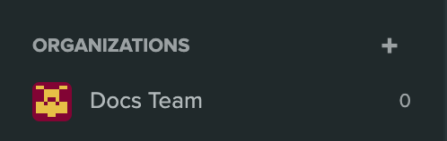
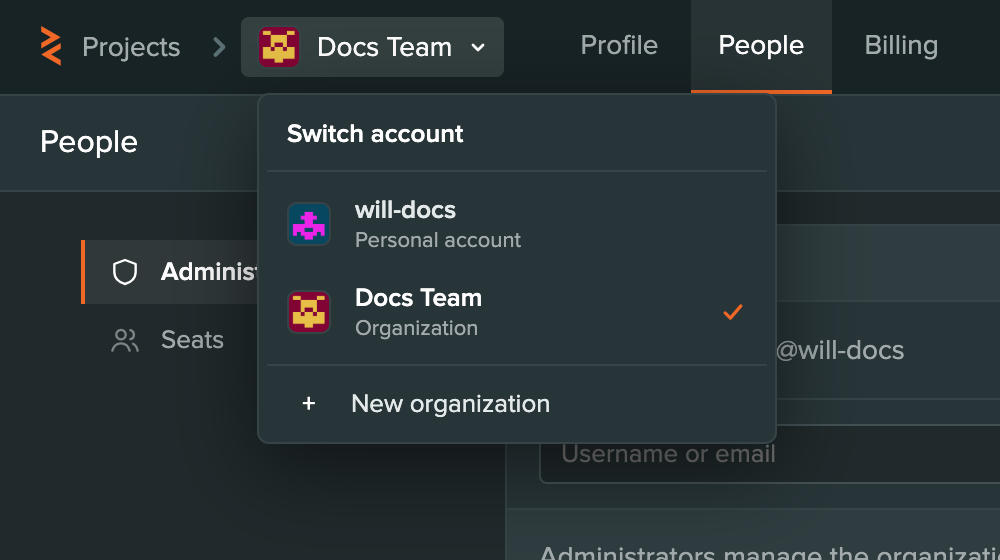
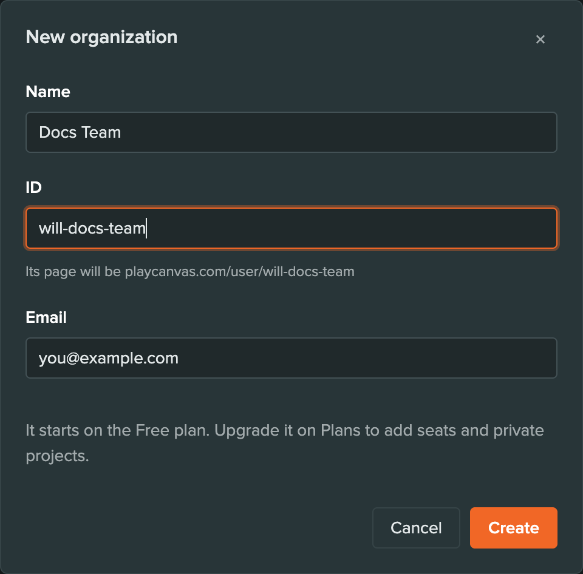
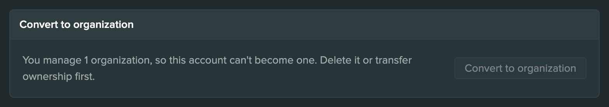
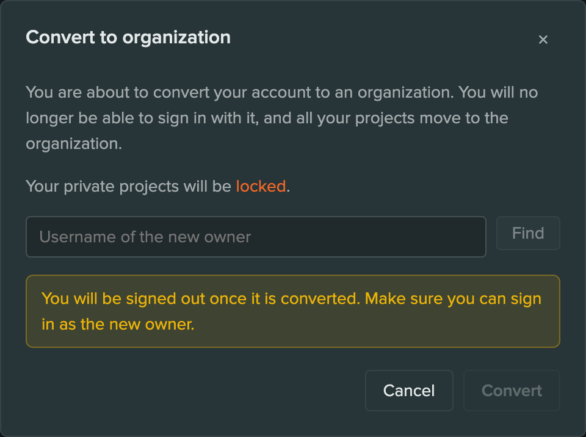

There are two ways to create an Organization: start a new one, or convert an existing user account into one. The Organizations you belong to are listed under **ORGANIZATIONS** in the [Project Dashboard](/user-manual/editor/projects/dashboard/#organizations) sidebar:

## Create a New Organization {#create-a-new-organization}

You can start a new Organization from either of these places:

- In the Project Dashboard, select **+** next to **ORGANIZATIONS**. See [Organizations](/user-manual/editor/projects/dashboard/#organizations) in the Project Dashboard docs.
- In your [account settings](/user-manual/account-management/user-accounts/settings/), open the account switcher at the top of the page and choose **New organization**.

The account settings open the **New organization** dialog:

- **Name** - The Organization's name, such as your company's name.
- **ID** - A unique ID with no spaces. It sets the address of the Organization's profile, `playcanvas.com/user/<ID>`.
- **Email** - Where the Organization's notifications go. It defaults to your own email address, but you can change it.

Select **Create** to finish. The Organization starts on the Free plan, with you as its owner, and its account settings open. To add private projects and seats, [upgrade it to the Organization plan](managing.md#billing).

### Transfer Existing Projects into the Organization {#transfer-existing-projects}

If you already have projects — for example, private projects on a Personal plan — you can move them into the new Organization:

1. From your user account, [transfer ownership of the projects](/user-manual/editor/projects/ownership-transfers#initiating-ownership-transfers) to the Organization.
2. From the Organization account, [accept the transfer](/user-manual/editor/projects/ownership-transfers/).
3. If you're on a Personal plan and no longer need it, [cancel it](/user-manual/account-management/plans-and-billing/#cancel-plan). If you subscribe the new Organization to the Organization plan straight after creating it, checkout offers **End my Personal plan when this starts** to do this for you.
4. [Add yourself to the projects as an administrator](managing.md#projects) of the Organization.

Your projects are now owned by the Organization, with your user account as an administrator on each.

## Convert a User Account into an Organization {#convert-a-user-account-into-an-organization}

Alternatively, you can convert an existing user account into an Organization. Log in with the account you want to convert, open the **Profile** tab of its [account settings](/user-manual/account-management/user-accounts/settings/#convert-account-to-organization), and select **Convert to organization**:

This opens the following dialog:

Because you can't log in *as* an Organization, converting an account means you'll no longer be able to log in with it, and all of its projects move to the Organization. You must therefore nominate another user as the new **owner**. Enter their username, select **Find**, and then select **Convert**.

:::warning

Make sure you can log in with the new owner's account before you convert.

:::

The account's private projects are locked unless you subscribe to the Organization plan. Where you can, the dialog offers **Subscribe to the Organization plan**, with the price for one seat for each user across your existing private projects. If the account is on a paid plan, that plan is cancelled.

You can't convert an account that owns Organizations. Delete them or transfer their ownership first.

After converting, you'll be logged out. Log back in with the new owner's account to access the Organization and all its projects.
