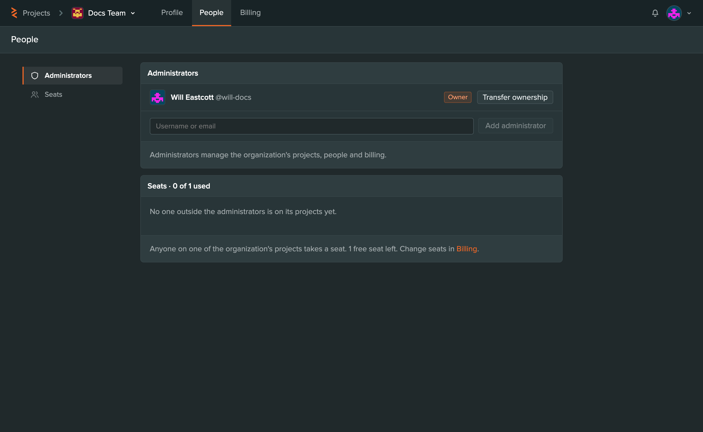
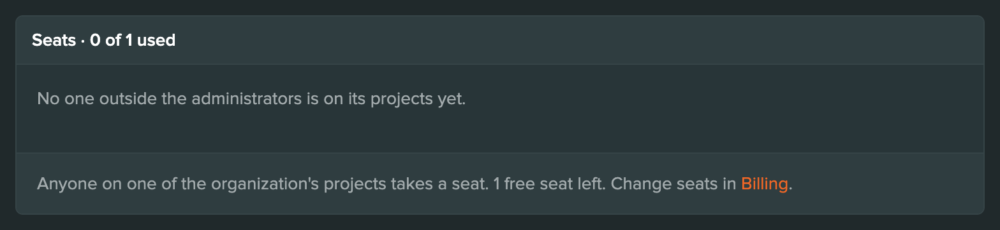
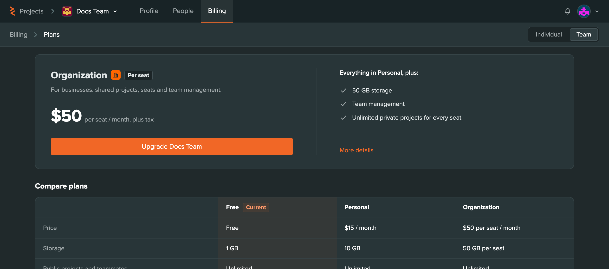
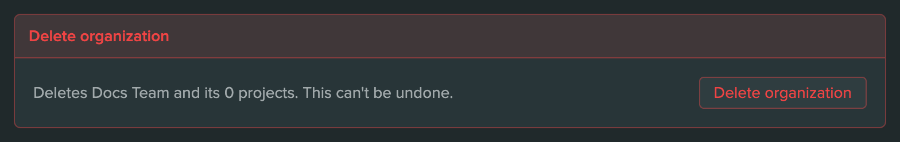

You manage an Organization from its account settings, where its owner and administrators handle its profile, people and billing. To open them, go to your [account settings](/user-manual/account-management/user-accounts/settings/) and choose the Organization in the account switcher at the top of the page. In the [Project Dashboard](/user-manual/editor/projects/dashboard/#organizations), **Organization details** in an Organization's **⋮** menu opens them too.

An Organization's settings have three tabs: **Profile**, **People** and **Billing**.

## Profile {#profile}

The **Profile** tab works like the one for your own [account settings](/user-manual/account-management/user-accounts/settings/#profile):

- **Account** - The Organization's picture, its username (the ID in its profile's address, `playcanvas.com/user/<ID>`), its name, and the email address its notifications go to.
- **Socials** - Links to the Organization's website and social accounts, shown on its profile.
- **Email notifications** - **My projects**, **New comments**, **New stars**, **PlayCanvas news**, and **Permission changes**, which emails you when someone is added to or removed from the Organization.
- **Delete organization** - See [Deleting an Organization](#delete).

## People {#people}

### Administrators {#administrators}

**Administrators** lists the Organization's **Owner** and its administrators. Administrators manage the Organization's projects, people and billing.

- To add an administrator, enter their username or email address and select **Add administrator**.
- To remove one, select **Remove** next to their name.
- To hand the Organization to someone else, the owner selects **Transfer ownership**, finds the new owner by username and selects **Transfer**. The new owner takes over the Organization and its billing, and the previous owner stays an administrator.

Administrators can do everything the owner can — including creating and deleting projects — *except* transfer ownership or delete the Organization itself. Only the owner can do that.

### Seats {#seats}

A **seat** is consumed when you add a user to one of the Organization's **private** projects. Public projects don't require seats, so you can have unlimited public collaborators at no cost.

**Seats** shows how many of the Organization's seats are used, and lists the people on its projects other than its administrators, with the projects each one is on. Select **Remove** next to someone to remove them from all of the Organization's projects and free up their seat.

The owner doesn't need to occupy a seat if they aren't actively working on projects. We recommend giving a seat to at least one administrator, so that someone can always create and manage projects.

## Billing {#billing}

An Organization has its own **Billing** tab, with its plan, storage, payment details and invoices. See [Plans and Billing](/user-manual/account-management/plans-and-billing/#billing-tab).

A new Organization starts on the Free plan. To give it private projects and seats, select **Change plan** on its **Billing** tab, then **Upgrade** followed by the Organization's name, and choose the number of seats at checkout.

### Adding and Removing Seats {#adding-and-removing-seats}

On the Organization plan, the **Plan** section of the **Billing** tab shows how many seats are in use. To add or remove seats at any time, select **Change seats**, choose the new number of seats and select **Save seats**. Seat changes are prorated on your next billing date — see the [worked example](/user-manual/account-management/billing/#how-is-billing-for-organization-accounts-calculated) in the Billing FAQ.

## Projects {#projects}

Administrators can add themselves to any project the Organization owns. In the [Project Dashboard](/user-manual/editor/projects/dashboard/), select the Organization in the sidebar and then the project. If you aren't on the project yet, its settings show only **Team**, where you can assign yourself as an admin. See [Project Settings](/user-manual/editor/projects/dashboard/#project-settings).

From there, you can add other users to the project as usual. See [Team Management](/user-manual/editor/projects/team-management/).

## Deleting an Organization {#delete}

Only the owner can delete the Organization. On its **Profile** tab, select **Delete organization**, type `delete this account` to confirm, and select **Delete**.

:::danger

Deleting an Organization from its account settings permanently erases the account and **all** of its projects. This action cannot be undone.

:::

To keep the Organization's projects, delete it from the [Project Dashboard](/user-manual/editor/projects/dashboard/#organizations) instead, which transfers its projects to your account.
