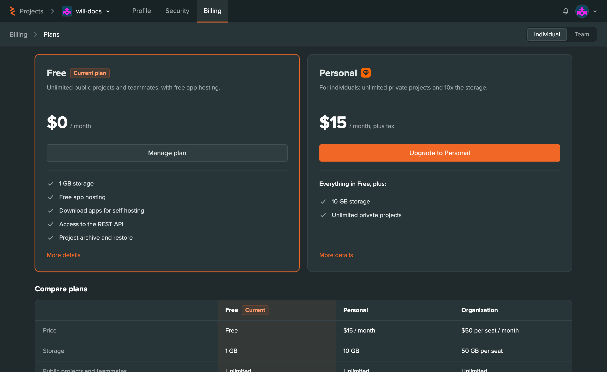
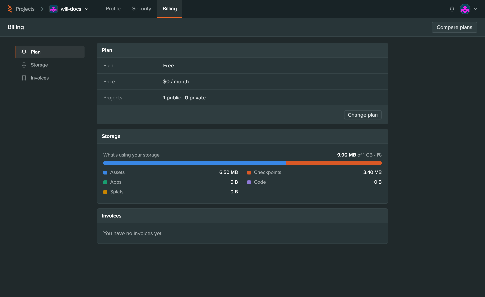

Your personal account and each organization have their own plan and their own billing. This page covers the **Plans** page, where you choose and subscribe to a plan, and the **Billing** tab of your [account settings](/user-manual/account-management/user-accounts/settings/), where you manage it. For questions about renewals, currencies, refunds and how seats are billed, see the [Billing FAQ](billing.md).

## Plans {#plans}

The Plans page compares the plans and lets you subscribe. Open it with **Upgrade plan** in the menu under your name in the [Project Dashboard](/user-manual/editor/projects/dashboard/), or with **Change plan** or **Compare plans** on the [Billing tab](#billing-tab).

**Individual** shows the **Free** and **Personal** plans, and **Team** shows the **Organization** plan. The plans apply to the account you're viewing. An organization can only choose the Organization plan, so on your personal account, **Team** offers **Create organization** instead.

To subscribe, select **Upgrade to Personal** on your personal account, or **Upgrade** followed by the organization's name on an organization. At checkout, enter your payment method and billing address, and select **Subscribe**. Prices are in US dollars, and tax is added at checkout based on your billing country. In Japan, prices are in yen and include tax — see [What payment methods and currency do you accept?](billing.md#what-payment-methods-and-currency-do-you-accept).

If you have a promo code, enter it under **Have a promo code?** and select **Apply**.

## The Billing Tab {#billing-tab}

To open it, select your name at the bottom of the Project Dashboard sidebar, choose **Account settings** and select the **Billing** tab. For an organization, switch to it with the account switcher at the top of the page first.

### Plan {#plan}

**Plan** shows the account's plan and price, and how many public and private projects it has. On a paid plan, it also shows when the plan renews, and for an organization, how many of its seats are in use. **Change plan** opens the [Plans](#plans) page, and so does **Compare plans** at the top right.

Organizations on the Organization plan also have **Change seats** here. See [Adding and Removing Seats](/user-manual/account-management/organizations/managing/#adding-and-removing-seats).

### Storage {#storage}

**Storage** shows how much of the plan's storage allowance the account is using, and what's using it:

- **Assets** - 3D models, textures, audio and other assets in your projects. Every open branch of a project counts its own copy of the assets. See [How Version Control Affects Your Storage](/user-manual/editor/version-control/#how-version-control-affects-your-storage).
- **Checkpoints** - The version history of your projects.
- **Apps** - Your published apps. Deleting a published build removes its full size from your usage.
- **Code** - Your scripts and other code.
- **Splats** - The Gaussian splats you have published to [SuperSplat](/user-manual/supersplat/).

The [Project Dashboard](/user-manual/editor/projects/dashboard/#storage) shows the same total, broken down by project.

### Payment {#payment}

Accounts on a paid plan have a **Payment** section with the card you pay with, your **Billing details** and your **VAT number**:

- Select **Update** next to your card to change your payment method.
- Select **Edit** next to your billing details to change the name and address shown on your invoices.
- Select **Add** or **Edit** next to the VAT number to set one. VAT numbers are only for billing addresses in the EU, UK, Switzerland and Norway.

### Invoices {#invoices}

**Invoices** lists the account's past invoices, with a PDF of each to download. Invoices are also emailed to the account's owner on each billing date.

### Cancel Plan {#cancel-plan}

You can cancel a paid plan at any time:

1. Open the **Billing** tab of your [account settings](https://playcanvas.com/account/billing).
2. In the **Cancel plan** section, select **Cancel plan** and confirm.
3. If you also have organizations on the Organization plan, switch to each one with the account switcher at the top of the page and repeat the steps above on its **Billing** tab.

Once your subscription is cancelled, you will not be billed again unless you resubscribe.

:::note

When you cancel your subscription, it will not revert to the Free plan immediately. Your plan stays active until the end of the billing period, and the **Plan** section shows when it ends. Private projects lock after that. If you change your mind before then, select **Resume plan** to continue your subscription.

:::
