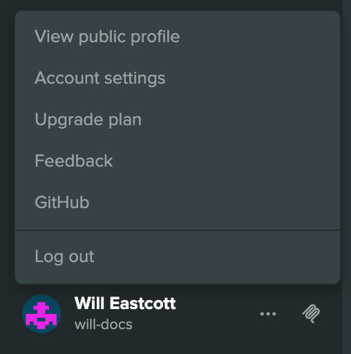
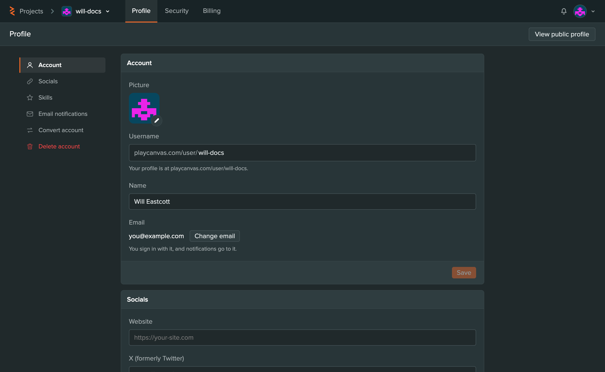
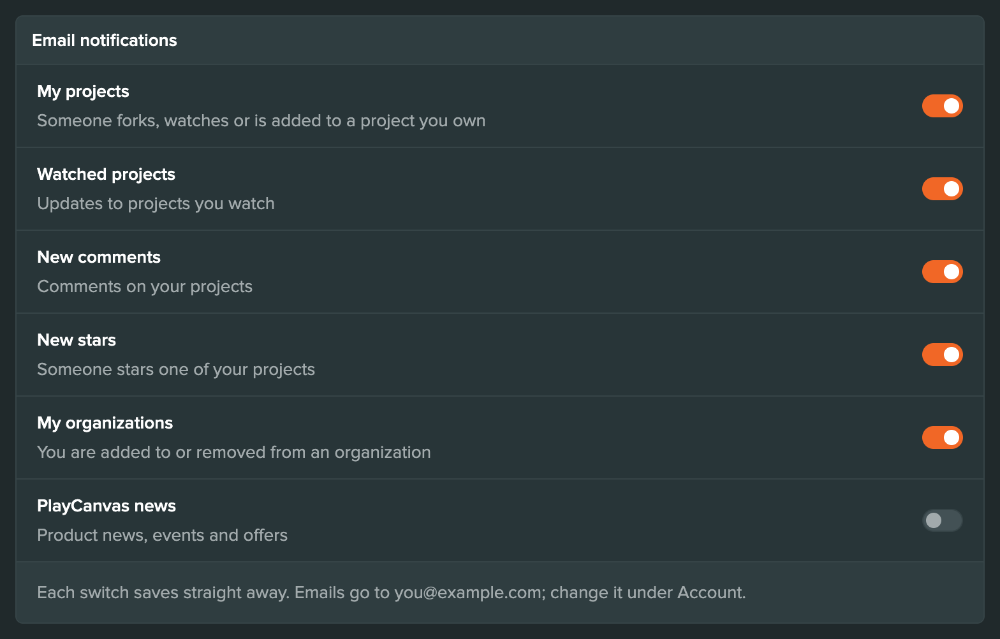
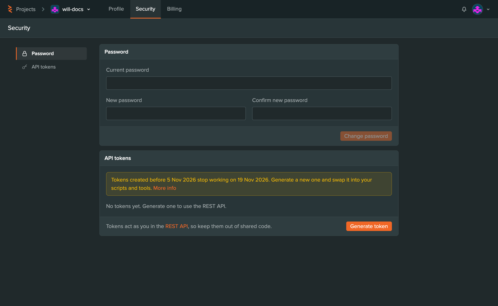

Your account settings are at [playcanvas.com/account](https://playcanvas.com/account). To open them from the [Project Dashboard](/user-manual/editor/projects/dashboard/), select your name at the bottom of the sidebar and choose **Account settings**.

The settings are split into three tabs:

- **[Profile](#profile)** - How you appear on PlayCanvas, the emails you receive, and converting or deleting your account
- **[Security](#security)** - Your password and API tokens
- **[Billing](#billing)** - Your plan, storage, payment details and invoices

The list on the left of each tab jumps to its sections. Across the top of the page:

- **Projects** takes you back to the Project Dashboard.
- The account switcher next to it shows the account you're editing. Use it to switch between your personal account and the organizations you own or administer, or to create a new organization. See [Managing Organizations](../organizations/managing.md).
- The bell shows your notifications, such as when someone stars or forks one of your projects.
- Your picture opens a menu with your public profile, account settings, billing and plans, your organizations, and **Log out**.

## Profile Tab {#profile}

**View public profile** at the top right opens [your profile](profile.md) as others see it.

### Account {#account}

- **Picture** - Select the pencil to upload a PNG or JPEG image.
- **Username** - Your unique handle, which sets the address of your profile, `playcanvas.com/user/<username>`. You can change it to any username that isn't already taken.
- **Name** - Your full name, shown on your profile and to your collaborators.
- **Email** - The address you log in with, and where your notifications go. To change it, select **Change email** and enter the new address. PlayCanvas sends a confirmation link to the new address and another to your current one.

Select **Save** to keep your changes.

### Socials {#socials}

Add links to your **Website**, **X (formerly Twitter)**, **LinkedIn** and **YouTube**, then select **Save**. These links are public on your profile.

### Skills {#skills}

Select the skills that describe you: **Coder**, **Artist**, **Designer** and **Musician**. They're shown on your public profile. Select **Save** to keep your changes.

### Email Notifications {#email-notifications}

Choose which emails PlayCanvas sends you. Each switch saves as soon as you change it.

| Switch | Emails you when |
| --- | --- |
| **My projects** | Someone forks, watches or is added to a project you own |
| **Watched projects** | A project you watch is updated |
| **New comments** | Someone comments on your projects |
| **New stars** | Someone stars one of your projects |
| **My organizations** | You're added to or removed from an organization |
| **PlayCanvas news** | There's PlayCanvas product news, an event or an offer |

### Convert Account {#convert-account-to-organization}

**Convert to organization** turns your account into an [organization](../organizations/index.md) owned by another user. Its projects move with it, and you can no longer log in to it. See [Convert a User Account into an Organization](../organizations/creating.md#convert-a-user-account-into-an-organization).

:::tip

You can't convert an account that owns organizations. Delete those organizations or transfer their ownership to another user first.

:::

### Delete Account {#delete-account}

**Delete account** deletes your account and every project you own. To confirm, type `delete this account` and select **Delete**.

:::danger

Deleting your account is permanent and can't be undone. [Export](/user-manual/editor/projects/backup-and-export/) any projects you want to keep first.

:::

If you own any organizations, **Delete account** is turned off. Delete those organizations or [transfer their ownership](../organizations/managing.md#administrators) first.

## Security Tab {#security}

### Password {#password}

To change your password, enter your **Current password**, then your **New password** and **Confirm new password**, and select **Change password**. If you signed up with Google or GitHub, your account has no password yet. Enter a new one and select **Set password** to log in with your email address or username as well.

:::tip

Use a strong password, and consider a password manager to keep track of it.

:::

### API Tokens {#api-tokens}

API tokens let your scripts and tools use the [REST API](/user-manual/api/). A token acts as you, so keep it out of shared code.

To create one, select **Generate token**, enter a **Name** such as `CI publish`, and select **Generate**. Copy the new token straight away, because you won't be able to see it again.

Your tokens are listed in this section, where you can **Rename** or **Revoke** each one, or select **Revoke all**. A revoked token stops working straight away.

:::note

API tokens created before 5 November 2026 don't work from 19 November 2026. If a script or tool still uses one, generate a new token and use that instead.

:::

## Billing Tab {#billing}

The **Billing** tab shows your **Plan**, what's using your **Storage**, your payment details and your **Invoices**. **Compare plans** opens the Plans page, where you can upgrade. See [Plans and Billing](../plans-and-billing.md).
