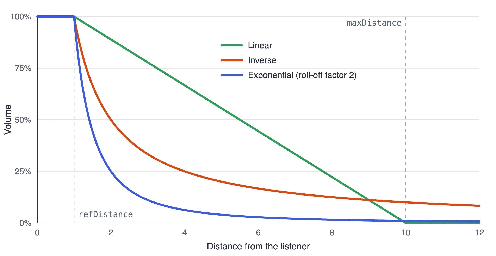

import Tabs from '@theme/Tabs';
import TabItem from '@theme/TabItem';

A **positional** sound is heard from where its entity is. As the entity moves relative to the **audio listener**, the sound moves between the speakers and fades with distance. This is the default for every sound component, so an entity with a sound component is already a point in space that makes noise. This page covers where sounds are heard from, how they fade, and when to turn positioning off.

## Positional and Non-Positional Sounds {#positional-and-non-positional-sounds}

The sound component's `positional` property is `true` by default. It applies to every slot of the component.

- **Positional sounds** suit anything that is somewhere in the world: footsteps, engines, voices, a waterfall.
- **Non-positional sounds** play at the same volume in both speakers, wherever the entity and the listener are. Turn `positional` off for music, interface sounds and narration.

A component is one or the other. For an entity that needs both, such as a player with footsteps in the world and a heartbeat in the head, put the non-positional sounds on a second sound component, on a child entity.

## The Audio Listener {#the-audio-listener}

Positional sounds are heard from the entity that has the **audio listener** component: its position is where the ears are, and its rotation is which way they face. Put it on the camera, and sounds match what you see.

<Tabs groupId="workflow" defaultValue="engine">
<TabItem value="engine" label="Engine">

Register `AudioListenerComponentSystem` with your application, then add the component to the camera. It has no settings:

```javascript
camera.addComponent('audiolistener');
```

</TabItem>
<TabItem value="editor" label="Editor">

Select the camera entity, click **Add Component** and choose **Audio Listener**. The component has no settings.

</TabItem>
<TabItem value="react" label="React">

Add the engine component from a small component of your own, inside the camera's `<Entity>`:

```jsx
import { useEffect } from 'react';
import { useParent } from '@playcanvas/react/hooks';

function AudioListener() {
  const entity = useParent();

  useEffect(() => {
    entity.addComponent('audiolistener');
    return () => entity.removeComponent('audiolistener');
  }, [entity]);

  return null;
}
```

```jsx
<Entity name="camera" position={[0, 2, 8]}>
  <Camera />
  <AudioListener />
</Entity>
```

</TabItem>
<TabItem value="web-components" label="Web Components">

Put a [`<pc-audio-listener>`](/user-manual/web-components/tags/pc-audio-listener/) inside the camera's entity:

```html
<pc-entity name="camera" position="0 2 8">
    <pc-camera></pc-camera>
    <pc-audio-listener></pc-audio-listener>
</pc-entity>
```

</TabItem>
</Tabs>

Only one listener is in use at a time:

- **The listener that was enabled most recently is the one in use.** Adding a second listener takes over from the first.
- **Disabling the listener in use does not hand over to another one.** Sounds go on being heard from where it last was, until a listener is enabled again. To switch between two listeners, disable one and then enable the other, in that order.
- **With no listener at all, sounds are heard from the world origin**, facing down the negative Z axis.

### The Camera or the Character {#the-camera-or-the-character}

In a first-person game, the camera is the character, and the listener belongs on it. In a third-person game, you have a choice. A listener on the camera matches the picture: a sound on the left of the screen is on the left. A listener on the character matches the game: the footsteps of an enemy creeping up behind the character are loud, however far away the camera is. A common compromise is to put the listener on an entity that takes its position from the character and its rotation from the camera.

## Distance {#distance}

Four properties of the sound component set how a positional sound fades with its distance from the listener. They apply to every slot of the component.

| Property | Default | Description |
| --- | --- | --- |
| `distanceModel` | `DISTANCE_LINEAR` | The shape of the fade: `DISTANCE_LINEAR`, `DISTANCE_INVERSE` or `DISTANCE_EXPONENTIAL` |
| `refDistance` | `1` | The distance within which the sound plays at full volume. The fade starts here |
| `maxDistance` | `10000` | With the linear model, the distance at which the fade ends. The other models ignore it |
| `rollOffFactor` | `1` | How steep the fade is. Higher values fade the sound over a shorter distance |



The chart shows each model with a `refDistance` of 1, and the linear model with a `maxDistance` of 10.

The three models fade a sound in different ways:

- **Linear** fades evenly from full volume at `refDistance` to silence at `maxDistance`. It is the easiest to reason about, and the only model with a hard edge beyond which a sound is silent. A `rollOffFactor` below 1 stops the fade short of silence: at 0.5, the sound falls to half volume at `maxDistance` and stays there.
- **Inverse** fades the way sound does in open air. With a `rollOffFactor` of 1, the volume halves each time the distance from the listener doubles, so a sound is loud close by, falls away quickly, and then lingers in the distance without ever reaching silence.
- **Exponential** is the same as inverse with a `rollOffFactor` of 1, but steeper as `rollOffFactor` rises. With a `rollOffFactor` of 2, the volume falls to a quarter each time the distance doubles.

:::warning

The defaults do not suit most scenes. A linear fade over 10,000 units is so gradual that a sound 100 units away still plays at 99% of its volume: sounds move between the speakers, but never seem to get quieter. Set `maxDistance` to the distance at which the sound should be silent, or choose the inverse model.

:::

<Tabs groupId="workflow" defaultValue="engine">
<TabItem value="engine" label="Engine">

```javascript
entity.addComponent('sound', {
    distanceModel: DISTANCE_LINEAR,
    refDistance: 1,
    maxDistance: 20
});

// or change them at any time, while sounds play
entity.sound.distanceModel = DISTANCE_INVERSE;
entity.sound.refDistance = 2;
```

</TabItem>
<TabItem value="editor" label="Editor">

With **Positional** turned on, the Sound component shows **Ref Distance**, **Max Distance**, **Distance Model** and **Roll-off Factor**.

</TabItem>
<TabItem value="react" label="React">

The `<Sound>` component from the [Getting Started](/user-manual/audio/getting-started/#playing-a-sound) page adds a sound component with default settings. To choose the settings, add the component first, from a wrapper that passes its props to the engine component:

```jsx
import { useEffect, useState } from 'react';
import { useParent } from '@playcanvas/react/hooks';

function SoundSource({ children, ...settings }) {
  const entity = useParent();
  const [ready, setReady] = useState(false);

  useEffect(() => {
    entity.addComponent('sound', settings);
    setReady(true);
    return () => {
      entity.removeComponent('sound');
      setReady(false);
    };
  }, [entity]);

  return ready ? children : null;
}
```

```jsx
<Entity name="radio" position={[4, 0, 0]}>
  <SoundSource positional distanceModel="linear" maxDistance={20}>
    <Sound name="music" src="https://developer.playcanvas.com/assets/music.mp3" loop autoPlay />
  </SoundSource>
</Entity>
```

</TabItem>
<TabItem value="web-components" label="Web Components">

```html
<pc-entity name="radio" position="4 0 0">
    <pc-sound distance-model="linear" ref-distance="1" max-distance="20">
        <pc-sound-slot name="music" asset="music" loop auto-play></pc-sound-slot>
    </pc-sound>
</pc-entity>
```

</TabItem>
</Tabs>

## Panning {#panning}

The direction of a sound from the listener decides how it is shared between the left and right speakers. A sound straight ahead plays equally in both, and a sound directly to one side plays in that speaker only.

Panning is left and right only. A sound behind the listener sounds the same as one in front, and height makes no difference. The engine does not simulate the Doppler effect either: a sound keeps its pitch however fast it moves.

Positions are updated every frame, so sounds follow moving entities and a moving listener with no work from you.

## Example {#example}

This Engine app plays music from a red sphere that circles a listener, the yellow capsule. The inner ring is the `refDistance` and the outer ring is the `maxDistance`. Click **Play**, and put headphones on to hear the panning.

```js live-example
import {
    AppBase,
    AppOptions,
    Asset,
    AudioHandler,
    AudioListenerComponentSystem,
    CameraComponentSystem,
    Color,
    createGraphicsDevice,
    DEVICETYPE_WEBGPU,
    Entity,
    FILLMODE_FILL_WINDOW,
    LightComponentSystem,
    RenderComponentSystem,
    RESOLUTION_AUTO,
    SoundComponentSystem,
    SoundManager,
    StandardMaterial,
    Vec3
} from 'playcanvas';

// create the application with the component systems and resource handlers it uses
const canvas = document.getElementById('application');
const device = await createGraphicsDevice(canvas, {
    deviceTypes: [DEVICETYPE_WEBGPU]
});
device.maxPixelRatio = Math.min(window.devicePixelRatio, 2);

const options = new AppOptions();
options.graphicsDevice = device;
options.soundManager = new SoundManager();
options.componentSystems = [
    RenderComponentSystem,
    CameraComponentSystem,
    LightComponentSystem,
    SoundComponentSystem,
    AudioListenerComponentSystem
];
options.resourceHandlers = [AudioHandler];

const app = new AppBase(canvas);
app.init(options);
app.setCanvasFillMode(FILLMODE_FILL_WINDOW);
app.setCanvasResolution(RESOLUTION_AUTO);
window.addEventListener('resize', () => app.resizeCanvas());
app.start();

app.scene.ambientLight = new Color(0.35, 0.35, 0.4);

const asset = new Asset('music', 'audio', {
    url: 'https://developer.playcanvas.com/assets/music.mp3'
});
await new Promise((resolve) => {
    asset.ready(resolve);
    app.assets.add(asset);
    app.assets.load(asset);
});

const createMaterial = (color) => {
    const material = new StandardMaterial();
    material.diffuse = color;
    material.update();
    return material;
};

// the camera looks down on the scene, so it is not where the sound is heard from
const camera = new Entity('camera');
camera.addComponent('camera', {
    clearColor: new Color(0.11, 0.12, 0.17)
});
camera.setPosition(0, 20, 11);
camera.lookAt(0, 0, 1.5);
app.root.addChild(camera);

const light = new Entity('light');
light.addComponent('light');
light.setEulerAngles(48, 38, 0);
app.root.addChild(light);

const floor = new Entity('floor');
floor.addComponent('render', { type: 'plane', material: createMaterial(new Color(0.24, 0.26, 0.31)) });
floor.setLocalScale(40, 1, 40);
app.root.addChild(floor);

// the listener: sounds are heard from here, facing away from the camera
const listener = new Entity('listener');
listener.addComponent('render', { type: 'capsule', material: createMaterial(new Color(0.95, 0.75, 0.2)) });
listener.addComponent('audiolistener');
listener.setPosition(0, 1, 0);
app.root.addChild(listener);

// the sound source: a positional sound component
const radio = new Entity('radio');
radio.addComponent('render', { type: 'sphere', material: createMaterial(new Color(0.9, 0.3, 0.35)) });
radio.addComponent('sound', {
    positional: true,
    distanceModel: 'linear',
    refDistance: 1,
    maxDistance: 10,
    rollOffFactor: 1
});
radio.sound.addSlot('music', { asset: asset.id, loop: true });
app.root.addChild(radio);

// the volume that each distance model gives at a distance
const volumeAt = (distance) => {
    const { distanceModel, refDistance, maxDistance, rollOffFactor } = radio.sound;
    const d = Math.max(distance, refDistance);
    if (distanceModel === 'linear') {
        const rollOff = Math.min(rollOffFactor, 1);
        return 1 - rollOff * (Math.min(d, maxDistance) - refDistance) / (maxDistance - refDistance);
    }
    if (distanceModel === 'inverse') {
        return refDistance / (refDistance + rollOffFactor * (d - refDistance));
    }
    return Math.pow(d / refDistance, -rollOffFactor);
};

// controls
const panel = document.createElement('div');
panel.style.cssText = 'position: absolute; left: 12px; top: 12px; right: 12px; display: flex; flex-wrap: wrap; gap: 8px 14px; align-items: center; color: #ccc; font: 14px sans-serif;';
document.body.appendChild(panel);

const playButton = document.createElement('button');
playButton.textContent = 'Play';
playButton.onclick = () => {
    const slot = radio.sound.slot('music');
    if (slot.isPlaying) {
        slot.stop();
    } else {
        slot.play();
    }
    playButton.textContent = slot.isPlaying ? 'Stop' : 'Play';
};
panel.appendChild(playButton);

const model = document.createElement('select');
for (const name of ['linear', 'inverse', 'exponential']) {
    model.add(new Option(name));
}
model.onchange = () => {
    radio.sound.distanceModel = model.value;
};
panel.appendChild(model);

const addSlider = (text, property, min, max) => {
    const label = document.createElement('label');
    const input = document.createElement('input');
    Object.assign(input, { type: 'range', min, max, step: 0.5, value: radio.sound[property] });
    input.style.width = '90px';
    input.oninput = () => {
        radio.sound[property] = Number(input.value);
    };
    label.append(`${text} `, input);
    panel.appendChild(label);
};
addSlider('Ref', 'refDistance', 0.5, 5);
addSlider('Max', 'maxDistance', 6, 12);
addSlider('Roll-off', 'rollOffFactor', 0, 3);

const status = document.createElement('div');
status.style.cssText = 'position: absolute; left: 12px; bottom: 10px; color: #ccc; font: 14px sans-serif;';
document.body.appendChild(status);

// draw a ring on the floor around the listener
const drawRing = (radius, color) => {
    const center = listener.getPosition();
    const steps = 64;
    for (let i = 0; i < steps; i++) {
        const a = (i / steps) * Math.PI * 2;
        const b = ((i + 1) / steps) * Math.PI * 2;
        app.drawLine(
            new Vec3(center.x + Math.cos(a) * radius, 0.02, center.z + Math.sin(a) * radius),
            new Vec3(center.x + Math.cos(b) * radius, 0.02, center.z + Math.sin(b) * radius),
            color
        );
    }
};

let angle = 0;
app.on('update', (dt) => {
    // carry the radio around the listener, passing close by on one side
    angle += dt * 0.5;
    radio.setPosition(Math.cos(angle) * 7 + 3, 0.5, Math.sin(angle) * 5);

    drawRing(radio.sound.refDistance, Color.WHITE);
    drawRing(radio.sound.maxDistance, Color.GRAY);

    const distance = radio.getPosition().distance(listener.getPosition());
    status.textContent = `Distance: ${distance.toFixed(1)}   Volume: ${Math.round(volumeAt(distance) * 100)}%`;
});
```

Some things to try:

- Switch the model to **inverse**. The outer ring no longer means anything: the sound is audible everywhere, and quickly gets louder as the radio comes close.
- Drag **Roll-off** to 0 to switch the fade off, and to 3 with the **exponential** model to make the sound drop away steeply.
- Delete the line `listener.addComponent('audiolistener');`. Nothing seems to change, because the sound is now heard from the world origin, and that is where the capsule stands. Then move the capsule with `listener.setPosition(8, 1, 0)`: the rings move with it, but the sound is still heard from the origin.

## See Also

- [Getting Started](/user-manual/audio/getting-started/) - Adding a sound component and playing a sound
- [Audio Listener Component](/user-manual/editor/scenes/components/audiolistener/) and [Sound Component](/user-manual/editor/scenes/components/sound/) - The Editor references
- [`<pc-audio-listener>`](/user-manual/web-components/tags/pc-audio-listener/) and [`<pc-sound>`](/user-manual/web-components/tags/pc-sound/) - The Web Components references
- [Positional Sound](https://playcanvas.github.io/web-components/examples/#positional-sound.html) and [Clock Tower](https://playcanvas.github.io/web-components/examples/#clock-tower.html) - Web Components examples of positional audio
- [AudioListenerComponent](https://api.playcanvas.com/engine/classes/AudioListenerComponent.html) and [SoundComponent](https://api.playcanvas.com/engine/classes/SoundComponent.html) - The engine API reference
