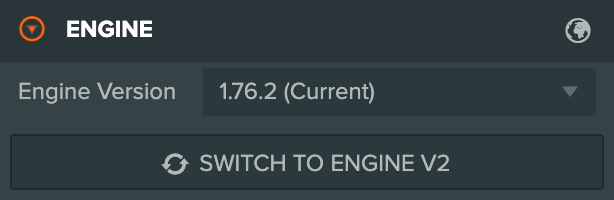
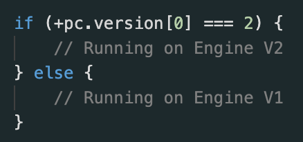
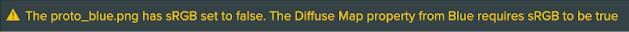
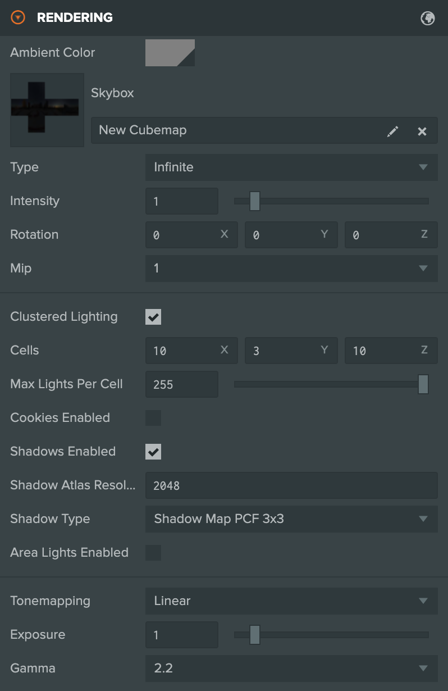

## Introduction {#introduction}

The Editor supports two major release streams of the engine:

- The latest release of engine v1.x.x (**Engine V1**)
  - This supports WebGL1 and WebGL2, and receives critical bug fixes. It does not receive any new features.
- The latest release of engine v2.x.x (**Engine V2**)
  - This supports WebGL2 and WebGPU but not WebGL1 for rendering. It receives both new features and fixes.

You are free to switch between these at any time.

### Switching projects between Engine V1 and V2 {#switching-projects-between-engine-v1-and-v2}

This process will involve migration and updating of scripts given differences in our Engine API between Engine V1 and V2. All details regarding the engine changes can be found [here](/user-manual/engine/migrations)

To initiate this navigate to the settings panel and click the `SWITCH TO ENGINE V2` button to convert your project to using Engine V2 (This will require a confirmation before converting). If you wish to switch back, there is a `SWITCH TO ENGINE V1` button in the same location for Project V2.

:::important

It is recommended to create a checkpoint before switching engines.

:::

:::warning

Once the switch has been confirmed, **all users** in the current project will be reloaded.

:::

#### Scripting {#scripting}

Given the changes in API for the engine you may wish to test your project in the launcher with Engine V1 or V2. You can do this by enabling the Force Engine V2 or Force Engine V1 checkboxes in the launcher options:

Additionally, conditionally checking the Engine version at runtime will allow your script to be made compatible with both versions of the engine during the transition time.

:::ai
When behavior differs between Engine versions, use the **[Editor MCP Server](/user-manual/editor/mcp-server/)** to reproduce the same scenario in each. An AI assistant can correlate logs and captures with affected scripts and APIs to suggest a focused fix.
:::

#### Gamma and Tonemap {#gamma-and-tonemap}

These settings were previously found under the rendering section of the Settings panel. However, in Engine V2, these have been moved to be set per camera. Each camera component will now have these additional fields:

The viewport settings are now located inside the EDITOR section of the Settings panel:

:::note

If you change the settings per camera and switch back to Project V1, your per-camera settings will be lost.

:::

#### sRGB Textures {#srgb-textures}

For Engine V2, textures must be set as sRGB or not, depending on their use case. The textures that store color data, such as diffuse and emissive maps, should use sRGB for accurate color representation. This is found under the texture asset panel as shown above. These will be automatically set. However, if there are conflicts, the console will display them:

Click on the console message to open up the conflicting reference. If you wish to use the same texture for both sRGB and not, it is advised to duplicate your texture to cover both cases.

## Troubleshooting the Switch {#troubleshooting-the-switch}

### The Scene Looks Brighter or Darker {#the-scene-looks-brighter-or-darker}

Gamma and tone mapping are set in different places in each engine version, so check every place your scene's look can come from:

- **The scene**, in an Engine V1 project: **Gamma** and **Tone Mapping** in **Settings** > **Rendering**.
- **Each camera**, in an Engine V2 project: **Gamma** and **Tone Mapping** on every Camera component. See [Gamma and Tonemap](#gamma-and-tonemap).
- **The Viewport**: its own gamma and tone mapping, in **Settings** > **Editor**.

Then check that each texture has the right sRGB setting (see [sRGB Textures](#srgb-textures)). When textures need attention, the status bar at the bottom of the Editor shows **N audits found**:

- Select it, then **Fix Issues**, to apply the automatic fixes.
- Resolve conflicts one at a time. The Console lists each affected texture or texture atlas and where it's used, and selecting a message takes you there.

<video autoPlay muted loop controls playsInline src='/video/asset-auditor.mp4' style={{width: '100%', height: 'auto'}} />

### A Camera Looks Different in the Editor and on the Launch Page {#a-camera-looks-different-in-the-editor-and-on-the-launch-page}

If a script creates the camera, set its gamma and tone mapping explicitly in code, with the Camera component's `gammaCorrection` and `toneMapping` properties.
