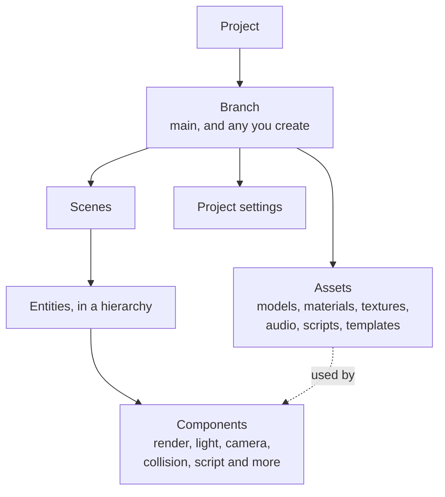

A PlayCanvas Editor project holds everything that makes up one app: its scenes, the assets they use, its scripts and its settings. This page explains how those pieces fit together, so the rest of this manual makes sense. If you haven't yet, build [Your First App](your-first-app.md) first. It touches every piece described here in about 15 minutes.

## Scenes, Entities and Components {#scenes-entities-and-components}

A **scene** is one world your app can show, such as a level or a menu. A project can have many scenes. An app starts in one of them and can [load others while it runs](../scenes/loading-scenes.md). You create and open scenes from [Managing Scenes](../scenes/managing-scenes.md).

A scene is a hierarchy of **entities**, which you see in the [Hierarchy panel](../interface/hierarchy.md). On its own, an entity is only a position, rotation and scale. **Components** give it abilities: a Render component draws a shape or a model, a Light lights the scene, Collision and Rigid Body components put it in the physics simulation, and a Script component runs your code. Select an entity to edit its components in the [Inspector](../interface/inspector.md). [Entity Component System](/user-manual/ecs/) explains the model in depth.

Each scene also has settings of its own, such as its skybox, ambient light and physics gravity.

## Assets {#assets}

**Assets** are the files and data your scenes use: models, materials, textures, audio, fonts, scripts and more. They belong to the project rather than to one scene, so every scene can use them, and you manage them in the [Assets panel](../assets/asset-panel.md). An entity uses an asset when one of its components refers to it, such as a Render component's material.

When you upload a file, the Editor's [import pipeline](../assets/import-pipeline/index.md) keeps the original as a **source asset** and creates the **target assets** your app loads. Uploading a 3D model, for example, creates a template with the model's hierarchy, render assets for its meshes, and its materials and textures. To update a model, upload the file again, and every asset made from it updates with it.

[Templates](../templates/index.md) are assets too. A template is a saved hierarchy of entities, like a prefab, that you can place many times and then change everywhere at once.

## Scripts {#scripts}

Scripts are JavaScript assets. To give an entity behavior, add a Script component and attach a script to it. Script attributes expose values in the Inspector, so you can tune a script without editing its code. Write scripts in the built-in [Code Editor](../scripting/code-editor.md), or in Visual Studio Code with the [PlayCanvas extension](../scripting/vscode-extension.md).

Scripts work directly with the PlayCanvas Engine, so everything in [Scripting](/user-manual/scripting/) applies to them.

## What Saves, and Who Sees It {#what-saves-and-who-sees-it}

There is no Save button for scenes. Every change you make to entities, components, assets and settings is saved as you make it, and everyone else working on the same branch sees it straight away. See [Real-time Collaboration](../realtime-collaboration.md).

- **Scripts are the exception.** Code Editor changes are saved when you save the file with <kbd>Ctrl</kbd>+<kbd>S</kbd> (<kbd>Cmd</kbd>+<kbd>S</kbd> on macOS), and only saved code runs when you launch.
- **Undo is yours.** <kbd>Ctrl</kbd>+<kbd>Z</kbd> (<kbd>Cmd</kbd>+<kbd>Z</kbd> on macOS) steps back through your own changes, not other people's.
- **Most settings are shared.** Project settings apply to everyone on the branch, but a few are just for you, such as the Editor camera and gizmo preferences. [Project Settings](../interface/settings/index.md) explains which are which.

A project belongs to a user or an organization, and its [team](../projects/team-management.md) decides who can see it and who can edit it.

## Testing with the Launch Page {#testing-with-the-launch-page}

Select **Launch** at the top right of the Viewport to run the current scene in a new browser tab. The [Launch Page](../interface/launch-page/index.md) stays connected to the Editor, so changes to entities, components, materials and settings show up in the running app as you make them. Reload it to pick up new assets and script changes, unless a script is written to [hot reload](../scripting/hot-reloading.md).

You can open the same page on a phone or tablet that is signed in to your PlayCanvas account, to test on a real device.

## Branches and Checkpoints {#branches-and-checkpoints}

Every project starts with a **main** branch, and everything in the diagram above lives on a branch. A [checkpoint](../version-control/checkpoints.md) is a snapshot of the project that you can return to. A [branch](../version-control/branches.md) is a separate line of work, so you can try something out without affecting the main branch, then [merge](../version-control/merging.md) it back when it's ready. See [Version Control](../version-control/index.md).

## Builds {#builds}

When your app is ready to share, [publish](../publishing/index.md) a **build**: a snapshot of the scenes you choose, packaged to run on its own. You can [host it on playcanvas.com](../publishing/web/playcanvas-hosting.md) at a link you can send to anyone, or [download it](../projects/downloading.md) to host yourself. Changes you make afterwards don't affect a build until you publish a new one.

## The Editor and the Engine {#the-editor-and-the-engine}

The Editor is built on the [PlayCanvas Engine](/user-manual/engine/). The Viewport renders your scene with it, and the app you launch and publish runs on it. That's why the Common Topics in this manual, such as [Graphics](/user-manual/graphics/), [Physics](/user-manual/physics/) and [Animation](/user-manual/animation/), apply to Editor projects too, often with an **Editor** tab showing how to do each step in the Editor. [Engine settings](../interface/settings/engine.md) choose the Engine version for launching and publishing.

## Next Steps {#next-steps}

- [Editor Interface](../interface/index.md) — a map of the panels you'll use most.
- [What to Learn Next](next-steps.md) — a suggested order for the tutorials and topics that come after your first app.
