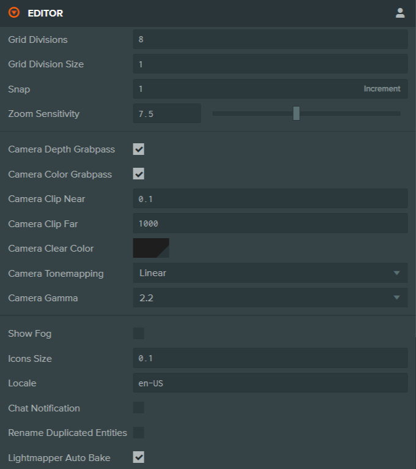

By default, the Editor is configured with settings that should suit the majority of users. However, in some circumstances, you may wish to modify the default behavior of the Editor.

:::note

These settings affect only you. They are 'sticky' and persist over multiple sessions. Most of them apply to every scene and branch of this project, but **Zoom Sensitivity**, **Gizmo Size**, **Gizmo Preset**, **Show View Cube**, **View Cube Size** and **Icons Size** apply to all of your projects.

:::

Navigate to the `EDITOR` section and expand the panel:

Here is a breakdown of the available settings:

## Settings

| Setting | Description |
| --- | --- |
| **Grid Divisions**               | Divisions specifies the number of grid cells in each horizontal direction. Set to 0 to disable the grid. With the Default **Gizmo Preset**, the grid fades out with distance instead, so only 0 has an effect. |
| **Grid Division Size**           | Size specifies the size of a cell. |
| **Snap**                         | Set the increment for [gizmo](../viewport.md#gizmos) snapping. Hold <kbd>Shift</kbd> or use the Snap toggle on the toolbar to enable snapping while using gizmos. |
| **Zoom Sensitivity**             | Change this value if you want to adjust the zoom sensitivity in the Editor viewport. |
| **Gizmo Size**                   | The size of the [gizmos](../viewport.md#gizmos) in the viewport. |
| **Gizmo Preset**                 | The look of the [gizmos](../viewport.md#gizmos) and the grid:<ul><li><strong>Default</strong>: the transform gizmos show how far you have dragged, outline their planes, and fade out an axis or plane you see edge-on. The helper gizmos have handles for editing cameras, lights, collision shapes and the bounds of the selection, and light icons take the color of their light. The grid fades out with distance.</li><li><strong>Classic</strong>: the look of the original PlayCanvas Editor, with opaque gizmo planes, a line grid and a plain bounding box. The helper gizmos are thin white lines with no handles.</li></ul> |
| **Show View Cube**               | Show or hide the [View Cube](../viewport.md#view-cube) in the viewport. |
| **View Cube Size**               | The size of the View Cube. Only shown while **Show View Cube** is enabled. |
| **Camera Depth Grabpass**        | Enable generating a depth map texture for the editor viewport. Required to preview certain material effects. |
| **Camera Color Grabpass**        | Enable generating a color map texture for the editor viewport. Required to preview certain material effects. |
| **Camera Clip Near**             | Adjust the editor camera Near clip value. This setting does not affect the game. |
| **Camera Clip Far**              | Adjust the editor camera Far clip value. This setting does not affect the game. |
| **Camera Clear Color**           | Set the editor camera clear color. This does not affect the game. |
| **Camera Tonemapping**           | Set the editor camera tone mapping. This setting does not affect the game. |
| **Camera Gamma**                 | Set the editor camera gamma correction. This setting does not affect the game. |
| **Show Fog**                     | Enable fog rendering in the viewport. |
| **Icons Size**                   | Size of icons displayed in the editor viewport. |
| **Locale**                       | The locale to preview in the editor and when you launch the application. This is only visible to you, not to other team members. |
| **Chat Notification**            | Receive notifications for the Editor's built-in [real-time chat](../../realtime-collaboration.md#real-time-chat). |
| **Rename Duplicated Entities**   | When enabled, duplicated entities are renamed by appending an incrementing number to ensure uniqueness. For example, 'Box' becomes 'Box2'. |
| **Lightmapper Auto Bake**        | Controls whether the [runtime lightmapper](/user-manual/graphics/lighting/runtime-lightmaps) automatically rebakes lightmaps whenever the scene is updated. |
| **Code Editor**                  | The code editor that opens when you edit a script:<ul><li><strong>Web</strong>: The browser-based [Code Editor](../../scripting/code-editor.md)</li><li><strong>VS Code</strong>, <strong>Cursor</strong> or <strong>Antigravity IDE</strong>: That desktop editor, through the [PlayCanvas VS Code Extension](../../scripting/vscode-extension.md)</li></ul> |
