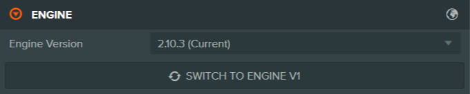

Configure which PlayCanvas Engine version is used when launching, publishing, or downloading builds.

:::note

This setting affects only you, and only for your current session. It is not saved or shared with other users.

:::

Navigate to the `ENGINE` section and expand the panel:

Here is a breakdown of the available settings:

## Settings

| Setting | Description |
| --- | --- |
| **Engine Version** | The engine to use when you click Launch or when you publish or download a build. This setting is only valid during your current session and is not shared among team members. Each option shows its version, such as 2.24.2 (Current):<ul><li><strong>Previous</strong>: the latest patch of the previous minor release.</li><li><strong>Current</strong>: the release the Editor uses by default.</li><li><strong>Release Candidate</strong>: the latest engine release, when it is newer than Current. Only listed while there is one. The Launch menu's <strong>Use Latest Engine</strong> option launches with the same release.</li></ul> |

### Notes

- Engine versions may affect rendering features and behavior. Verify your project after switching.
- To launch with an engine that isn't listed, see [Using a Custom Engine](../launch-page/custom-engine.md). If you open the Editor with a `use_local_engine` parameter in its URL, every launch uses that engine, and **Engine Version** shows its version and can't be changed.
