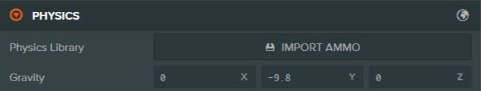

Controls the global physics simulation settings.

:::note

**Gravity** is a scene setting: it is saved with the scene that is open, so each scene can have its own gravity. **Physics Library** adds files to the project, so it applies to every scene. Both affect all users on the currently active [branch](../../version-control/branches.md) of the project.

:::

Navigate to the `PHYSICS` section and expand the panel:

Here is a breakdown of the available settings:

## Settings

| Setting | Description |
| --- | --- |
| **Physics Library** | Add the Ammo asm.js and WebAssembly modules to this project from the PlayCanvas Store. |
| **Gravity** | Gravity is the acceleration applied every frame to all rigid bodies in your scene. By default, it is set to -9.8 m/s^2, which essentially approximates Earth's gravity. If you are making a game in space, you might want to set this to 0, 0, 0 (zero g). |

### Notes

- Without Ammo.js imported, physics features will not function.
- Gravity can be adjusted to simulate different worlds, and each scene can use a different value.
