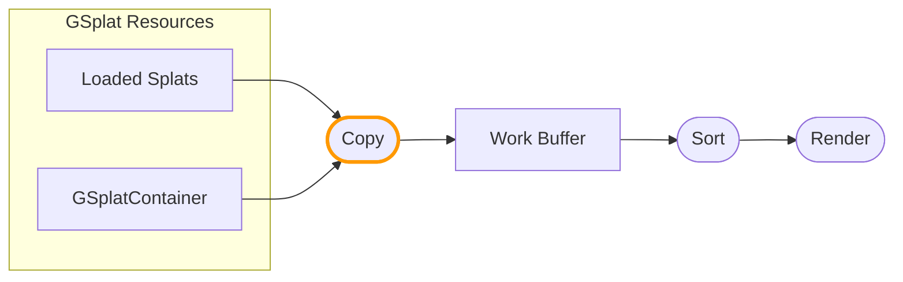

import Tabs from '@theme/Tabs';
import TabItem from '@theme/TabItem';

The work buffer format defines the data streams available in the work buffer and how splat data is copied from resources. You can customize the copy operation to transform splats and write additional per-component data.

:::note

This feature builds on the [splat rendering architecture](/user-manual/gaussian-splatting/rendering-architecture).

:::

## Pipeline Overview

Splat data flows from resources through a **Copy** operation into the work buffer:



The Copy operation runs for each gsplat component and can be customized per-component using `setWorkBufferModifier()`.

## Customizing the Copy Operation

Use `setWorkBufferModifier()` on each gsplat component to customize how its splats are copied to the work buffer.

### Modifier Functions

Your modifier code must implement three functions:

| Function | Purpose |
|----------|---------|
| `modifySplatCenter(inout vec3 center)` | Modify splat position |
| `modifySplatRotationScale(vec3 originalCenter, vec3 modifiedCenter, inout vec4 rotation, inout vec3 scale)` | Modify rotation and scale |
| `modifySplatColor(vec3 center, inout vec4 color)` | Modify color and write to extra streams |

`modifySplatCenter` always executes first. You can use it to sample extra streams and store values in global variables, or execute code shared between the three functions.

### Basic Example

```javascript
entity.gsplat.setWorkBufferModifier({
    glsl: `
        void modifySplatCenter(inout vec3 center) {
            // Offset all splats upward
            center.y += 1.0;
        }
        void modifySplatRotationScale(vec3 originalCenter, vec3 modifiedCenter,
                                       inout vec4 rotation, inout vec3 scale) {}
        void modifySplatColor(vec3 center, inout vec4 color) {
            // Tint splats red
            color.rgb *= vec3(1.0, 0.5, 0.5);
        }
    `,
    wgsl: `
        fn modifySplatCenter(center: ptr<function, vec3f>) {
            (*center).y += 1.0;
        }
        fn modifySplatRotationScale(originalCenter: vec3f, modifiedCenter: vec3f,
                                     rotation: ptr<function, vec4f>, scale: ptr<function, vec3f>) {}
        fn modifySplatColor(center: vec3f, color: ptr<function, vec4f>) {
            *color = vec4f((*color).rgb * vec3f(1.0, 0.5, 0.5), (*color).a);
        }
    `
});
```

## Adding Extra Streams

By default, the work buffer contains standard splat data (position, color, rotation, scale). You can add additional streams to store custom per-splat data:

```javascript
// Add a stream to store component IDs (R32U = unsigned int)
app.scene.gsplat.format.addExtraStreams([
    { name: 'splatId', format: pc.PIXELFORMAT_R32U }
]);
```

Common stream formats:

- `PIXELFORMAT_R32U` - Single unsigned integer (e.g., component IDs)
- `PIXELFORMAT_RGBA8` - 4 bytes (e.g., packed data)
- `PIXELFORMAT_RGBA16F` - 4 half floats (e.g., custom attributes)
- `PIXELFORMAT_RGBA32F` - 4 floats (e.g., high precision data)

:::note

Streams cannot be removed once added. The `GSPLAT_STREAM_INSTANCE` storage option is ignored for work buffer formats.

:::

## Writing to Extra Streams

For each extra stream, a write function is generated: `write{StreamName}()`. For example, a stream named `splatId` generates `writeSplatId()`.

:::note

Each `setWorkBufferModifier` must write to **all** extra streams defined in the work buffer format. All components share the same work buffer format, so their modifiers must be consistent.

:::

```javascript
entity.gsplat.setWorkBufferModifier({
    glsl: `
        uniform uint uComponentId;

        void modifySplatCenter(inout vec3 center) {}
        void modifySplatRotationScale(vec3 originalCenter, vec3 modifiedCenter,
                                       inout vec4 rotation, inout vec3 scale) {}
        void modifySplatColor(vec3 center, inout vec4 color) {
            // Write component ID to the splatId stream
            writeSplatId(uvec4(uComponentId, 0u, 0u, 0u));
        }
    `,
    wgsl: `
        uniform uComponentId: u32;

        fn modifySplatCenter(center: ptr<function, vec3f>) {}
        fn modifySplatRotationScale(originalCenter: vec3f, modifiedCenter: vec3f,
                                     rotation: ptr<function, vec4f>, scale: ptr<function, vec3f>) {}
        fn modifySplatColor(center: vec3f, color: ptr<function, vec4f>) {
            writeSplatId(vec4u(uniform.uComponentId, 0u, 0u, 0u));
        }
    `
});
```

## Passing Uniforms

Use `setParameter()`, `getParameter()`, and `deleteParameter()` on the component to manage uniform values:

```javascript
// Set a uniform
entity.gsplat.setParameter('uComponentId', componentIndex);

// Get a uniform value
const id = entity.gsplat.getParameter('uComponentId');

// Delete a uniform
entity.gsplat.deleteParameter('uComponentId');
```

Supported uniform types:

- Numbers (int, float, uint)
- Arrays (vec2, vec3, vec4, mat4, etc.)
- `Texture` objects
- `StorageBuffer` objects

## Reading Source Data

In the copy modifier, you can read the original splat data using load functions generated from the [splat data format](/user-manual/gaussian-splatting/rendering-architecture/splat-data-format). For example, with the default format:

- `loadDataColor()` - Returns `vec4` color
- `loadDataCenter()` - Returns `vec4` position (xyz) + extra data (w)
- `loadDataScale()` - Returns `vec4` scale
- `loadDataRotation()` - Returns `vec4` rotation quaternion

### Reading from Different Indices

Each load function has a `WithIndex` variant to read from a specific splat index:

```glsl
// GLSL - Read neighbor splat data
vec4 neighborCenter = loadDataCenterWithIndex(neighborIndex);
```

To read multiple attributes from the same different index, use `setSplat()` to change the current index:

```glsl
// GLSL - Read multiple attributes from another splat
setSplat(otherIndex);
vec3 otherPos = getCenter();
vec4 otherColor = getColor();
```

See [Splat Data Format - Shader Access](/user-manual/gaussian-splatting/rendering-architecture/splat-data-format#shader-access) for more details.

## Reading SOG Blind Data

[SOG](/user-manual/gaussian-splatting/formats/sog) version 3 files can carry [blind data](/user-manual/gaussian-splatting/formats/sog#37-blind-data-optional): per-gaussian fields whose meaning the application defines. The copy modifier of a component that renders such an asset can read each field through:

- `getBlind_<name>()` - Returns the field's value for the current splat: `uint` (`u32` in WGSL) for the integer types `u8` to `u32`, `float` (`f32`) for `f16`, `f32`, `unorm8` and `unorm16`.
- `SOG_BLIND_<name>` - A define that is set when the asset has the field, so one modifier can serve assets with and without it.

`<name>` is the field name with every character other than a letter, digit or `_` replaced by `_`, repeated `_` collapsed and leading or trailing `_` removed. A field named `part-id` is read with `getBlind_part_id()`.

This modifier colors the splats whose `logo` field is 1:

<Tabs groupId="shader-language" queryString="lang">
<TabItem value="glsl" label="GLSL">

```glsl
void modifySplatCenter(inout vec3 center) {}
void modifySplatRotationScale(vec3 originalCenter, vec3 modifiedCenter, inout vec4 rotation, inout vec3 scale) {}
void modifySplatColor(vec3 center, inout vec4 color) {
    #ifdef SOG_BLIND_logo
        if (getBlind_logo() == 1u) {
            color.rgb = vec3(1.0, 0.65, 0.15);
        }
    #endif
}
```

</TabItem>
<TabItem value="wgsl" label="WGSL">

```wgsl
fn modifySplatCenter(center: ptr<function, vec3f>) {}
fn modifySplatRotationScale(originalCenter: vec3f, modifiedCenter: vec3f, rotation: ptr<function, vec4f>, scale: ptr<function, vec3f>) {}
fn modifySplatColor(center: vec3f, color: ptr<function, vec4f>) {
    #ifdef SOG_BLIND_logo
        if (getBlind_logo() == 1u) {
            *color = vec4f(1.0, 0.65, 0.15, (*color).a);
        }
    #endif
}
```

</TabItem>
</Tabs>

```javascript
entity.gsplat.setWorkBufferModifier({ glsl: glslModifier, wgsl: wgslModifier });
```

Blind data is read from the asset and is not part of the work buffer. To use a field when rendering, write it to an [extra stream](#adding-extra-streams) during the copy.

The Blind Data example reads two fields from a SOG version 3 file: a `logo` flag that adds a shine to the logo, and an `edge` distance that drives hue waves across the rest of the splat. Its **View** option shows the fields themselves.

<EngineExample id="gaussian-splatting-fx/blind-data" title="Blind Data example" />

## Live Example

See the LOD Instances example which demonstrates:

<EngineExample id="gaussian-splatting/streamed-instances" title="LOD Instances example" />

- Adding a `splatId` stream to the work buffer
- Writing component IDs during copy using `setWorkBufferModifier()`
- Passing uniforms with `setParameter()`

## See Also

- [Work Buffer Rendering](/user-manual/gaussian-splatting/rendering-architecture/work-buffer-rendering) - Customizing the render operation
- [Splat Data Format](/user-manual/gaussian-splatting/rendering-architecture/splat-data-format)
- [Splat Rendering Architecture](/user-manual/gaussian-splatting/rendering-architecture)
