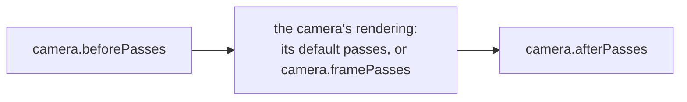

Each camera renders its part of the [frame graph](index.md) as a group of [frame passes](frame-passes.md). By default, these are passes the engine creates to render the layers of the camera. You can add passes of your own before and after them, or replace them with your own passes.

## The passes of a camera

Each camera renders its passes in three groups, in this order, and all three finish before the next camera starts:



- [`beforePasses`](#before-passes) render before the camera renders its scene.
- The camera's rendering is either its default rendering, or the passes in [`framePasses`](#replacing-the-cameras-rendering).
- [`afterPasses`](#after-passes) render after everything the camera renders.

## Before passes

The passes in [`CameraComponent#beforePasses`](https://api.playcanvas.com/engine/classes/CameraComponent.html#beforepasses) render after the directional shadow maps of the camera, and before it renders its scene. Use them to render into textures the materials of the scene read, or to run compute shaders whose results the scene uses, in the same frame.

They cannot include a pass rendering the layers of a camera, such as a [`RenderPassForward`](render-pass-forward.md#limitations). When the frame renders multiple XR views, they render for each view, apart from a compute pass, which executes in the view its [`xrViewIndex`](compute-pass.md#xr-views) selects.

## After passes

The passes in [`CameraComponent#afterPasses`](https://api.playcanvas.com/engine/classes/CameraComponent.html#afterpasses) render after everything the camera renders in the frame, its frame passes included. Use them to process what the camera rendered in the same frame, for example with a [compute pass](compute-pass.md) reading its color map. When the frame renders multiple XR views, they render once, after all the views.

## Replacing the camera's rendering

The passes in [`CameraComponent#framePasses`](https://api.playcanvas.com/engine/classes/CameraComponent.html#framepasses) render instead of the camera's default rendering, in the order of the array. With them, you decide how the camera renders: which of its layers render into which render targets, and which passes process the result. Usually, one of them is a [`RenderPassForward`](render-pass-forward.md), which renders the layers of the scene with the camera.

Here, a forward pass renders the scene into a texture, and a [shader quad pass](render-pass-shader-quad.md) draws it to the screen, tinted:

```javascript
// a texture the size of the back buffer, which the scene renders into
const texture = new Texture(app.graphicsDevice, {
    name: 'SceneTexture',
    width: 4,
    height: 4,
    format: PIXELFORMAT_RGBA8,
    mipmaps: false,
    minFilter: FILTER_LINEAR,
    magFilter: FILTER_LINEAR,
    addressU: ADDRESS_CLAMP_TO_EDGE,
    addressV: ADDRESS_CLAMP_TO_EDGE
});
const renderTarget = new RenderTarget({ colorBuffer: texture, depth: true });

// render the world and the UI layers into the texture, resized to the back buffer each frame
const scenePass = new RenderPassForward(app.graphicsDevice, app.scene, cameraEntity.camera);
scenePass.name = 'ScenePass';
scenePass.init(renderTarget, { resizeSource: null });
scenePass.addLayer(worldLayer, false);
scenePass.addLayer(uiLayer, true);

// draw the texture to the screen, tinted
const tintPass = new TintPass(app.graphicsDevice, texture);
tintPass.init(null);

cameraEntity.camera.framePasses = [scenePass, tintPass];
```

To return to the camera's default rendering, set `framePasses` to `null`.

The before and after passes of the camera still render around its frame passes. The before passes render before the first of the frame passes rendering the layers of the camera, and do not render when none of them does. The after passes render after all of them.

A camera can also render its layers in several forward passes, for example its opaque layers, then a pass of your own reading what they rendered, and then its transparent layers.

## Adding and removing passes

Add passes to the arrays, and remove them to stop rendering them. The camera does not destroy its passes, so destroy a pass once it is removed, and then what it renders into:

```javascript
const pass = new MyPass(app.graphicsDevice);
pass.name = 'MyPass';
cameraEntity.camera.afterPasses.push(pass);

// when no longer needed, remove the pass and destroy it
const passes = cameraEntity.camera.afterPasses;
passes.splice(passes.indexOf(pass), 1);
pass.destroy();
```

## Examples

The camera renders with frame passes: a forward pass renders the world and the UI layers into a texture, which a shader quad pass draws to the screen, tinted.

<EngineExample id="render-targets/render-pass-camera" title="Render Pass Camera" />

A compute pass in the after passes of the camera builds a histogram of the colors it rendered.

<EngineExample id="compute/histogram" title="Histogram" />
