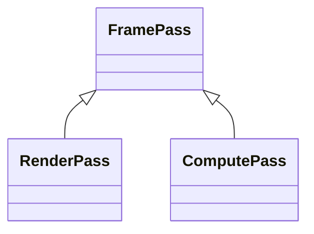
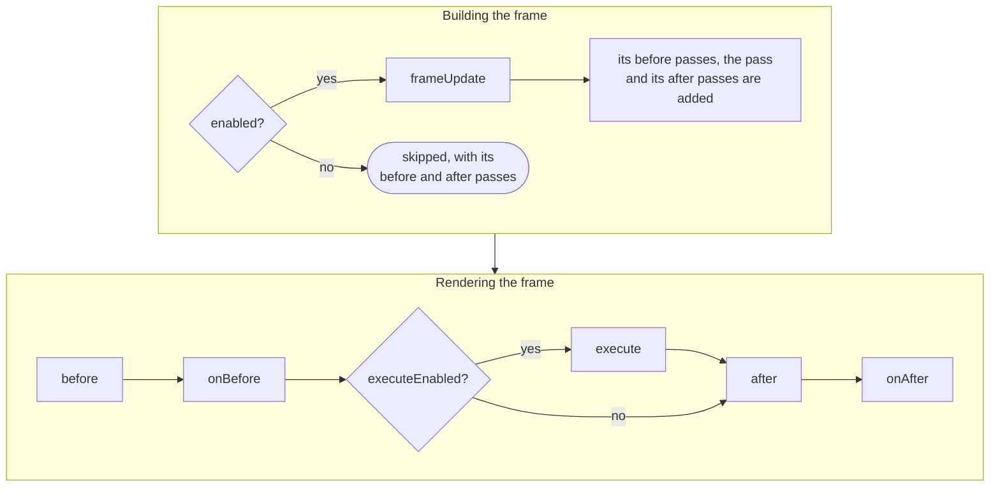
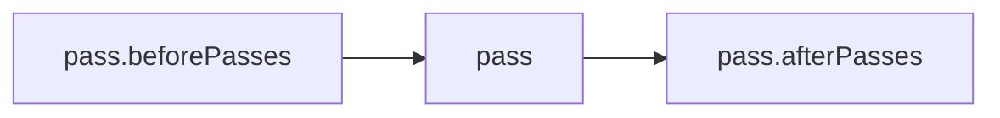

In PlayCanvas, each logical pass of the [frame graph](index.md) is a **frame pass**: an object of the engine, which records the work of the pass when the frame renders. The engine renders its own frame this way: the shadow maps, the scene of each camera, and the post-processing are all frame passes, and you can add frame passes of your own, to render into textures, to process what a camera renders, or to run compute shaders on it.

Each frame, the engine collects the frame passes, in order, into the frame graph, and then runs them one after another, starting and ending the physical passes they need. You never start or end a physical pass yourself.

## The pass classes

Every frame pass is an instance of `FramePass`, or of a class derived from it. Two classes derived from it cover the two kinds of physical passes: `RenderPass` for rendering, and `ComputePass` for compute shaders:



| Class | Use it for |
| ----- | ---------- |
| [`FramePass`](https://api.playcanvas.com/engine/classes/FramePass.html) | The base class. Work which does not need a physical pass, or a group of other frame passes. |
| [`RenderPass`](render-pass.md) | Rendering into a render target, or into the back buffer. |
| [`ComputePass`](compute-pass.md) | Dispatching compute shaders at a position in the frame. |

A `RenderPass` is a logical render pass, which records its draw calls into a physical render pass for its render target. Usually, the engine starts a physical render pass for each `RenderPass` and ends it after it. When `RenderPass` objects in a row render into the same render target, they share a single physical render pass instead, see [Frame Graph](index.md#the-frame-graph). Similarly, the engine records the dispatches of a `ComputePass` into a physical compute pass.

The engine derives classes from `RenderPass` for common kinds of drawing, such as running a shader for every pixel of a render target, or rendering the scene. See [Render Passes](render-pass.md#classes-derived-from-renderpass).

## The lifecycle of a frame pass

A frame pass goes through two phases in each frame it is part of. While the frame is built, before anything renders, the engine updates the pass and works out which passes the frame renders. Then the frame renders the passes in order.



A subclass overrides these methods to do its work:

- [`frameUpdate`](https://api.playcanvas.com/engine/classes/FramePass.html#frameupdate) updates the pass for the frame, before anything renders: for example to resize its render targets, to set the textures it reads, or to add or remove its before and after passes.
- [`before`](https://api.playcanvas.com/engine/classes/FramePass.html#before) and [`after`](https://api.playcanvas.com/engine/classes/FramePass.html#after) run around the work of the pass.
- [`execute`](https://api.playcanvas.com/engine/classes/FramePass.html#execute) records the work. For a `RenderPass`, it runs inside a physical render pass for its render target.

The [`onBefore`](https://api.playcanvas.com/engine/classes/FramePass.html#onbefore) and [`onAfter`](https://api.playcanvas.com/engine/classes/FramePass.html#onafter) callbacks let you hook into a pass without writing a subclass: to set the parameters of the pass, or to clear a buffer it writes to, right before it executes, and to read back what it wrote right after:

```javascript
pass.onBefore = () => {
    buffer.clear();
};

pass.onAfter = () => {
    buffer.read().then((data) => {
        // the results arrive a few frames later
    });
};
```

### Enabled and executeEnabled

Two properties turn a pass off, at different points of the lifecycle:

- Setting [`enabled`](https://api.playcanvas.com/engine/classes/FramePass.html#enabled) to false skips the pass when the frame is built, together with its before and after passes, and its `frameUpdate` is not called. Change it before the frame is built: the `frameUpdate` of a pass cannot disable the pass itself.
- Setting [`executeEnabled`](https://api.playcanvas.com/engine/classes/FramePass.html#executeenabled) to false only skips `execute`. The pass is still updated, its before and after passes still render, and `before`, `after`, `onBefore` and `onAfter` are still called. Set it at the latest in `frameUpdate`.

## Before and after passes

Every pass has [`beforePasses`](https://api.playcanvas.com/engine/classes/FramePass.html#beforepasses) and [`afterPasses`](https://api.playcanvas.com/engine/classes/FramePass.html#afterpasses), which render right before and right after it, every frame the pass renders:



This nests passes, and a plain `FramePass` can hold a group of passes which are enabled and disabled together:

```javascript
// a group of two blur passes: disabling the group skips both
const blur = new FramePass(app.graphicsDevice);
blur.name = 'Blur';
blur.beforePasses.push(horizontalBlurPass, verticalBlurPass);

blur.enabled = false;
```

## Adding passes to a camera

A camera renders [before passes](camera-passes.md#before-passes), then its own rendering, which you can replace with [frame passes](camera-passes.md#replacing-the-cameras-rendering) of your own, and then [after passes](camera-passes.md#after-passes). See [Camera Passes](camera-passes.md).

## Rendering a pass on its own

A pass can also render outside of a frame, for example to render into a texture once, by calling [`render`](https://api.playcanvas.com/engine/classes/FramePass.html#render). It runs `before`, `onBefore`, `execute`, `after` and `onAfter`, but the frame does not prepare it: its `frameUpdate` is not called, and its before and after passes do not render.

```javascript
pass.render();
```

## Owning passes

Nothing destroys a pass for you. A camera does not destroy the passes in its lists, and a pass does not destroy its before and after passes. The code which creates a pass destroys it, once it is removed from the lists it was added to, by calling [`destroy`](https://api.playcanvas.com/engine/classes/FramePass.html#destroy). A pass is not used after it is destroyed. A pass does not destroy what it was given either, such as its render target or its shader.

The name of a pass, set with [`name`](https://api.playcanvas.com/engine/classes/FramePass.html#name), identifies it in GPU profiling and graphics debuggers. Set it explicitly, as the default, the name of the class, is shortened in minified builds.
