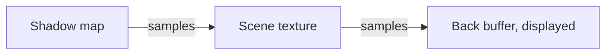
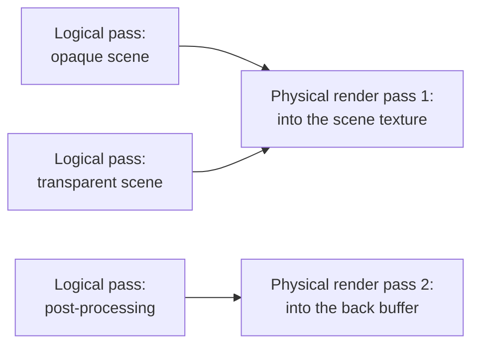
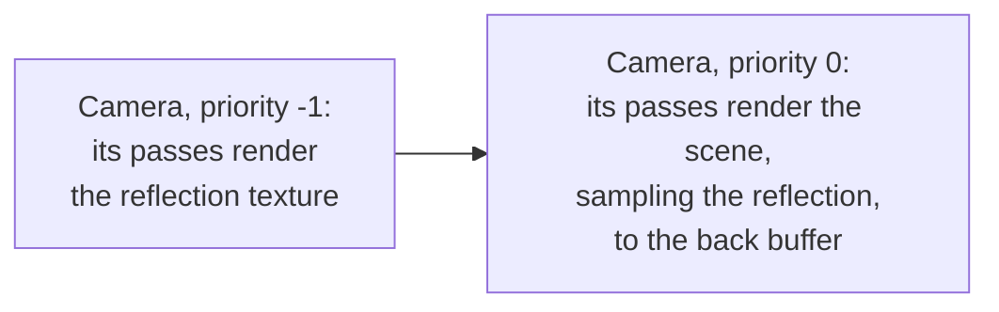

The GPU renders into a [render target](/user-manual/graphics/advanced-rendering/render-targets/), a texture or a set of textures, or into the **back buffer**, which is displayed on the screen. Rendering into one of them, from start to end, is called a **physical render pass**. A frame takes several physical render passes, and a **frame graph** describes the steps of the frame which produce them, as **logical passes**. This page explains these concepts, and the pages in this section show how PlayCanvas implements them.

## Physical render passes

A render target holds one or more color buffers, and optionally a depth and a stencil buffer, called its **attachments**. The back buffer has the same attachments, provided by the canvas. A physical render pass renders into these attachments in three steps:

1. **It starts** by clearing the attachments to a value, or by loading what they already contain.
2. **It draws**: all its draw calls render into the attachments.
3. **It ends** by storing what was drawn into the attachments, or by discarding it.

The graphics API defines the physical render pass: WebGPU calls it a render pass, and in WebGL it is the drawing done into one framebuffer.

## Physical compute passes

Compute shaders do not render into a render target. Instead, they run dispatches, which read and write buffers and textures directly. The GPU runs them in **physical compute passes**, which group the dispatches the way a physical render pass groups draw calls. Compute shaders are only supported on WebGPU.

## A frame of passes

A **frame** is one image the application renders, typically once for each refresh of the display. A physical render pass renders into a single render target, so a frame needs several of them: to render into a different render target, for example to sample a texture which was just rendered into, one physical render pass ends and another starts. A simple frame renders three physical render passes, each sampling what the one before it rendered:

Each box is one physical render pass, named after what it renders into: the shadow map of a light, a texture holding the scene, and the back buffer, into which the post-processing draws the scene texture. The passes depend on each other, so their order matters: a pass sampling a texture renders after the pass rendering into it.

## The frame graph

A **frame graph** describes all the steps of a frame, in the order they execute: what each step renders into, and what it draws or computes. Each step is a **logical pass**. Rather than starting and ending physical passes as it goes, the renderer builds the frame graph for the frame first, and then executes its logical passes in physical passes. Most logical render passes get a physical render pass of their own, but knowing the whole frame in advance lets the renderer start and end only the physical passes the frame needs:

- **Logical passes share physical render passes.** Consecutive logical passes rendering into the same render target are recorded into a single physical render pass, so the attachments are not stored and loaded again between them.
- **Attachments are stored only when needed.** An attachment a later logical pass loads is stored, and the others can be discarded.

Here, three logical passes render the frame in two physical render passes:

### Multiple cameras

A scene can have several cameras, for example one rendering a reflection or a minimap into a texture, and the main camera rendering to the screen. The frame graph composes the logical passes of all the cameras into one frame, in the order of their [priorities](https://api.playcanvas.com/engine/classes/CameraComponent.html#priority): the passes of a camera with a smaller priority value come first. A camera rendering into a texture therefore needs a smaller priority than the camera using the texture, so the texture is ready when it is used. The shadow maps a camera needs render before its scene.

## Performance

Starting and ending a physical render pass has a cost, especially on mobile GPUs. They render in small tiles of fast on-chip memory, and copy the attachments between it and the main memory: in when a pass loads them, and out when it stores them. How many physical render passes a frame needs, and what they load and store, therefore matters for performance. Clearing an attachment, rather than loading it, avoids copying it in, and so does sharing a physical render pass between logical passes rendering into the same render target.

## In PlayCanvas

Each logical pass of the frame graph is a frame pass, an object of the engine. The engine renders its own frame with frame passes, and you can add your own:

- [Frame Passes](frame-passes.md) are the logical passes of the frame graph: the pass classes and their lifecycle.
- [Camera Passes](camera-passes.md) render before and after a camera, or replace its rendering.
- [Render Passes](render-pass.md) render into a render target, including running a shader for every pixel of it, and rendering the scene.
- [Compute Passes](compute-pass.md) run compute shaders.
