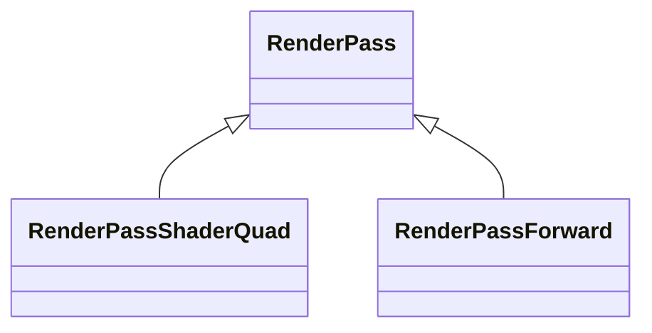

A [`RenderPass`](https://api.playcanvas.com/engine/classes/RenderPass.html) is a [frame pass](frame-passes.md) which draws into a [render target](/user-manual/graphics/advanced-rendering/render-targets/). When it executes, its draw calls are recorded into a physical render pass for its render target: usually one of its own, which starts right before the pass executes and ends right after, or one it shares with the passes next to it which render into the same render target, see [Passes sharing a render target](#passes-sharing-a-render-target).

## Classes derived from RenderPass

`RenderPass` is the base class of the passes which draw. For common kinds of drawing, the engine provides classes derived from it, which you use directly, or as the base class of your own pass:



| Class | Use it for |
| ----- | ---------- |
| [`RenderPassShaderQuad`](render-pass-shader-quad.md) | Running a shader for every pixel of a render target, or of a part of it, such as a post-processing effect. |
| [`RenderPassForward`](render-pass-forward.md) | Rendering layers of the scene with a camera. |

Derive from `RenderPass` itself to record draw calls of your own, see [Writing a pass](#writing-a-pass). The rest of this page applies to all render passes, including the derived classes.

## Setting up the pass

Once the pass is created, call [`init`](https://api.playcanvas.com/engine/classes/RenderPass.html#init) with the render target to draw into, or with `null` to draw into the back buffer. A pass needs to be initialized before it renders, and before its clears and stores are set:

```javascript
const pass = new MyPass(app.graphicsDevice);
pass.name = 'MyPass';
pass.init(renderTarget);
```

The pass does not own its render target, and does not destroy it. Call `init` again to switch the pass to a render target with different attachments. A render target with the same layout, the same color buffers, depth and stencil, and number of samples, can also be assigned to [`renderTarget`](https://api.playcanvas.com/engine/classes/RenderPass.html#rendertarget) directly, for example to alternate between two render targets each frame.

## Resizing the render target

When `init` is given options, the pass also resizes its render target every frame, to the size of a texture, of a render target, or of the back buffer, scaled by `scaleX` and `scaleY`:

```javascript
// a render target half the size of the back buffer
pass.init(renderTarget, {
    resizeSource: null,
    scaleX: 0.5,
    scaleY: 0.5
});

// a render target the size of the texture the pass processes
pass.init(renderTarget, { resizeSource: sourceTexture });
```

The options are copied. To change them later, set [`resizeSource`](https://api.playcanvas.com/engine/classes/RenderPass.html#resizesource), [`scaleX`](https://api.playcanvas.com/engine/classes/RenderPass.html#scalex) and [`scaleY`](https://api.playcanvas.com/engine/classes/RenderPass.html#scaley) on the pass: for example, set `resizeSource` when the texture the pass processes is replaced. A `resizeSource` of `undefined`, the default, leaves the size of the render target as it is.

The render target is resized while the frame is built, in the `frameUpdate` of the pass, and has its new size once the pass is updated. On a frame the size changes, the passes updated before it still see the previous size.

## Clearing the attachments

The attachments of a render target are its color buffers, and its depth and stencil buffers. By default, the physical render pass loads their content, and the pass draws over it. To start from a single value instead, clear them:

```javascript
pass.setClearColor(Color.BLACK);
pass.setClearDepth(1);
pass.setClearStencil(0);
```

When the pass covers an attachment completely, clearing it is also faster than loading it on tiled mobile GPUs, which then do not read the previous content from memory. [`setClearColor`](https://api.playcanvas.com/engine/classes/RenderPass.html#setclearcolor) clears all the color buffers, or the one at the index it is given.

## Storing the attachments

When the physical render pass ends, the pass keeps what it rendered into the textures of its render target, so they can be sampled, or loaded by a later pass: its color buffers, resolved when the render target is multisampled, and its depth buffer texture. It discards the other attachments: the samples of a multisampled color buffer which is resolved, the stencil, and a depth buffer the render target creates internally.

When a later pass of the same frame draws into the same render target and loads them, the frame stores them automatically. For a pass rendered on its own, store them with [`setStoreColor`](https://api.playcanvas.com/engine/classes/RenderPass.html#setstorecolor), [`setStoreDepth`](https://api.playcanvas.com/engine/classes/RenderPass.html#setstoredepth) and [`setStoreStencil`](https://api.playcanvas.com/engine/classes/RenderPass.html#setstorestencil).

The mipmaps of color buffers with mipmaps are generated when the pass ends too. When several passes draw into the same render target, the mipmaps are only needed after the last of them, so turn them off for the others with [`setGenerateMipmaps`](https://api.playcanvas.com/engine/classes/RenderPass.html#setgeneratemipmaps):

```javascript
firstPass.setGenerateMipmaps(false);
```

`init` resets the clears, stores and mipmaps to their defaults, so set them once the pass is initialized.

## Passes sharing a render target

In a frame, consecutive passes drawing into the same render target are merged into a single physical render pass, which avoids storing and loading the attachments between them. Something which needs to happen between them keeps them apart: a clear of the later pass, a before or after pass between them, or an `onBefore` or `onAfter` callback.

## Writing a pass

A subclass records its draw calls in [`execute`](https://api.playcanvas.com/engine/classes/FramePass.html#execute), which runs while the physical render pass is active. It can override [`postInit`](https://api.playcanvas.com/engine/classes/RenderPass.html#postinit) to set up its clears once the pass is initialized, and [`frameUpdate`](https://api.playcanvas.com/engine/classes/RenderPass.html#frameupdate) to update the pass before each frame renders, calling `super.frameUpdate()` to keep the resize. It releases what it created in [`destroy`](https://api.playcanvas.com/engine/classes/FramePass.html#destroy), calling `super.destroy()`:

```javascript
// A pass drawing a quad with a shader, covering its whole render target
class MyPass extends RenderPass {
    constructor(device, shader) {
        super(device);
        this.quadRender = new QuadRender(shader);
    }

    postInit() {
        // the quad covers the whole target, so clear it instead of loading its content
        this.setClearColor(Color.BLACK);
    }

    execute() {
        // the default draw states suit a quad: no blending, and no depth test or write
        this.device.setDrawStates();
        this.quadRender.render();
    }

    destroy() {
        this.quadRender.destroy();
        super.destroy();
    }
}
```

For a quad drawn with a shader, [`RenderPassShaderQuad`](render-pass-shader-quad.md) already does this, and also sets up the render states.

## Rendering into a texture once

To render into a texture only when its content needs to change, render the pass on its own with [`render`](https://api.playcanvas.com/engine/classes/RenderPass.html#render), outside of a frame:

```javascript
const renderTarget = new RenderTarget({ colorBuffer: texture, depth: false });
const pass = new MyPass(app.graphicsDevice, shader);
pass.name = 'MyPass';
pass.init(renderTarget);

// draw into the texture
pass.render();

// destroy the pass, and then the render target, which the pass does not own
pass.destroy();
renderTarget.destroy();
```

## Example

Two `RenderPass` subclasses, which are not attached to any camera, generate the textures of a material: a pattern, and a normal map from its height. They render on their own from the `prerender` event, every frame while animating, and otherwise only when a setting changes.

<EngineExample id="render-targets/render-pass-procedural-texture" title="Procedural Texture" />
