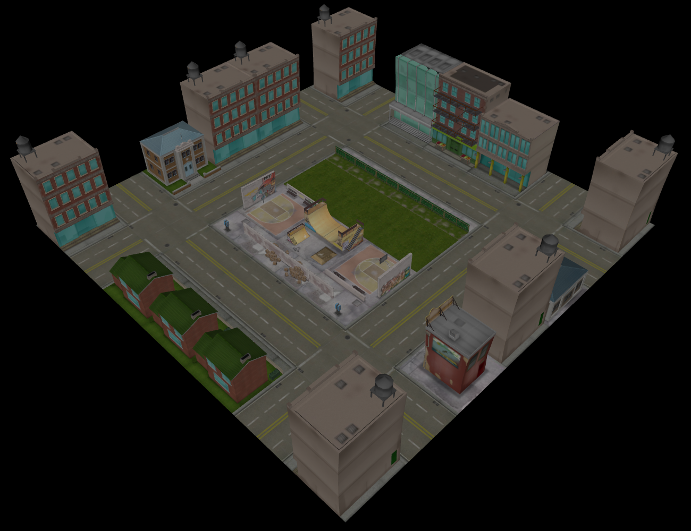
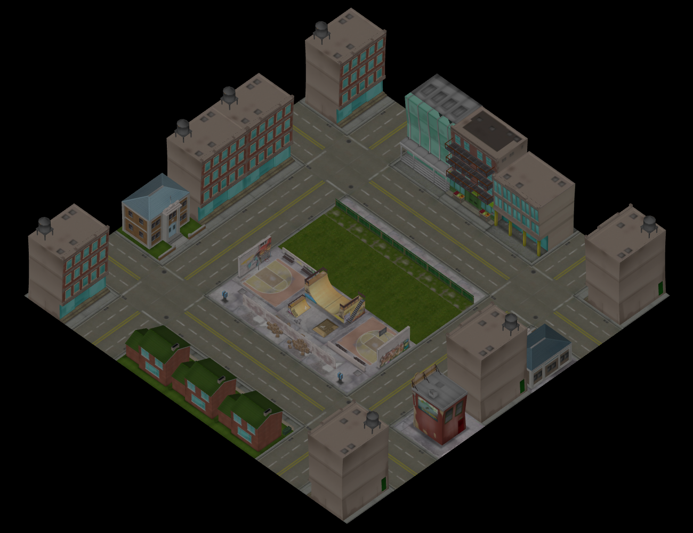

import Tabs from '@theme/Tabs';
import TabItem from '@theme/TabItem';

A camera's projection defines how the 3D scene is flattened onto a 2D image. PlayCanvas cameras support two projection types: perspective and orthographic.

## Perspective Projection {#perspective}

Perspective projection, the default, mimics how our eyes and physical cameras work: objects appear smaller the further away they are. The volume of space the camera can see — its frustum — is a truncated pyramid.



The shape of the frustum is controlled by the field of view (`fov`), an angle in degrees that defaults to 45. By default this angle is measured vertically; set `horizontalFov` to `true` to measure it horizontally instead. Larger values take in more of the scene, with a fisheye look at the extreme; smaller values have a zoomed-in, telephoto effect.

## Orthographic Projection {#orthographic}

Orthographic projection is a parallel projection: objects keep the same size on screen regardless of their distance from the camera. The frustum is a cuboid. It is often used for 2D and isometric games, as well as CAD-style visualizations.



Since field of view does not apply, the size of the view is set with `orthoHeight`: half the height of the view volume in world units (defaults to 10). The width is derived from the aspect ratio.

Set the projection type as follows:

<Tabs groupId="workflow" defaultValue="engine">
<TabItem value="engine" label="Engine">

```javascript
// PROJECTION_PERSPECTIVE (default) | PROJECTION_ORTHOGRAPHIC
camera.camera.projection = PROJECTION_ORTHOGRAPHIC;
camera.camera.orthoHeight = 5; // half-height of the view in world units
```

</TabItem>
<TabItem value="editor" label="Editor">

Select the camera in the Hierarchy and set **Projection** to **Perspective** or **Orthographic** in the [Camera Component](/user-manual/editor/scenes/components/camera). The **Field of View** or **Ortho Height** field is shown accordingly.

</TabItem>
<TabItem value="react" label="React">

```jsx
import { PROJECTION_ORTHOGRAPHIC } from 'playcanvas';

<Entity name="camera">
  <Camera projection={PROJECTION_ORTHOGRAPHIC} orthoHeight={5} />
</Entity>
```

</TabItem>
<TabItem value="web-components" label="Web Components">

```html
<!-- perspective is the default; add the orthographic flag to switch -->
<pc-entity name="camera">
  <pc-camera orthographic ortho-height="5"></pc-camera>
</pc-entity>
```

</TabItem>
</Tabs>

## Clip Planes {#clip-planes}

The near and far clip planes cap the frustum at both ends, bounding the range of distances the camera can see. Anything closer than `nearClip` (default 0.1) or further than `farClip` (default 1000) is not rendered:

```javascript
camera.camera.nearClip = 0.5;
camera.camera.farClip = 500;
```

:::note

The ratio between the far and near clip planes determines how depth buffer precision is distributed across the scene. If the near plane is very small relative to the far plane, distant surfaces can be left with too little precision to be separated reliably, causing flickering known as z-fighting. To avoid it, set the near plane as large as your scene can tolerate and the far plane no larger than necessary. For scenes that need a very large view distance, use [reverse-z](#reverse-z).

:::

## Reverse-Z {#reverse-z}

By default, the depth buffer stores a depth of 0 at the near plane and 1 at the far plane. A perspective projection spends most of the available values close to the camera, so distant surfaces get the least precision. Reverse-z flips the range, storing 1 at the near plane and 0 at the far plane. Combined with a floating point depth buffer, whose own precision is highest near 0, this spreads the precision almost evenly across the view distance. Scenes such as terrain, flight or space views can then keep a small near plane and a far plane many kilometers away without z-fighting.

Enable it per camera with the `reverseZ` property:

```javascript
if (app.graphicsDevice.supportsReverseZ) {
    camera.camera.reverseZ = true;
}
```

Reverse-z is supported on WebGPU, where `GraphicsDevice#supportsReverseZ` is `true`. On other devices, the camera keeps the setting but renders without it. It is also not applied while the camera renders the views of an XR session.

### Depth Buffer Format {#reverse-z-depth-format}

Reverse-z only improves precision when the depth buffer stores floating point values. On WebGPU, the engine allocates `depth24plus-stencil8` for the back buffer and for render targets created without a depth buffer of their own. This format may use 24-bit fixed point depth, in which case reverse-z makes little difference.

For the full precision gain, render the camera into a render target with a [`PIXELFORMAT_DEPTH`](https://api.playcanvas.com/engine/variables/PIXELFORMAT_DEPTH.html) depth buffer, which uses `depth32float`:

```javascript
const colorBuffer = new Texture(device, {
    width, height,
    format: PIXELFORMAT_RGBA8,
    mipmaps: false
});

const depthBuffer = new Texture(device, {
    width, height,
    format: PIXELFORMAT_DEPTH,
    mipmaps: false
});

camera.camera.renderTarget = new RenderTarget({ colorBuffer, depthBuffer });
camera.camera.reverseZ = true;
```

The depth buffer must be single-sampled, or explicitly multisampled with the same sample count as the render target. When a multisampled render target uses a single-sampled depth texture, the engine renders into an internal `depth24plus-stencil8` attachment and only resolves the result to the float texture, which does not recover the lost precision.

### Rendering Behavior {#reverse-z-rendering}

Materials and depth states keep their usual meaning with reverse-z. The graphics device reverses the depth test functions and depth biases for the camera, so [`FUNC_LESSEQUAL`](https://api.playcanvas.com/engine/variables/FUNC_LESSEQUAL.html) still passes the nearer fragments, and the depth clear value of the camera (`clearDepth`, 1 by default) is reversed as well. The same layers can therefore be rendered by cameras with and without reverse-z.

Cameras that render into the same depth buffer need to use the same setting.

The built-in perspective and orthographic projections compute the reversed depth from the clip planes, keeping the far plane exact for any ratio of the far clip to the near clip. A projection supplied by `calculateProjection` is reversed from its own 32-bit values, which loses some precision when that ratio is very large.

Shaders compiled for a camera with reverse-z get the `REVERSE_Z` define. Custom shaders that write or read the depth of the camera need to handle it, see [Reverse-Z Define](/user-manual/graphics/shaders/#reverse-z-define).

:::warning

Features that read the depth rendered by the camera do not support reverse-z yet, and render incorrectly with it:

- The scene depth map, see [Depth Layer](depth-layer.md)
- The depth prepass of [CameraFrame](/user-manual/graphics/posteffects/cameraframe/)
- [Picking](scene-picker.md)
- [Gaussian splats](/user-manual/gaussian-splatting/)

:::

## Aspect Ratio {#aspect-ratio}

By default, a camera's aspect ratio is computed automatically every frame from its render target and [viewport](multiple-cameras.md#viewports) (`aspectRatioMode` of [`ASPECT_AUTO`](https://api.playcanvas.com/engine/variables/ASPECT_AUTO.html)), so the image is never stretched as the canvas resizes. For special cases — such as rendering for a display with non-square pixels — set `aspectRatioMode` to [`ASPECT_MANUAL`](https://api.playcanvas.com/engine/variables/ASPECT_MANUAL.html) and assign `aspectRatio` yourself.

## Frustum Culling {#frustum-culling}

When frustum culling is enabled (`frustumCulling`, the default), the engine skips rendering any mesh instance whose bounding box falls completely outside the camera's frustum, which can dramatically reduce the number of draw calls in large scenes. Disable it only if you need everything submitted to the GPU regardless of visibility.

The frustum itself is exposed as a [Frustum](https://api.playcanvas.com/engine/classes/Frustum.html) via the read-only `frustum` property, which you can query for custom visibility logic:

```javascript
const visible = camera.camera.frustum.containsPoint(entity.getPosition());
```
