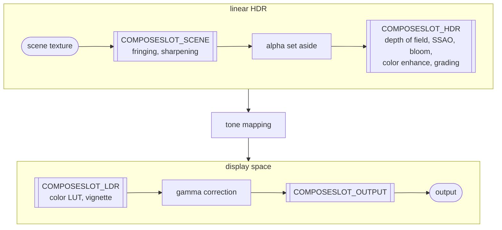

import Tabs from '@theme/Tabs';
import TabItem from '@theme/TabItem';

A [`CameraFrame`](https://api.playcanvas.com/engine/classes/CameraFrame.html) renders its post-processing with **effects**, objects derived from [`CameraFrameEffect`](https://api.playcanvas.com/engine/classes/CameraFrameEffect.html). The built-in effects are effects too: `cameraFrame.bloom`, `cameraFrame.vignette` and the others are instances of effect classes. You can write effects of your own, and register them with a camera frame next to the built-in ones.

Most effects contribute a shader chunk to the **composition**: a single pass, drawing the final image, in which all these chunks run, one after another. Contributing to it never costs an additional full-screen pass. An effect needing work the composition cannot do in a single sample per pixel, such as a blur at a lower resolution, owns passes as well, see [Effects with Passes](effect-passes.md).

## Compose slots

The composition is a shader which runs once for each pixel of the output. It reads the color the scene rendered at the pixel, and converts it to the color written to the screen. The scene renders linear HDR colors, proportional to the light and of any brightness. Tone mapping maps them to the range a display can show, and gamma correction then encodes them for the display. The chunks of the effects modify the color along the way.

A **compose slot** is a point of this conversion, at which the composition calls the chunks of the effects. Each effect applies at one of the four slots, which decides the color it receives, and so what it can do. The effects at a slot run one after another, each receiving the color the effect before it returned:



The slots are shown with the built-in effects applying at them, in their order.

| Slot | The color it receives | Use it for |
| ---- | --------------------- | ---------- |
| `COMPOSESLOT_SCENE` | The scene color as sampled, with its alpha, before the effects of the later slots modify it. | Effects changing the scene image itself, which the other effects build on: those sampling the scene texture again around the pixel, such as a sharpening, and those changing the alpha. At a later slot, sampling the scene texture again would discard what the effects before them did. |
| `COMPOSESLOT_HDR` | The linear HDR color, before tone mapping. | Effects working with light, such as adding the light of a bloom, or darkening by the ambient occlusion. |
| `COMPOSESLOT_LDR` | The tone mapped color, in the 0-1 range of the display, before gamma correction. | Effects on the look of the final image, such as a vignette, or a color lookup table. |
| `COMPOSESLOT_OUTPUT` | The final values written to the screen, after gamma correction. | Effects on the exact values written, such as a dithering. |

`COMPOSESLOT_SCENE` and `COMPOSESLOT_HDR` are both in linear HDR, with no conversion between them. All the effects at `COMPOSESLOT_SCENE` run before any effect at `COMPOSESLOT_HDR`, and only they can change the alpha of the output.

The entry function of a chunk at `COMPOSESLOT_SCENE` takes the color as a `vec4`, with its alpha, and the uv, and returns the color as a `vec4`. At the other slots, it takes the color as a `vec3` and the uv, and returns the color as a `vec3`.

### The built-in effects

A camera frame registers its built-in effects in this order, which is the order they apply in at their slot. Each is identified by its id, which [`getEffect`](https://api.playcanvas.com/engine/classes/CameraFrame.html#geteffect) and [`insertEffectBefore`](https://api.playcanvas.com/engine/classes/CameraFrame.html#inserteffectbefore) take:

| Id | Effect | Compose slot |
| -- | ------ | ------------ |
| `taa` | Temporal anti-aliasing, `cameraFrame.taa` | None, it only owns passes |
| `fringing` | Fringing, `cameraFrame.fringing` | `COMPOSESLOT_SCENE` |
| `cas` | Sharpening, `cameraFrame.rendering.sharpness` | `COMPOSESLOT_SCENE` |
| `dof` | Depth of field, `cameraFrame.dof` | `COMPOSESLOT_HDR` |
| `ssao` | Ambient occlusion, `cameraFrame.ssao` | `COMPOSESLOT_HDR`, with the `SSAOTYPE_COMBINE` type |
| `volumetricFog` | Volumetric fog, `cameraFrame.volumetricFog` | None, it only owns passes |
| `bloom` | Bloom, `cameraFrame.bloom` | `COMPOSESLOT_HDR` |
| `colorEnhance` | Color enhancement, `cameraFrame.colorEnhance` | `COMPOSESLOT_HDR` |
| `grading` | Color grading, `cameraFrame.grading` | `COMPOSESLOT_HDR` |
| `colorLut` | Color lookup table, `cameraFrame.colorLUT` | `COMPOSESLOT_LDR` |
| `vignette` | Vignette, `cameraFrame.vignette` | `COMPOSESLOT_LDR` |

The effects you add apply after the built-in effects at their slot, in the order they are added. This includes the other effects of the engine: the [lens flare](lens-flare.md), `lensFlare`, applies at `COMPOSESLOT_HDR` after the color grading, while the dynamic sky, SMAA and auto exposure only own passes. To apply an effect before one of the built-in effects, register it with `insertEffectBefore`, see [Registering effects](#registering-effects). For example, an effect inserted before `bloom` acts on the scene before the light of the bloom is added, and the color grading then applies to its result.

## Writing an effect

An effect is constructed with the graphics device, its **id**, and its declarations: the compose slot it applies at, and its shader chunk in GLSL and WGSL. The chunk declares the uniforms the effect sets, and its entry function, named `apply<Id>`, which the composition calls at the slot of the effect. This chunk draws the image as dots:

<Tabs groupId="shader-language" queryString="lang">
<TabItem value="glsl" label="GLSL">

```glsl
uniform float pixelationTilePixels;
uniform float pixelationIntensity;

vec3 applyPixelation(vec3 color, vec2 uv) {
    vec2 tileUV = vec2(pixelationTilePixels) * sceneTextureSize.zw;
    vec2 centerUv = (floor(uv / tileUV) + 0.5) * tileUV;

    vec2 local = (uv - centerUv) / tileUV;
    float dist = length(local);
    float edge = fwidth(dist) * 1.5;
    float mask = 1.0 - smoothstep(0.35, 0.35 + edge, dist);
    return mix(color, color * mask, pixelationIntensity);
}
```

</TabItem>
<TabItem value="wgsl" label="WGSL">

```wgsl
uniform pixelationTilePixels: f32;
uniform pixelationIntensity: f32;

fn applyPixelation(color: vec3f, uv: vec2f) -> vec3f {
    let tileUV = vec2f(uniform.pixelationTilePixels) * uniform.sceneTextureSize.zw;
    let centerUv = (floor(uv / tileUV) + vec2f(0.5, 0.5)) * tileUV;

    let local = (uv - centerUv) / tileUV;
    let dist = length(local);
    let edge = fwidth(dist) * 1.5;
    let mask = 1.0 - smoothstep(0.35, 0.35 + edge, dist);
    return mix(color, color * mask, uniform.pixelationIntensity);
}
```

</TabItem>
</Tabs>

The effect class declares its parameters as fields, and applies them in `update`:

```javascript
class PixelationEffect extends CameraFrameEffect {
    // the size of one tile, in screen pixels
    tilePixels = 8;

    // the blend between the original image (0) and the pixelated one (1)
    intensity = 0.5;

    constructor(device) {
        super(device, 'pixelation', {
            slot: COMPOSESLOT_LDR,
            glsl: pixelationGLSL,
            wgsl: pixelationWGSL
        });
    }

    // at zero intensity, the effect leaves the image as it is, so it is left out of the shader
    get active() {
        return this.enabled && this.intensity > 0;
    }

    update() {
        this.setUniform('pixelationTilePixels', this.tilePixels);
        this.setUniform('pixelationIntensity', this.intensity);
    }
}
```

An effect driven by data needs no class: construct a `CameraFrameEffect` with its declarations, and set its uniforms directly.

### What the chunk can read

Every chunk can read what the composition provides: the scene color, `sceneTexture`, and `sceneTextureSize`, holding the width, the height, 1 / width and 1 / height of the scene texture. Use the size for anything depending on the resolution, such as texel offsets, pixel sizes or the aspect ratio.

An effect which lists `FRAMERESOURCE_DEPTH` in its [`requires`](https://api.playcanvas.com/engine/classes/CameraFrameEffect.html#requires) option can also read the depth of the scene, with `getLinearScreenDepth(uv)`.

## Registering effects

Register an effect with a camera frame with [`addEffect`](https://api.playcanvas.com/engine/classes/CameraFrame.html#addeffect). Effects at the same compose slot run in the order they are registered, so an effect added after the built-in vignette, which is at `COMPOSESLOT_LDR` too, applies after it. To place an effect before another one, register it with [`insertEffectBefore`](https://api.playcanvas.com/engine/classes/CameraFrame.html#inserteffectbefore), with that effect, or its id, see [The built-in effects](#the-built-in-effects):

```javascript
const pixelation = new PixelationEffect(app.graphicsDevice);
cameraFrame.addEffect(pixelation);

// or, to apply it before the vignette
cameraFrame.insertEffectBefore(pixelation, 'vignette');

cameraFrame.update();
```

[`getEffect`](https://api.playcanvas.com/engine/classes/CameraFrame.html#geteffect) returns a registered effect by its id, and [`removeEffect`](https://api.playcanvas.com/engine/classes/CameraFrame.html#removeeffect) removes it.

Like the rest of the camera frame, an effect is configured when [`CameraFrame#update`](https://api.playcanvas.com/engine/classes/CameraFrame.html#update) is called: changes to its parameters, and adding or removing it, take effect at the next update. The camera frame does not own the effects you add: removing an effect, or destroying the camera frame, does not destroy it, so destroy it with [`destroy`](https://api.playcanvas.com/engine/classes/CameraFrameEffect.html#destroy) once it is no longer used.

## Parameters

An effect applies its parameters in [`update`](https://api.playcanvas.com/engine/classes/CameraFrameEffect.html#update), which the camera frame calls on each `CameraFrame#update` while the effect is active:

- [`setUniform`](https://api.playcanvas.com/engine/classes/CameraFrameEffect.html#setuniform) sets the value of a uniform the chunk reads. Like a material parameter, the value is stored by reference, so an array or a texture can be updated in place.
- [`setDefine`](https://api.playcanvas.com/engine/classes/CameraFrameEffect.html#setdefine) sets a define on the compose shader, for variants of the chunk. Changing a define rebuilds the compose shader, so use defines for settings which change rarely, and uniforms for the others. Fixed defines can be set once, in the constructor.

[`enabled`](https://api.playcanvas.com/engine/classes/CameraFrameEffect.html#enabled) turns an effect on and off. An effect which does nothing for some values of its parameters, such as a zero intensity, overrides [`active`](https://api.playcanvas.com/engine/classes/CameraFrameEffect.html#active), so its chunk is left out of the compose shader then.

The few effects which depend on values changing every frame, such as the time, implement [`frameUpdate`](https://api.playcanvas.com/engine/classes/CameraFrameEffect.html#frameupdate). It is called each frame the effect takes part in, with the values of that frame, including the time since the last frame, `dt`, and the sizes the scene renders at:

```javascript
frameUpdate(frame) {
    this.time += frame.dt;
    this.setUniform('waveTime', this.time);
}
```

An effect adapting the exposure of the camera, as the auto exposure does, returns a scale from [`cameraExposureScale`](https://api.playcanvas.com/engine/classes/CameraFrameEffect.html#cameraexposurescale).

## Debug views

An effect can provide debug views, which display an intermediate result in place of the output of the camera. List their names in the `debugViews` option, and implement a `debug<Name>()` function for each in the chunk, returning the color to display:

```javascript
super(device, 'pixelation', {
    slot: COMPOSESLOT_LDR,
    glsl, wgsl,
    debugViews: ['pixelationMask']
});
```

Display a view by setting it as the debug view of the camera frame:

```javascript
cameraFrame.debug = 'pixelationMask';
cameraFrame.update();
```

## Overriding the chunk of an effect

The chunk of an effect can be overridden by name, like the built-in shader chunks: a chunk set in [`ShaderChunks`](https://api.playcanvas.com/engine/classes/ShaderChunks.html) under `compose<Id>PS` replaces the source of the effect. This works for the built-in effects too:

```javascript
ShaderChunks.get(app.graphicsDevice, SHADERLANGUAGE_GLSL).set('composePixelationPS', myPixelationGLSL);
ShaderChunks.get(app.graphicsDevice, SHADERLANGUAGE_WGSL).set('composePixelationPS', myPixelationWGSL);
```

While an effect is active, its id in upper snake case is defined in the compose shader, `PIXELATION` here, should another chunk need to know.

## Effects in the Editor

To use an effect in the Editor, write a script deriving from `CameraFrameEffectScript`, from [`camera-frame-effect.mjs`](https://github.com/playcanvas/engine/blob/main/scripts/esm/camera-frame-effect.mjs), and add it to the camera entity, next to the [`cameraFrame` script](/user-manual/graphics/linear-workflow/hdr-rendering/#cameraframe-in-the-editor). The script declares the parameters of the effect as attributes, creates the effect in `createEffect`, and copies the attributes into it in `updateEffect`:

```javascript
import { CameraFrameEffectScript } from './camera-frame-effect.mjs';

class PixelationEffectScript extends CameraFrameEffectScript {
    static scriptName = 'pixelationEffect';

    /**
     * @attribute
     * @range [0, 1]
     */
    intensity = 0.5;

    createEffect(device) {
        return new PixelationEffect(device);
    }

    updateEffect(effect) {
        effect.intensity = this.intensity;
    }
}
```

The effect is registered with the camera frame as soon as both scripts exist, follows the enabled state of the script, and is destroyed with it. To expose the debug views of the effect, override the `debugView` getter of the script. The scripts of the [lens flare](lens-flare.md), the SMAA and the auto exposure effects in the engine repository are complete examples.

## Example

A pixelation effect, at `COMPOSESLOT_LDR`, applied after the built-in vignette.

<EngineExample id="camera-frame/custom-compose-shader" title="Custom Compose Shader" />
