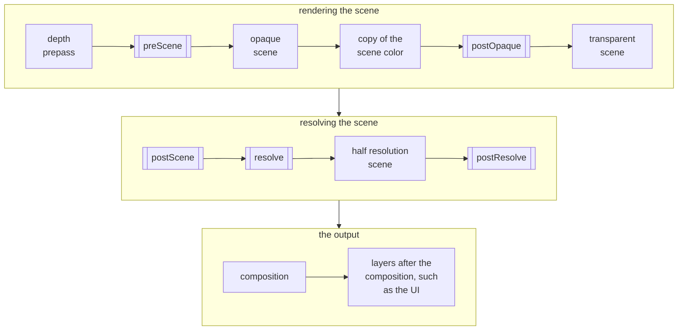

A [custom effect](custom-effects.md) can own [frame passes](/user-manual/graphics/advanced-rendering/frame-graph/frame-passes/), for work the composition cannot do in a single sample per pixel: a blur at a lower resolution, rendering into the scene, or accumulating the frames over time. The built-in bloom, depth of field and temporal anti-aliasing are effects with passes.

The camera frame asks the effect for its passes, hands it the **frame resources** it requires, such as the scene depth, and runs its passes at the **stages** of the frame they belong to. The effect writes the passes like any other render pass, typically as [shader quad passes](/user-manual/graphics/advanced-rendering/frame-graph/render-pass-shader-quad/), and its chunk can read what they render. An effect owning passes does not need a compose slot.

## The stages of the camera frame

A camera frame renders the passes of its effects at five stages, between the passes rendering the scene:



The stages, in double-bordered boxes, are where the passes of the effects run.

| Stage | Runs | Use it for | Effects of the engine |
| ----- | ---- | ---------- | --------------------- |
| `preScene` | After the depth prepass, when one renders, before the scene. | Rendering textures which the materials of the scene read. | Ambient occlusion with the `SSAOTYPE_LIGHTING` type, dynamic sky |
| `postOpaque` | After the opaque geometry, the skybox and the copy of the scene color, before the transparent geometry. | Rendering into the scene, under the transparent geometry. | None |
| `postScene` | After the scene, before it is resolved. | Rendering into the scene. | Ambient occlusion with the `SSAOTYPE_COMBINE` type, volumetric fog |
| `resolve` | Resolving the scene. | Passes which read the scene color and render a new one, such as an anti-aliasing, see [Resolving the scene](#resolving-the-scene). | TAA, SMAA |
| `postResolve` | After the scene is resolved, and its half resolution copy is made, before the composition. | Processing the final scene color, such as a bloom. | Depth of field, bloom, lens flare, auto exposure |

At each stage, the passes of the effects run in the order the effects are registered: the built-in effects in the order listed in [The built-in effects](custom-effects.md#the-built-in-effects), and after them the effects added to the camera frame, in the order they are added, unless inserted before another effect with `insertEffectBefore`.

## Frame resources

An effect lists the frame resources it needs in its [`requires`](https://api.playcanvas.com/engine/classes/CameraFrameEffect.html#requires) option, and the camera frame provides them while the effect is active:

| Resource | Provides |
| -------- | -------- |
| `FRAMERESOURCE_DEPTH` | `resources.depth`, the scene depth. |
| `FRAMERESOURCE_PREPASSDEPTH` | `resources.prepassDepth`, the scene depth rendered by a depth prepass, before the scene renders, for passes at the `preScene` stage. |
| `FRAMERESOURCE_SCENECOLORHALF` | `resources.sceneColorHalf`, a half resolution copy of the resolved scene color. |
| `FRAMERESOURCE_SCENECOLORGRAB` | `resources.sceneColorGrab`, the handle of a copy of the opaque scene color, which the shaders sample as `uSceneColorMap` from the `postOpaque` stage. |
| `FRAMERESOURCE_SCENETARGET` | `resources.sceneTarget`, the render target the scene renders to, for passes rendering into the scene. |

The resources stay the same objects for the life of the passes, so they can be handed to the passes once. Their textures are resized with the canvas, so do not keep their sizes. An effect whose requirements depend on a parameter overrides `requires` as a getter.

How the scene depth is stored depends on what renders it, so a shader reads it with the `getLinearScreenDepth` function of the `screenDepthPS` chunk, given the defines describing the storage. Pass the defines of the depth to the shader, and add its key to the unique name of the shader, so that differently stored depths do not share a compiled shader:

```javascript
const { depth } = resources;
this.shader = ShaderUtils.createShader(device, {
    uniqueName: `InkOutlineShader-${depth.key}`,
    attributes: { aPosition: SEMANTIC_POSITION },
    vertexChunk: 'quadVS',
    fragmentDefines: depth.defines,
    fragmentGLSL: inkGLSL,  // includes "screenDepthPS", and calls getLinearScreenDepth(uv)
    fragmentWGSL: inkWGSL
});
```

## Creating the passes

The effect creates its passes in [`createPasses`](https://api.playcanvas.com/engine/classes/CameraFrameEffect.html#createpasses), from the resources it requires, adding each to the array of the stage it runs at, in the order they execute. One effect can run passes at several stages. It releases them in [`destroyPasses`](https://api.playcanvas.com/engine/classes/CameraFrameEffect.html#destroypasses):

```javascript
class InkOutlineEffect extends CameraFrameEffect {
    width = 3;

    _pass = null;

    constructor(device) {
        super(device, 'inkOutline', {
            requires: [FRAMERESOURCE_SCENECOLORGRAB, FRAMERESOURCE_SCENETARGET, FRAMERESOURCE_DEPTH]
        });
    }

    createPasses(resources, passes) {
        // the pass draws the lines into the scene, after the opaque geometry
        this._pass = new RenderPassInkOutline(this.device, this.cameraFrame.cameraComponent, resources.depth);
        this._pass.init(resources.sceneTarget);
        passes.postOpaque.push(this._pass);
    }

    destroyPasses() {
        this._pass?.destroy();
        this._pass = null;
    }

    // called by cameraFrame.update(): apply the parameters to the pass
    update() {
        this._pass.width = this.width;
    }
}
```

A pass rendering into a render target of the effect sizes it with [`resizeSource`](/user-manual/graphics/advanced-rendering/frame-graph/render-pass/#resizing-the-render-target), for example to follow the half resolution scene. The chunk of the effect reads what the passes render through a uniform it sets with `setUniform`, as a texture is stored by reference.

### When the passes are rebuilt

The camera frame creates the passes of its effects when it builds its own passes: on the first `CameraFrame#update`, and again each time it rebuilds them, after releasing the previous ones with `destroyPasses`. It rebuilds them when the options of the camera frame change, when an effect owning passes is added, removed, enabled or disabled, and when the requirements of such an effect, or its [`buildKey`](https://api.playcanvas.com/engine/classes/CameraFrameEffect.html#buildkey), change.

`buildKey` returns a string which changes whenever the passes need recreating: the parameters which change the passes, rather than their uniforms. Parameters the passes pick up in `update` do not belong in it:

```javascript
buildKey() {
    // a pass more renders at the high quality
    return `${this.highQuality}`;
}
```

`destroyPasses` is also called when the effect has no passes, for example for an effect which was inactive when the passes were built, and by `destroy`. So destroy only what exists, and clear the references, as the example does.

## Values of each frame

The resources do not change from frame to frame. Values which do, such as the resolution the scene renders at, or the resolved scene color, which the temporal anti-aliasing alternates between two textures, are handed to [`frameUpdate`](https://api.playcanvas.com/engine/classes/CameraFrameEffect.html#frameupdate) every frame, before any pass renders:

```javascript
frameUpdate(frame) {
    // the size of a pixel of the scene render target, which the pass renders into
    this._pass.texelWidth = 1 / frame.renderWidth;
    this._pass.texelHeight = 1 / frame.renderHeight;
}
```

## Resolving the scene

An effect whose passes run at the `resolve` stage replaces the scene color, which the rest of the frame reads, with what its passes render. The camera frame calls its [`resolveScene`](https://api.playcanvas.com/engine/classes/CameraFrameEffect.html#resolvescene) every frame, before `frameUpdate`, with the scene being resolved. The effect hands its passes the scene color the effects before it resolved, and replaces it with the texture its passes render to this frame:

```javascript
resolveScene(scene) {
    this._pass.setSourceTexture(scene.texture);
    scene.texture = this._pass.outputTexture;
}
```

An effect resolving the scene to another resolution, such as an upscaler, also sets the `width` and the `height` of the scene.

## TypeScript

In TypeScript, the parameters of an overridden method are not typed from the base class. Import the types of the hooks, [`CameraFrameEffectResources`](https://api.playcanvas.com/engine/interfaces/CameraFrameEffectResources.html), [`CameraFrameEffectPasses`](https://api.playcanvas.com/engine/interfaces/CameraFrameEffectPasses.html), [`CameraFrameEffectScene`](https://api.playcanvas.com/engine/interfaces/CameraFrameEffectScene.html) and [`CameraFrameEffectContext`](https://api.playcanvas.com/engine/interfaces/CameraFrameEffectContext.html), to annotate them:

```typescript
import { CameraFrameEffect } from 'playcanvas';
import type { CameraFrameEffectPasses, CameraFrameEffectResources } from 'playcanvas';

class BlurEffect extends CameraFrameEffect {
    createPasses(resources: CameraFrameEffectResources, passes: CameraFrameEffectPasses) {
        // ...
    }
}
```

## Example

An ink outline effect draws lines where the depth or the brightness of the opaque scene changes abruptly. Its pass runs at the `postOpaque` stage, reading the copy of the opaque scene color and the scene depth, and drawing into the scene, so the transparent geometry renders over the lines.

<EngineExample id="camera-frame/ink-outline" title="Ink Outline" />
