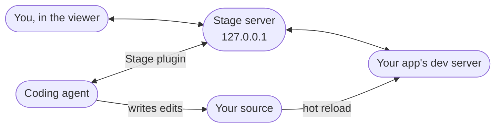

import Link from '@docusaurus/Link';

[PlayCanvas Stage](https://github.com/playcanvas/stage) is an editor where you and your coding agent work on PlayCanvas apps together. Instead of describing where something is, you point at it: pause your app, click an entity, move it with a gizmo or leave a comment on it, and the agent writes the change into your source. It works with Claude Code and Codex, and runs entirely on your machine.

<video controls muted playsInline preload="metadata" poster="/img/user-manual/stage/stage.webp" src="/video/playcanvas-stage.mp4" style={{width: '100%', height: 'auto'}} />

    <Link className="button button--primary button--lg" to="/user-manual/stage/getting-started/">Get Started →</Link>
    <Link className="button button--secondary button--lg" to="https://github.com/playcanvas/stage">View on GitHub</Link>

:::important Prerelease

Stage 0.1.0 is a prerelease. Expect rough edges and changes between versions, and [report what you find](https://github.com/playcanvas/stage/issues).

:::

## Your first stage in 5 minutes

1. **Install.** Add the Stage plugin to Claude Code or Codex. See [Getting Started](getting-started.md#installation).
2. **Ask.** Ask your agent for a scene ("build my desk in 3D at real scale"), or point it at an app you already have. Stage opens in your browser.
3. **Pause and select.** Press <kbd>⌘</kbd>/<kbd>Ctrl</kbd>+<kbd>P</kbd> to pause the app, then click an entity. See [Editing Scenes](editing.md).
4. **Move and Apply.** Drag the gizmo to move, rotate or scale it, then press **Apply**. The agent writes the edit into your source.
5. **Comment.** Press <kbd>C</kbd>, click an object or drag across an area, type what you want and press **Send to Agent**. See [Comments](comments.md).

## Where do you want to start?

  

    <Link className="card path-card" to="/user-manual/stage/getting-started/#start-from-a-new-scene">
      
<h3>✨ I'm starting from nothing</h3>

      

Ask for a scene and the agent scaffolds a PlayCanvas project, starts its dev server and opens it in Stage.

      
Start from a new scene →

    </Link>
  

  

    <Link className="card path-card" to="/user-manual/stage/getting-started/#attach-an-existing-app">
      
<h3>🔌 I have an app</h3>

      

Attach Stage to any running PlayCanvas app on Engine 2.23 or later, whatever it's built with. Its hot reload keeps working.

      
Attach an existing app →

    </Link>
  

  

    <Link className="card path-card" to="/user-manual/stage/editing/">
      
<h3>🎯 I want to lay out a scene</h3>

      

Pause the app, select entities, move, rotate and scale them with gizmos, and Apply the edits to your source.

      
Editing Scenes →

    </Link>
  

  

    <Link className="card path-card" to="/user-manual/stage/comments/">
      
<h3>💬 I want the agent to change something</h3>

      

Comment on an entity or an area. The agent gets its path, the 3D point and a capture of what you saw, and replies in the thread.

      
Comments →

    </Link>
  

## How it fits together

Stage runs a small server on your machine. It proxies your app's dev server into a viewer in your browser and adds its tools to the page, while your agent talks to the same server through the Stage plugin.

- **The viewer** shows your app with a toolbar above it, the comments sidebar and the [Inspector](viewer-tools.md#inspector).
- **The Stage server** keeps your edits and comments, and hands them to the agent when you press **Apply** or **Send to Agent**.
- **Your agent** reads them, writes the changes into your source, and your dev server's hot reload shows the result.

Stage never starts or stops your dev server, and nothing is added to your source except the edits the agent writes. Close Stage and you have the same app you started with.

:::info Runs on your machine

Stage has no telemetry and makes no outbound requests of its own. Its server binds to `127.0.0.1` only and keeps all state in `~/.playcanvas-stage`. Scaffolding a new project runs `npx create-playcanvas@latest` from npm, and any other traffic is only what your app loads. See [Configuration](configuration.md#data-and-network-use).

:::

:::note Open Source

PlayCanvas Stage is [open-sourced under an MIT license on GitHub](https://github.com/playcanvas/stage).

:::
