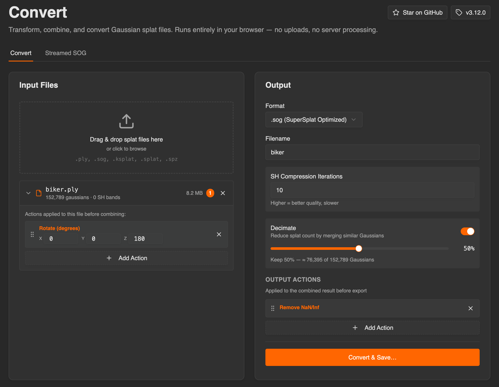
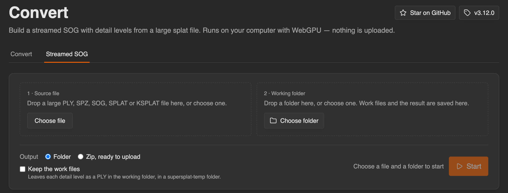

The [Convert page](https://superspl.at/convert) is a browser-based tool for converting splats between formats, transforming, filtering and decimating them, and combining several into one. There's no installation and no command line. It's the web frontend to the [splat-transform](/user-manual/splat-transform/) CLI, and its header shows which splat-transform release it runs.

Convert runs **entirely in your browser**. Your splats are never uploaded to a server: everything happens on your computer, and the result is saved back to it.

The page has two tabs:

- **[Convert](#converting-splats)** converts, transforms and combines splat files.
- **[Streamed SOG](#streamed-sog)** builds a Streamed SOG, with levels of detail, from a large splat.

## When to use Convert vs the CLI

Use the **Convert** page when you want a single one-off conversion, want to experiment interactively, or don't have Node.js installed. Use the [splat-transform CLI](/user-manual/splat-transform/) when you need to script conversions, batch many files, or integrate with a build pipeline.

## Converting splats {#converting-splats}

### Input files

Drag files onto **Input Files**, or click it to choose from your filesystem. It accepts:

- `.ply` — Standard PLY
- `.sog` — SuperSplat Optimized
- `.ksplat` — mkkellogg compressed format
- `.splat` — antimatter15 compressed format
- `.spz` — Niantic compressed format

Each file you add is listed with its Gaussian count, its spherical harmonic (SH) bands and its size. A file that can't be read shows **Unreadable or corrupt file**. When you add more than one file, they're combined into one output.

Click a file to show its own actions, which are applied to that file before the files are combined. A badge on the file shows how many it has.

### Output

| Setting | Description |
|---------|-------------|
| **Format** | The output format. See the table below. The default is **Standard PLY**. |
| **Filename** | The output file's name, without its extension. It starts as the first input file's name. |
| **SH Compression Iterations** | Shown for SOG and Embedded Viewer output. The number of clustering passes used to compress the spherical harmonics (`1–100`, default `10`). More iterations give better quality but take longer. |
| **Voxel Resolution** | Shown for Voxel Collision Bundle output. The voxel size in world units (default `0.05`). Smaller voxels give more detail but take longer. |
| **Opacity Cutoff** | Shown for Voxel Collision Bundle output. Voxels above this opacity are treated as solid (default `0.1`). |

| Format | Filename | Notes |
|--------|----------|-------|
| **Standard PLY** | `.ply` | Default. Largest; useful as a lossless interchange format. |
| **Compressed PLY** | `.compressed.ply` | Quantized PLY, smaller than standard PLY. |
| **SuperSplat Optimized** | `.sog` | Best compression for runtime use. |
| **Spreadsheet** | `.csv` | Per-Gaussian data dumped to CSV for spreadsheet or data analysis. |
| **Embedded Viewer** | `.html` | A self-contained `.html` file with the splat and the viewer. Open it locally with a double-click. |
| **Voxel Collision Bundle** | `.voxel.zip` | Voxel collision data for making your scene walkable in [Studio](/user-manual/supersplat/studio/collision). |

SOG, Embedded Viewer and Voxel Collision Bundle output are produced on the GPU, so they need a browser with WebGPU, such as Chrome or Edge 113 or later.

### Decimate

Turn on **Decimate** to reduce the splat count by merging similar Gaussians. The slider sets how many to keep, from 1% to 100% (default 50%), and shows the resulting count, such as **Keep 50% — ≈ 76,395 of 152,789 Gaussians**.

### Actions

Actions transform or filter the splat data. Each input file has its own actions, and **Output Actions** are applied to the combined result before it's written. Click **Add Action** to add one. Actions run top to bottom, in the order you add them. Click an action's close button to remove it.

**Transform actions:**

| Action | Parameters | Default |
|--------|-----------|---------|
| **Translate** | `X`, `Y`, `Z` | `0, 0, 0` |
| **Rotate (degrees)** | `X`, `Y`, `Z` | `0, 0, 0` |
| **Scale** | `Factor` | `1` (min `0.001`) |

**Filter actions:**

| Action | Parameters | Default |
|--------|-----------|---------|
| **Remove NaN/Inf** | _(none)_ | — |
| **SH Bands** | `Max Band`: `0` (DC only), `1`, `2` or `3` (Full) | `3` |
| **Bounding Box** | `Min X`, `Min Y`, `Min Z`, `Max X`, `Max Y`, `Max Z` | `±10` |
| **Sphere Filter** | `Center X`, `Center Y`, `Center Z`, `Radius` | center `0`, radius `10` |

### Converting

Click **Convert & Save…** to choose where to save the result, then convert. In browsers that can't save files directly, the button reads **Convert & Download** instead, and the result downloads when it's ready.

While it works, the page shows its progress and a log of messages from splat-transform. When it finishes, a **Data Summary** shows the **Total Gaussians**, the number of **Columns**, and the minimum, maximum and mean of each column.

## Streamed SOG {#streamed-sog}

The **Streamed SOG** tab, at [superspl.at/convert/streamed-sog](https://superspl.at/convert/streamed-sog), builds a [Streamed SOG](/user-manual/supersplat/publishing/streaming) from a large splat. It builds the levels of detail the viewer streams, then writes them as a Streamed SOG that you can [upload](/user-manual/supersplat/publishing/upload) or host yourself. It runs on your computer, using its GPU, and nothing is uploaded.

It needs desktop Chrome or Edge. It uses WebGPU, and it saves its work to a folder on your computer, which only those browsers can do.

### Building a Streamed SOG

1. Under **1 · Source file**, drop a PLY, SPZ, SOG, SPLAT or KSPLAT file, or click **Choose file**.
2. Under **2 · Working folder**, drop a folder, or click **Choose folder**. The tool saves its work files and the result there, so pick a drive with plenty of free space.
3. Check **What to expect**: how many levels of detail it will build, the free disk space it needs, and roughly how much memory it uses and how large the result is. SPZ and KSPLAT files need extra memory, because they're decompressed while they're prepared.
4. Choose the **Output**: a **Folder**, or a **Zip, ready to upload**. Tick **Keep the work files** to keep each level of detail as a PLY, in a `supersplat-temp` folder in the working folder.
5. Click **Start**.

The conversion runs in four steps, shown with their progress and an estimate of the time left:

| Step | What it does |
|------|--------------|
| **Prepare source** | Removes invalid and transparent splats, and sorts the rest spatially. |
| **Build detail levels** | Builds each level of detail. A splat with fewer than 1 million Gaussians needs no extra levels. |
| **Write streamed SOG** | Encodes the levels into the Streamed SOG. |
| **Clean up** | Removes the work files, unless you chose to keep them. |

When it's done, **Streamed SOG ready** shows where it was saved, with its number of levels, Gaussians, size and time taken. If you chose a zip, **Upload to SuperSplat** opens the upload page, where you choose the zip from your working folder.

### Pausing and resuming

A large conversion can take a long time. Click **Pause** to stop it; you can close the tab once it's paused. The step that was in progress restarts when you resume, and finished steps are kept.

When you come back, the page lists your **Unfinished conversions**, each with a **Resume** button. Chrome may ask you to allow access to the source file and the working folder again.

Canceling a conversion deletes its work files. Your source file is never changed.

Each file can only be converted in one tab at a time. Running two conversions at once in different tabs needs about twice the memory, and both run slower.

## See also

- [splat-transform CLI](/user-manual/splat-transform/) — the same actions and formats, for the command line
- [Streaming & Performance](/user-manual/supersplat/publishing/streaming) — how the viewer streams levels of detail
- [Direct Upload](/user-manual/supersplat/publishing/upload) — publish a finished splat without leaving the browser
- [Studio / Collision](/user-manual/supersplat/studio/collision) — what to do with a `.voxel.zip`
