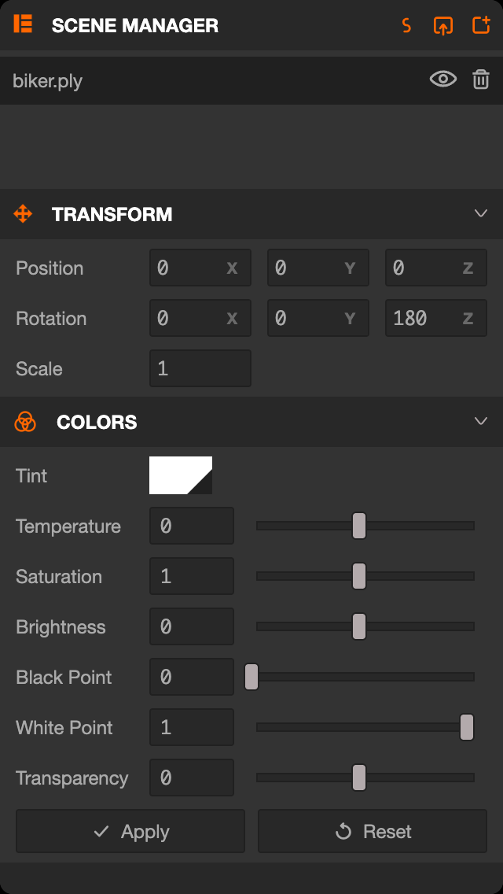

Two different sets of controls affect how a splat looks in SuperSplat:

- The **Colors** section of the Scene Manager changes the splat data itself: tint, temperature, saturation, brightness, tonal range, and transparency. These edits are saved and exported with the splat.
- The [mode strip](interface.md#mode-strip) and the viewport colors in [Preferences](interface.md#preferences) change only how the viewport draws the markers and the selection. They never modify the splat.

## Colors

Expand the **Colors** section at the bottom of the [Scene Manager](scene-management.md), below **Transform**, by clicking its header. The sliders hold a pending color grade that is previewed live in the viewport on the Gaussians it would affect: the current selection, or the whole active splat when nothing is selected. Click **Apply** to bake the grade into those Gaussians; the sliders then return to neutral, ready for the next adjustment. To grade one region differently from the rest, select it first.

### Controls

| Control | Range | Effect |
|---|---|---|
| **Tint** | color | Multiplies the color by the chosen tint. White leaves the source color unchanged. |
| **Temperature** | −0.5 to 0.5 | Shifts the result toward cooler (negative) or warmer (positive) tones. |
| **Saturation** | 0 to 2 | Reduces or increases color intensity. `1` leaves saturation unchanged. |
| **Brightness** | −1 to 1 | Darkens or brightens. `0` leaves brightness unchanged. |
| **Black Point** | 0 to 1 | Raises the darkest value that is mapped to black, increasing shadow clipping. |
| **White Point** | 0 to 1 | Lowers the brightest value that is mapped to white, increasing highlight clipping. |
| **Transparency** | −6 to 6 | Reduces (negative) or increases (positive) opacity relative to the source values. |

Black Point always stays below White Point: moving one into the other pushes the other along. **Reset** removes any grade already applied to the targeted Gaussians and returns the sliders to neutral. Changing the selection discards a pending grade that has not been applied. Apply and Reset are recorded in the edit history and can be undone and redone.

### A Practical Correction Workflow

1. Set the viewport tone mapping and background color in [Preferences](interface.md#preferences), so you are judging the scene in its intended viewing conditions.
2. Correct overall warmth with **Temperature**.
3. Adjust **Brightness**, then set **Black Point** and **White Point** to establish the tonal range.
4. Use **Saturation** and **Tint** for the final color balance.
5. Check the result from several camera angles. Spherical harmonic color can change with view direction.
6. Click **Apply**.

Tone mapping and the background color are view settings; the Colors section changes the splat itself.

### Copy and Paste a Grade

Right-click the **Colors** header and choose **Copy** to copy every slider value, or right-click a single row to copy just that value. The values are copied as plain JSON text, for example `{"tint":[1,1,1],"temperature":0.1,"saturation":1.2,"brightness":0,"blackPoint":0,"whitePoint":1,"transparency":0}`, so you can keep them in a note or paste them into another Editor session. **Paste** on the header accepts any subset of these keys, so `{"saturation":1.2}` changes only saturation; **Paste** on a row accepts a bare value or a copied section. **Tint** also accepts a hex color such as `#ffcc88`. Pasted values are clamped to each slider's range, and invalid clipboard contents change nothing and briefly flash the target red.

Copy and paste work on the pending grade shown in the sliders: click **Apply** after pasting to bake it in.

### Save and Export Behavior

Applied grades become part of the splat's color data, so they are stored in `.ssproj` projects and included in every export format. Click **Apply** before saving or exporting: a pending grade that has not been applied is only a preview.

## Markers and Selection Display {#appearance}

How the viewport draws markers and the selection is set on the [mode strip](interface.md#mode-strip) beside the View Cube. These settings are saved with your preferences and affect only the viewport. See [Selection Mode and X-Ray](editing-splats.md#selection-mode-and-x-ray) for how the mode and X-Ray change what the selection tools hit.

### Mode Options

Press and hold **Centers** or **Rings** on the mode strip to open its options. A short press just chooses the mode.

| Mode | Control | Default | Description |
|---|---|---|---|
| Centers | **Center Size** | 2 | Size of the center dots in pixels (0–10). |
| | **Splat Colors** | Off | Draw unselected center dots in the colors of their Gaussians instead of the unselected color. |
| Rings | **Ring Thickness** | 4 | Thickness of the ring outlines (1–50). |
| | **Splat Colors** | On | Draw unselected rings in the colors of their Gaussians instead of the unselected color. |

Selected markers always use the selected color.

### Markers Options

Press and hold **Markers** on the mode strip to open its options. A short press toggles the markers, like `Tab`.

| Control | Default | Description |
|---|---|---|
| **Markers Only** | Off | Hide the Gaussians themselves while the markers are shown, leaving only the dots or rings. |
| **Tint Selection** | Off | Tint the selected Gaussians with the selected color. |
| **Outline Selection** | Off | Draw an outline around the silhouette of the selection in the selected color. |

### Viewport Colors

The **Background Color**, **Selected Color**, **Unselected Color**, and **Locked Color** are set in the **Colors** section of the [Preferences](interface.md#preferences) popup. They are used by the markers, the selection tint and outline, and the [Splat Data](data-panel.md) histogram.

For per-Gaussian inspection and selection by color or other attributes, use the [Splat Data panel](data-panel.md). To animate the viewport camera after finishing the splat's appearance, see the [Timeline](timeline.md).
