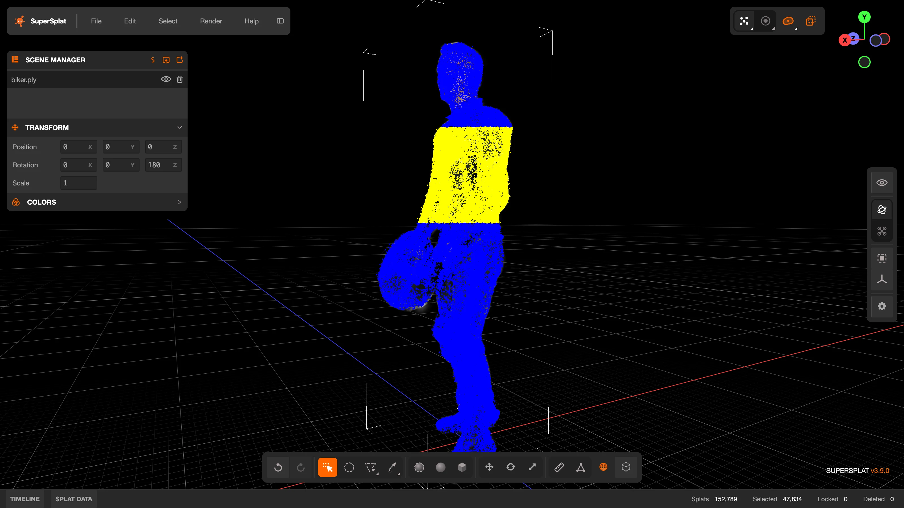
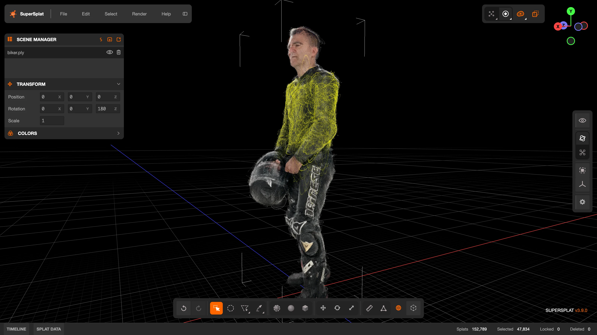

Select a splat in the **Scene Manager** before editing it. Gaussian selection and cleanup operations apply only to that active splat, even when several splats are visible.

## Selection Mode and X-Ray {#selection-mode-and-x-ray}

The [mode strip](interface.md#mode-strip) beside the View Cube controls how the 2D selection tools decide which Gaussians they hit, and shows you what a drag would select.

| Control | Shortcut | Setting | Effect |
|---|---|---|---|
| **Centers** / **Rings** | <kbd>M</kbd> | **Centers** (default) | Selects by center: a Gaussian is picked when its center point falls inside the tool's shape. A dot marks each Gaussian center. |
| | | **Rings** | Selects by footprint: a Gaussian is picked when any part of its projected ellipse falls inside the shape, so large, soft Gaussians at the edge of a selection are included. A ring outlines each footprint. |
| **X-Ray** | <kbd>N</kbd> | On (default) | Selects through the whole scene: every Gaussian under the tool's shape is picked, regardless of what is in front of it. |
| | | Off | Selects only the visible surface: Gaussians hidden behind others are left alone. Turn X-Ray off to clean the surface of a scene without punching through it. |

The mode, Markers, and X-Ray settings are remembered between sessions.

### Markers

The center dots and rings are called markers. Press <kbd>Tab</kbd> (or click **Markers** on the mode strip) to show or hide them on the unselected Gaussians. Markers are off by default, so you see the plain rendered splat; switching mode turns them on. Hiding the markers does not change how selection works, and selected Gaussians keep their indicators: a dot or ring in the selection color (yellow by default).

A marker's color shows its selection state. Selected markers always use the selection color. Unselected center dots use the unselected color (blue by default), while unselected rings take the colors of their Gaussians. With X-Ray off, unselected markers are drawn only on the Gaussians a selection could reach from the current view, so you can see what a drag would pick before you make it. Selected markers are always drawn. Marker size, colors, and the selection tint and outline are set from the mode strip's press-and-hold menus; see [Markers and Selection Display](color-and-appearance.md#appearance).

Locked and deleted Gaussians cannot be selected. Fully transparent Gaussians can, which makes it possible to clean up invisible leftovers that still cost memory and rendering time.

## Selection Tools

Each Scene Manager row represents an imported splat, while the selection tools act on individual Gaussians within the active splat. Use these tools to crop a splat or remove unwanted Gaussians:

| Tool | Description |
|------|-------------|
|  **Rectangle Selection** (<kbd>R</kbd>) | Click to select a single Gaussian, or click and drag to select everything inside a rectangle. This is the default selection tool. |
|  **Brush Selection** (<kbd>B</kbd>) | Click and drag to paint a selection with a circular brush. Adjust the brush size with the <kbd>[</kbd> (decrease) and <kbd>]</kbd> (increase) keys, or with <kbd>Alt</kbd> + mouse wheel. Ideal for organic selection work. |
|  **Polygon Selection** (<kbd>P</kbd>) | Click to place the vertices of a polygon. Press <kbd>Backspace</kbd> to remove the last placed point. Close the shape by clicking the first point, double-clicking, or pressing <kbd>Enter</kbd>. Useful for precise selections with straight edges. Shares a toolbar button with Lasso Selection. |
|  **Lasso Selection** (<kbd>L</kbd>) | Click and drag to draw a freeform shape. Gaussians within the outline are selected. Shares a toolbar button with Polygon Selection. |
|  **Eyedropper Selection** (<kbd>Ctrl</kbd>+<kbd>E</kbd>) | Click the viewport to select Gaussians of a similar color. A threshold slider (0–1) controls the sensitivity of the color match. Shares a toolbar button with Flood Selection. |
|  **Flood Selection** (<kbd>O</kbd>) | Click the viewport to grow a 2D selection from that point with a flood fill. A threshold slider (0–1) controls its sensitivity. Particularly useful for isolated stray Gaussians (floaters). Shares a toolbar button with Eyedropper Selection. |
|  **Sphere Brush Selection** (<kbd>Shift</kbd>+<kbd>B</kbd>) | Paint a selection in 3D. Each point of the stroke is projected onto the surface under the cursor and selects the Gaussians inside a sphere there, so the brush follows the surface instead of selecting through the scene. The brush size is shared with Brush Selection (<kbd>[</kbd>, <kbd>]</kbd>, <kbd>Alt</kbd> + mouse wheel) and maps to a world-space radius at the picked depth. |
|  **Sphere Selection** | Creates a 3D spherical volume for volumetric selection. Double-click anywhere in the scene to position the sphere center. Move and Scale buttons in the toolbar (or the <kbd>1</kbd> and <kbd>3</kbd> keys) switch the sphere's gizmo — dragging the scale gizmo's center handle changes the radius — or enter its **Position** (X, Y, Z) and **Radius** numerically. Click **Set**, **Add**, **Remove**, or **Intersect** to apply the volume to the current selection. |
|  **Box Selection** | Creates a 3D box for volumetric selection. Double-click anywhere in the scene to position the box center. Move, Rotate, and Scale buttons in the toolbar (or the <kbd>1</kbd>, <kbd>2</kbd>, and <kbd>3</kbd> keys) switch the box's gizmo, so the box can be freely positioned, rotated, and resized — or enter its **Position** (X, Y, Z) and **Size** (X, Y, Z) numerically. While the rotate gizmo is active, the **Size** fields are replaced by **Rotation** fields (enter `0, 0, 0` to reset the orientation). Click **Set**, **Add**, **Remove**, or **Intersect** to apply the volume to the current selection. Ideal for selecting Gaussians within a specific region of 3D space. |

Two of the toolbar buttons hold a pair of tools: **Polygon** / **Lasso** and **Eyedropper** / **Flood**. Click the button to activate the tool it currently shows, or press and hold it to choose the other; the button then remembers your choice. The keyboard shortcuts always activate a specific tool.

### Selection Modifiers {#selection-modifiers}

The 2D selection tools and the Sphere Brush support modifier keys to control how the selection is applied:

| Modifier | Action |
|----------|--------|
| **None** | Replace the current selection with the new selection |
| <kbd>Shift</kbd> | Add to the current selection |
| <kbd>Ctrl</kbd> | Remove from the current selection |
| <kbd>Shift</kbd>+<kbd>Ctrl</kbd> | Keep only Gaussians that are in both the current selection and the new selection |

While one of these tools is active, the cursor shows which operation the current modifier keys will apply. A plain crosshair means **Set**; a badge on the crosshair indicates **Add** (`+`), **Remove** (`−`), or **Intersect** (`∩`). The same feedback appears when selecting a value range in the [Splat Data panel](data-panel.md).

The 3D volume tools (Sphere Selection and Box Selection) have **Set**, **Add**, **Remove**, and **Intersect** buttons in their toolbar instead of using modifier keys. Their volumes are transformed with the same gizmos as the transform tools: clicking the active gizmo mode button again hides the gizmo, the gizmo follows the local/world coordinate-space toggle, and volume edits are undoable while the tool is active. Press <kbd>F</kbd> to frame the volume in the viewport.

## Lock, Delete, and Restore {#lock-delete-and-restore}

Use **Select > Lock Selection** or press <kbd>H</kbd> to lock the selected Gaussians. Locking clears the selection and prevents those Gaussians from being selected or deleted. This is useful for protecting a finished area while you clean nearby geometry. Choose **Select > Unlock All** or press <kbd>Shift</kbd>+<kbd>H</kbd> to unlock all locked Gaussians in the active splat.

Delete selected Gaussians with **Select > Delete Selection**, <kbd>Delete</kbd>, or <kbd>Backspace</kbd>. Deletion is non-destructive while you edit: use Undo to reverse the latest deletion, or choose **Select > Reset Splat** to restore all deleted Gaussians in the active splat. Reset Splat does not unlock locked Gaussians.

Lock, unlock, delete, and reset operations are recorded in the edit history. Removing an entire row from the Scene Manager is different and cannot be undone.

## Duplicate and Separate a Selection {#duplicate-and-separate-a-selection}

When a Gaussian selection exists, the **Edit** menu provides two ways to turn it into another splat:

- **Duplicate** copies the selected Gaussians into a new splat and keeps the originals unchanged.
- **Separate** creates a new splat from the selected Gaussians and deletes them from the original splat.

Both operations can be undone and are useful for giving one region its own transform or visibility.

## Cleanup Recipes

### Remove Floaters

1. Turn off **X-Ray** (<kbd>N</kbd>) so selections stop at the visible surface, and press <kbd>Tab</kbd> if you want to see the markers while you work.
2. Use Flood Selection for an isolated patch, or Lasso, Brush, Sphere Brush, Sphere, or Box Selection for a larger region.
3. Rotate the camera and add to or remove from the selection until the intended geometry is isolated.
4. Press <kbd>Delete</kbd> or <kbd>Backspace</kbd>.
5. Inspect the result from several angles and use Undo if too much was removed.

### Crop a Splat

1. Select the region you want to keep with Box, Sphere, Lasso, or Polygon Selection. Leave **X-Ray** on so the selection reaches through the whole scene.
2. Choose **Select > Invert**.
3. Delete the inverted selection.
4. Export the cleaned result, or save an `.ssproj` if you want to preserve the splat and project setup.

### Protect Finished Areas

Select a finished region and press <kbd>H</kbd> to lock it. Continue cleaning the remaining selectable Gaussians, then press <kbd>Shift</kbd>+<kbd>H</kbd> when you need to edit the protected region again.

For attribute-driven cleanup, use the [Splat Data panel](data-panel.md) to select ranges such as low opacity or extreme scale values.

## Next Step

Continue to [Transform, Measure and Align](transform-measure-align.md) to transform selected Gaussians or whole splats, calibrate scale, align captures and merge visible splats.
