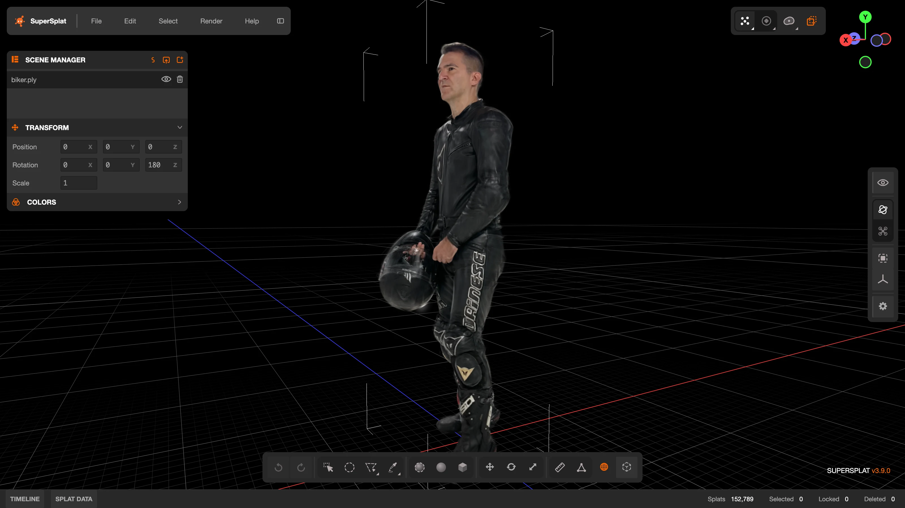

The [SuperSplat Editor](https://superspl.at/editor) is the open-source, browser-based editor at the heart of the [SuperSplat platform](../). It's the tool you use to clean up raw splat captures, trim floaters, crop scenes, retouch colors, build camera animations, and publish a finished splat ready to share. The Editor is [open source on GitHub](https://github.com/playcanvas/supersplat) under the MIT license and runs entirely in your browser — nothing is uploaded until you choose to publish.

If your splat is already clean, you can skip the Editor and [upload it directly](/user-manual/supersplat/publishing/upload/).

## Video Tutorials

### Introduction to SuperSplat

A great way to learn the basics of the SuperSplat Editor is to watch this video introduction:

    <iframe width="560" height="315" src="https://www.youtube.com/embed/MwzaEM2I55I" title="SuperSplat Basics" allowfullscreen></iframe>

### In-Depth Tutorial

For a more comprehensive guide to using the SuperSplat Editor, check out this in-depth tutorial:

    <iframe width="560" height="315" src="https://www.youtube.com/embed/J37rTieKgJ8" title="SuperSplat In-Depth Tutorial" allowfullscreen></iframe>

## System Requirements {#system-requirements}

- **A WebGPU-capable browser** — Current Chrome or Edge, Safari 26 or later, or Firefox with WebGPU enabled. If WebGPU is unavailable, the Editor shows a message at startup instead of loading.
- **GPU acceleration** — Keep hardware acceleration enabled in your browser. A dedicated GPU helps with very large splats.
- **Nothing to install** — Everything runs in the browser. You can optionally install the Editor as an app from the browser's address bar; it then opens `.ply`, `.splat`, `.sog`, `.spz`, `.ksplat`, and `.ssproj` files directly from your file manager.

## What's next?

- New to SuperSplat? [Getting Started](/user-manual/supersplat/getting-started/) takes a splat from import to a published scene in about ten minutes
- Get oriented with the [Interface Overview](interface)
- Learn the supported [Import and Export](import-export) formats
- Clean a capture with [Selection and Cleanup](editing-splats), then use [Transform, Measure and Align](transform-measure-align) to prepare it
- Work with multiple captures using [Managing Splats](scene-management), and finish their look with [Color and Appearance](color-and-appearance)
- Keep the [Keyboard Shortcuts](keyboard-shortcuts) reference nearby, or check [Troubleshooting](troubleshooting) when a workflow does not behave as expected
- Once your splat is clean, [Publish](/user-manual/supersplat/publishing/editor/) it to superspl.at to land on your [Manage page](/user-manual/supersplat/publishing/manage/) and open it in [Studio](../studio/)
- Let an AI agent inspect and edit your scene through the browser's experimental [WebMCP](webmcp) tools
