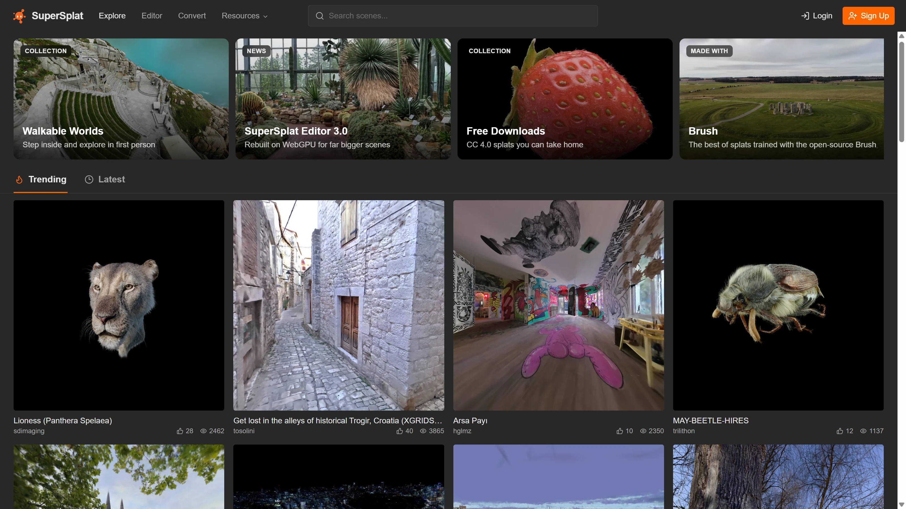
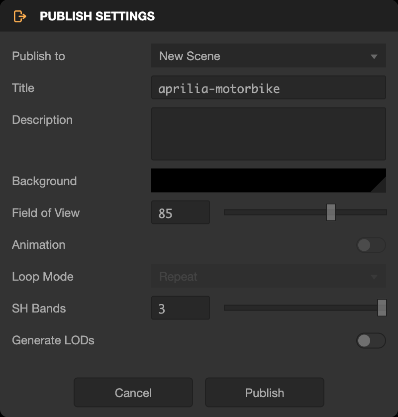

Publishing from the SuperSplat Editor uploads your edited splat to [superspl.at](https://superspl.at), where it lands on your [Manage page](/user-manual/supersplat/manage), gets a public [scene page](/user-manual/supersplat/scene-page), and can be opened in [Studio](/user-manual/supersplat/studio/) to curate the viewing experience (cameras, camera animation, annotations, post effects, skybox, collision).

:::tip Two ways to publish

You can also publish without using the Editor. Hit the orange **Upload Splat** button on the [superspl.at home page](https://superspl.at) (or use the [Direct Upload](/user-manual/supersplat/upload) flow) to publish a ready-made splat file straight to your Manage page. Both paths land in the same place and share the same downstream tooling.

:::

To self-host your own copy of the published viewer instead of (or in addition to) publishing to superspl.at, see [Self-Hosting the Viewer](/user-manual/supersplat/viewer/self-hosting).

## Ensuring you are Logged In

Publishing splats requires you to be logged in.

Before you begin, you must have [created a PlayCanvas account](/user-manual/account-management/user-accounts/account-creation) and be logged in at [playcanvas.com](https://playcanvas.com). You must then also log in at [superspl.at](https://superspl.at) (via the `Login` button in the top right). Verify you are logged in by checking that your account avatar is displayed in the top right of the page on [superspl.at](https://superspl.at).

## Publishing your Splats

To publish your splat:

1. Open the `File` menu.
2. Select `Publish`.
3. Fill out the options in the Publish dialog:

   

   | Option | Description |
   |--------|-------------|
   | **Publish to** | Select where to publish your scene. Choose **New Scene** (default) to publish a brand new scene on a new URL, or select one of your existing published scenes from the dropdown to overwrite it |
   | **Title** | A short title that will appear below your splat's thumbnail once it is published |
   | **Description** | A textual description of your splat that will be displayed under the splat on its viewer page |
   | **Background** | The background color of the viewer. Defaults to the Editor's current background color (set in the **Colors** section of the [Preferences](interface.md#preferences) popup) |
   | **Field of View** | The field of view of the viewer's camera in degrees, measured across the longer side of the screen. Defaults to the Editor camera's current setting |
   | **Animation** | If enabled, the camera animation authored on the [Timeline](timeline.md) is baked into the scene and plays when it loads. Only available when the Timeline has keyframes (and enabled by default in that case) |
   | **Loop Mode** | How an included camera animation plays back in the viewer: • **None**: Play once and stop • **Repeat**: Loop continuously • **Ping Pong**: Play forwards, then backwards, repeatedly Initialized from the Timeline's Loop toggle - **Repeat** if looping is enabled, **None** otherwise |
   | **SH Bands** | The number of spherical harmonic bands to publish (0–3). Defaults to the highest band count in the scene, capped by the **SH Bands** setting in [Preferences](interface.md#preferences). Choosing more bands than the scene contains fills the missing ones with zeros |
   | **Generate LODs** | Generate levels of detail so the published splat is streamed progressively. Automatically enabled for scenes with 1 million or more splats that span a large area. Scenes with more than 40 million splats (not counting deleted ones) must be published with LODs: the toggle is switched on and disabled, with a note saying it is required. See [Streaming & Performance](/user-manual/supersplat/streaming) |

4. Select `Publish`.

If your account cannot publish another model right now, the dialog says why and `Publish` is disabled. This happens when you have used today's publishing allowance (the message says when you can publish again) or when you already have the maximum number of scenes processing (you can publish again when one finishes). Updating only the animation of an existing scene is still allowed, since no model is uploaded.

The published scene's camera starts at the pose your viewport camera has at the moment you publish, so frame your favorite view before opening the dialog.

:::note

New scenes are published unlisted - they are only discoverable by people who have the link. To make a splat appear in [Explore](/user-manual/supersplat/explore) and in searches on superspl.at, set its **Visibility** to **Public** on your [Manage page](/user-manual/supersplat/manage) after publishing.

:::

:::note

It may take several minutes to compress your splat to SOG format during the publishing process, so be patient! ⏳

:::

Once the publish process is complete, a modal dialog will show with the URL of your published splat. Copy it and share it with whoever you like. If publishing fails, the **Publish Failed** dialog shows the error, including the reason given by superspl.at when it refuses an upload.

## Republishing to an Existing Scene

Setting **Publish to** to one of your existing scenes overwrites that scene in place. The scene keeps its URL, title, description, and [Studio](/user-manual/supersplat/studio/) settings, so the dialog hides **Title**, **Description**, **Background**, **Field of View**, and **Animation**. Instead, two toggles choose what gets replaced (**SH Bands** and **Generate LODs** are hidden when only the animation is replaced):

| Option | Description |
|--------|-------------|
| **Override Model** | Replace the scene's splat model with the currently loaded scene |
| **Override Animation** | Replace the scene's camera animation with the current Timeline animation |

At least one of the two must be enabled to publish. Overriding only the animation is a quick way to update a published camera path without re-uploading (and re-compressing) the splat data itself.

## What's next?

- Your new splat now lives on the [Manage page](/user-manual/supersplat/manage) where you can edit its title, description, visibility, and downloadable license.
- Open it in [Studio](/user-manual/supersplat/studio/) to frame its camera, animate it, or add annotations, post effects, a skybox, or collision geometry.
- Visitors browse to its [public scene page](/user-manual/supersplat/scene-page) to view, share, embed, like, and (if you allow it) download.
