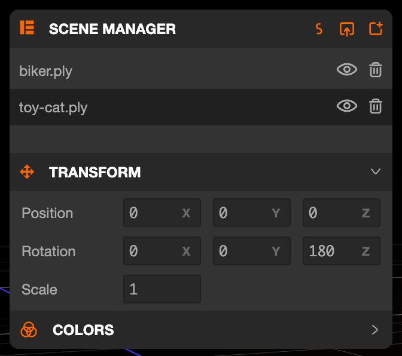

The **Scene Manager** lists the splats in the current project. Each splat file you import appears as a separate row. This makes it possible to assemble several captures, compare revisions, or align independently captured areas before exporting them together.

## The Active Splat

Click a row to make that splat active. The active splat is the target for:

- Gaussian selection and editing
- The **Transform** and **Colors** sections of the Scene Manager, and the **Splat Data** panel
- Camera focus and measurement tools

Only one splat can be active at a time. Selecting a row does not change its visibility.

## Transform and Colors

Below the splat list, the **Transform** section shows the active splat's **Position**, **Rotation**, and **Scale** for precise numeric edits (see [Transform, Measure and Align](transform-measure-align.md)). The **Colors** section below it grades the color of the active splat, or of the selected Gaussians, and bakes the result with **Apply** (see [Color and Appearance](color-and-appearance.md#colors)). Click a section's header to collapse or expand it; **Transform** starts expanded and **Colors** collapsed.

Right-click a section header to copy or paste all of its values, or right-click a row to copy or paste one value. Values travel through the system clipboard as plain JSON text, which makes it easy to give several splats the same transform or color grade.

## Add Splats

Use **File > Import** (or **File > Import Recent** for a file you have loaded before), the import button in the Scene Manager header, or drag supported files into the viewport. Importing adds splats to the current project; it does not replace splats that are already loaded. When you pick or drop a mixed set of files, the **Import Files** dialog lets you choose which of them to import (see [Importing Several Files](import-export.md#importing-several-files)).

**File > New** is different: it starts a new, empty project after asking for confirmation if the current project contains data.

See [Import and Export](import-export.md) for supported formats and multi-file import requirements.

## Visibility and Solo Mode

Click the eye icon on a splat row to show or hide it. Hidden splats are excluded from splat exports, so check visibility before exporting a combined result.

Use the **Solo** button in the Scene Manager header when you want to work on one splat without changing your visibility setup:

1. Select a splat.
2. Enable **Solo** to hide every other splat.
3. Select another row to switch which splat is shown.
4. Disable **Solo** to restore the visibility state that existed before Solo mode was enabled.

If you import a splat while Solo mode is active, select its row to view it.

## Rename and Remove Splats

Double-click a splat name to rename it. Renaming can be undone and redone.

Click the trash icon on a splat row to remove the entire splat from the project. Removing a splat cannot be undone. This is different from deleting selected Gaussians, which is recorded in the edit history and can be undone. Save an `.ssproj` copy first if you may need the splat later.

## Assemble Multiple Captures

A typical multi-splat workflow is:

1. Import all captures.
2. Use Solo mode to inspect and clean each splat independently.
3. Use the [transform tools](transform-measure-align.md) to position, rotate and scale each splat.
4. Show the splats together and check their alignment from several camera angles.
5. Hide any splat that should not be included.
6. Choose **File > Export > PLY** to combine the visible splats into one PLY file.

Saving with **File > Save** creates an editable `.ssproj` project instead of a merged PLY. See [Managing Projects](managing-projects.md).
