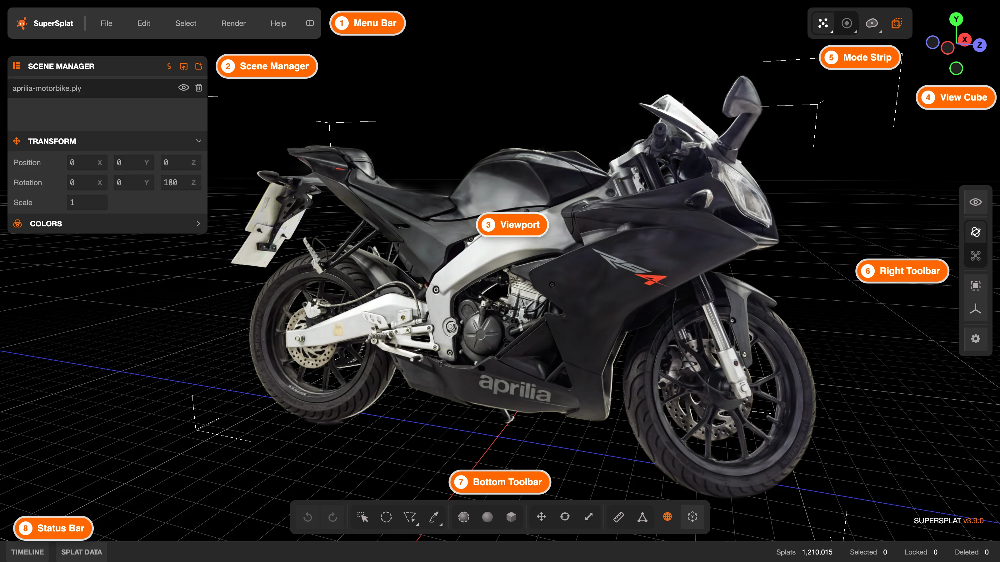
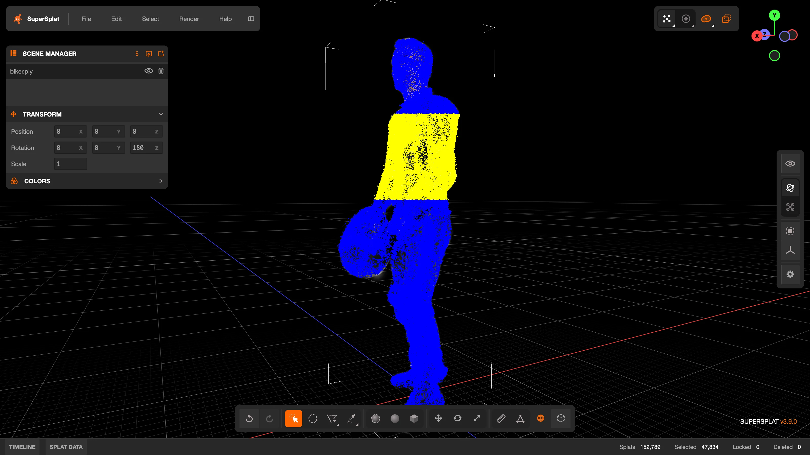
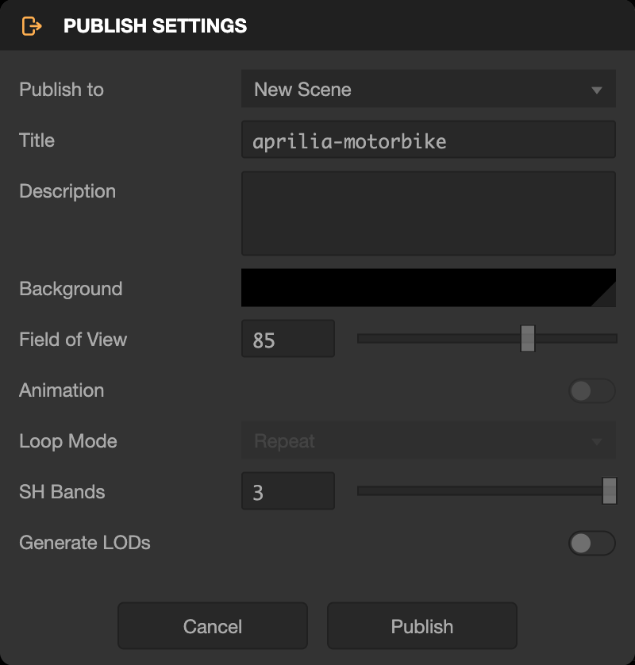
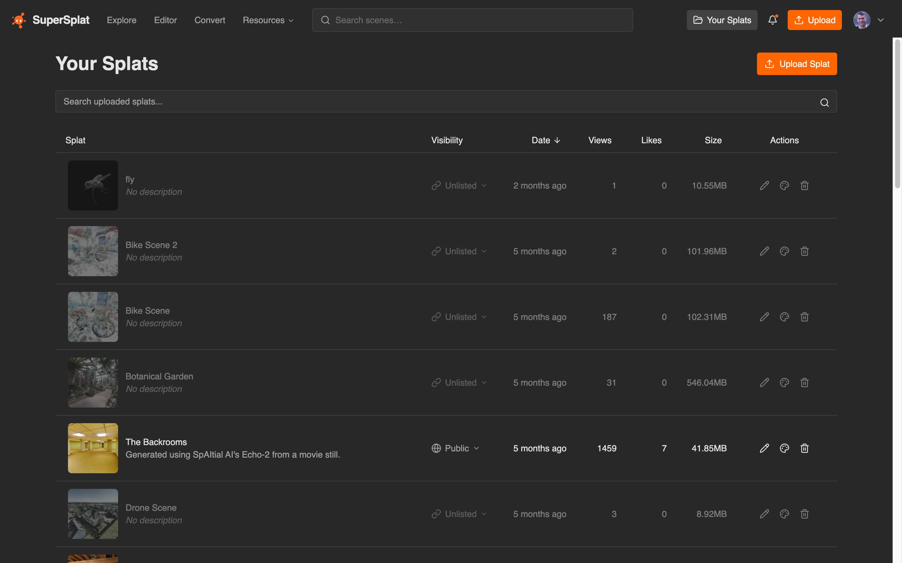
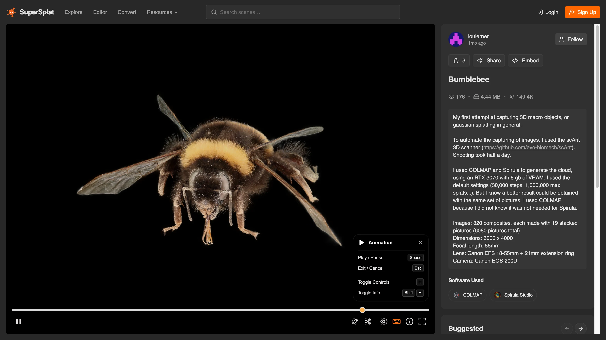

This guide takes a raw splat file all the way to a published, shareable scene page. It takes about ten minutes and touches every part of the SuperSplat workflow: **Editor → Publish → Studio → Share**.

## Before you start

- **A splat file.** Any `.ply` produced by a Gaussian splatting trainer works, as do `.compressed.ply`, `.sog`, `.splat`, `.ksplat`, `.spz`, and XGRIDS `.lcc` files. Don't have one yet? [Creating Splats](/user-manual/gaussian-splatting/creating/) explains how captures are made and [Recommended Tools](/user-manual/gaussian-splatting/creating/recommended-tools) compares the apps that produce them. Or practice on the sample biker: [open it in the Editor](https://superspl.at/editor?load=https://raw.githubusercontent.com/willeastcott/assets/main/biker.ply).
- **A free PlayCanvas account** for step 3. Loading and editing don't need one; publishing does. See [Account Creation](/user-manual/account-management/user-accounts/account-creation).
- **A browser with WebGPU.** See the Editor's [System Requirements](/user-manual/supersplat/editor/#system-requirements). There is nothing to install.

## 1. Load your splat in the Editor

Open [superspl.at/editor](https://superspl.at/editor) and drop your file anywhere in the window. You can also use **File → Import**.

Once the splat appears, get your bearings:

| Do this | To |
|---------|----|
| Left-drag | Orbit around the focal point |
| Right-drag | Pan |
| Mouse wheel | Zoom |
| Double-click | Set the focal point |
| Press <kbd>F</kbd> | Focus the camera on the current selection |

If the scene is on its side or upside down, select it in the **Scene Manager** and rotate it upright with the transform controls. See [Transform, Measure and Align](editor/transform-measure-align.md). The full list of controls is in [Camera Controls](editor/camera-controls.md).

## 2. Clean it up

Most raw captures contain **floaters**: stray Gaussians hanging in space where the trainer wasn't sure what it saw. Removing them is the single biggest quality win.

1. Turn off **X-Ray** on the mode strip at the top right of the viewport (or press <kbd>N</kbd>) so selections stop at the visible surface, and turn on **Markers** (or press <kbd>Tab</kbd>) to show the Gaussian centers.
2. Pick a selection tool from the toolbar: **Brush Selection** to paint over floaters, **Sphere Brush** to paint in 3D along a surface, **Sphere Selection** or **Box Selection** to grab a 3D region, or **Flood Selection** for an isolated patch. Hold <kbd>Shift</kbd> to add to the selection and <kbd>Ctrl</kbd> to remove from it.
3. Press <kbd>Delete</kbd>. Rotate the camera, check from another angle, and repeat.
4. Removed too much? Use **Edit → Undo**, or **Select → Reset Splat** to restore every deleted Gaussian.

To crop away everything outside your subject, select the region to keep with Box or Sphere Selection, choose **Select → Invert**, and delete. [Selection and Cleanup](editor/editing-splats.md) covers every tool plus more cleanup recipes, and [Color and Appearance](editor/color-and-appearance.md) is where you fix exposure and tint.

:::tip Save your work

Choose **File → Save** to keep an `.ssproj` project file. It preserves your edits and project setup so you can pick up where you left off. See [Managing Projects](editor/managing-projects.md).

:::

## 3. Publish

1. Make sure you are logged in at [superspl.at](https://superspl.at) (the **Login** button in the top right). Your avatar appears there when you are.
2. Frame your favorite view. The published scene opens with the camera exactly where you leave it.
3. Choose **File → Publish**, give the splat a **Title** and a **Description**, and click **Publish**.

Compression to SOG takes a moment, and several minutes for very large scenes. When it finishes, a dialog shows the URL of your new [scene page](/user-manual/supersplat/viewing/scene-page/). New splats are **Unlisted**: anyone with the link can view them, but they won't appear in Explore until you make them Public in step 5.

:::tip Already clean?

If your file needs no editing, skip the Editor. The orange **Upload Splat** button on superspl.at publishes it directly. See [Direct Upload](/user-manual/supersplat/publishing/upload/).

:::

Every option in the dialog, including republishing to an existing scene, is covered in [Publishing from the Editor](/user-manual/supersplat/publishing/editor/).

## 4. Curate it in Studio

Your splat now appears on your [Manage page](/user-manual/supersplat/publishing/manage/). Click **Open in Studio** in its row, or **Edit in Studio** on your scene page, to open [Studio](studio/index.md), where you shape what visitors see.

Three things worth doing on a first pass:

- **Frame the opening shot.** In the **Scene** tab, under **Cameras**, frame your best angle and click **Set camera to current view** so visitors start there. See [Cameras](studio/cameras.md).
- **Add a hotspot.** Frame a detail, press <kbd>C</kbd>, click the spot you want to annotate, and give it a title and some text. Visitors click through hotspots like a guided tour. See [Annotations](studio/annotations.md).
- **Add some polish.** Pick a **Tonemapping** curve under **Look & Tone**, or try a **Vignette** or some **Color Grading** under **Post Effects**. See [Look & Tone](studio/look-and-tone.md) and [Post Effects](studio/post-effects.md).

<video autoPlay muted loop controls src='/video/supersplat-studio-edit-camera.mp4' style={{width: '100%', height: 'auto'}} />

Click **Save** in the header when you're happy. Edits are not saved automatically. Each save publishes the complete settings, so visitors see the update as soon as they reload.

## 5. Share it

Open your [scene page](/user-manual/supersplat/viewing/scene-page/) at `superspl.at/scene/<hash>`.

- **Share** copies the link or posts it to social platforms.
- **Embed** gives you an `<iframe>` snippet for your own website. Later Studio changes show up there automatically.
- To let visitors download your splat, enable **Downloadable** and pick a Creative Commons license on the [Manage page](/user-manual/supersplat/publishing/manage/).
- To appear in [Explore](/user-manual/supersplat/viewing/explore/) and in search results, switch **Visibility** to **Public** in Manage.

## Where next?

- [Keyboard Shortcuts](editor/keyboard-shortcuts.md) to speed up cleanup.
- [Timeline](editor/timeline.md) to animate the camera and publish a flythrough.
- [Collision](studio/collision.md) to make a scene walkable in first person.
- [Convert](convert.md) to change formats or shrink a splat without leaving the browser.
- [Self-Hosting the Viewer](/user-manual/supersplat/developers/self-hosting/) to export a single HTML file you can host anywhere.
- [API & Integrations](/user-manual/supersplat/developers/api-integrations/) to publish from your own pipeline.
