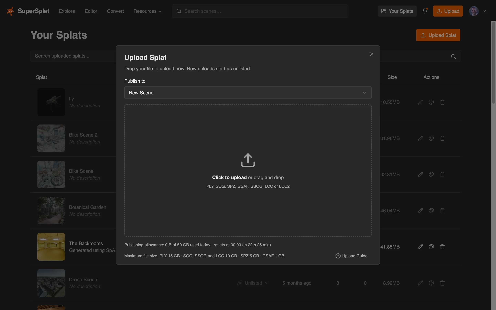

If you already have a clean splat file, you don't need to use the [SuperSplat Editor](/user-manual/supersplat/editor/) to publish it. The **Direct Upload** flow lets you push a finished splat straight to your [Manage page](/user-manual/supersplat/publishing/manage), where you can open it in [Studio](/user-manual/supersplat/studio/) or share its [scene page](/user-manual/supersplat/viewing/scene-page).

This is the right path when:

- Your splat is already clean (no floaters, no unwanted background, sized appropriately).
- You produced the splat in another tool — a training pipeline, a smartphone scanner, or via the [Convert](/user-manual/supersplat/convert) utility or the [splat-transform](/user-manual/splat-transform/) CLI.
- You want to publish quickly without round-tripping through the Editor.

## Launching the Upload dialog

There are three ways to open the Upload Splat dialog:

- The orange **Upload Splat** button on the [superspl.at home page](https://superspl.at). The fastest path if you're not already logged in or in the manage view — you'll be prompted to sign in.
- The **Upload Splat** button on the [Manage page](/user-manual/supersplat/publishing/manage).
- Navigating to [superspl.at/upload](https://superspl.at/upload), which redirects to the Manage page with the dialog open.

You must be signed in with a PlayCanvas account to upload. See [Account Creation](/user-manual/account-management/user-accounts/account-creation).

## Supported input formats

Drag and drop, or pick from your filesystem. The dialog accepts these formats, each up to its own maximum size. Its **Upload Guide** summarizes them. Below the drop area, the dialog also shows how much of today's [publishing allowance](/user-manual/supersplat/publishing/#limits) you've used and when it resets.

| Format | File to upload | Maximum size | How it is validated |
|--------|----------------|--------------|---------------------|
| **PLY** | `.ply` | 15 GB | A PLY file containing Gaussian splat data. A PLY that holds only a mesh or a point cloud is rejected. |
| **SPZ** | `.spz` | 5 GB | A readable SPZ file. |
| **SOG** | `.sog` | 10 GB | Contains one `meta.json` file and the expected SOG WebP payload files. |
| **GSAF** | `.gsaf` | 1 GB | An animated splat sequence, recognized by the `GSAF` header at the start of the file. Playing its animation needs WebGPU, and downloads aren't available for GSAF scenes yet. |
| **Streamed SOG bundle (SSOG)** | `.zip` | 10 GB | Contains `lod-meta.json` and one or more SOG chunk folders. See [Streaming & Performance](/user-manual/supersplat/publishing/streaming). |
| **LCC or LCC2** | `.zip` | 10 GB | Contains exactly one `.lcc2` file, or exactly one `.lcc` file with sibling `index.bin` and `data.bin` files. |

The file contents are validated after selection. Direct Upload does not accept `.compressed.ply`, `.ksplat`, or `.splat` files directly. Use the [Convert](/user-manual/supersplat/convert) utility or the [splat-transform CLI](/user-manual/splat-transform/) to convert those first, or to bring a file under its format's maximum size.

### Levels of detail

When you choose a PLY or SPZ file, the dialog shows an **Auto generate LODs** checkbox. When it is ticked, the splat is published as a progressively streamed [Streamed SOG](/user-manual/supersplat/publishing/streaming) instead of a single SOG file. It is ticked automatically for splats of 1 million Gaussians or more, and you can change it before uploading. Splats of more than 40 million Gaussians must be streamed, so for them it is ticked and locked. SOG files are always published as a single file, while SSOG and LCC archives are always streamed.

## What happens after upload

The dialog moves through four stages:

1. **Select** — choose a file (or drop one in).
2. **Ready** — the file is validated locally. You can change it before continuing.
3. **Uploading** — the file streams to PlayCanvas storage.
4. **Publishing** — the platform creates the scene record.

When publishing completes, the dialog switches to the **Edit Splat** view for the newly created scene so you can immediately fill in metadata. The defaults are deliberately conservative:

| Field | Default |
|-------|---------|
| **Title** | Your filename with the extension removed |
| **Description** | _(empty)_ |
| **Visibility** | **Unlisted** — your splat is reachable only via its direct URL |
| **Downloadable** | **Off** — visitors can view but not download the source file |

From the Edit Splat view, you can:

- Adjust **Title** and **Description**.
- Tag the **Software Used** to capture or train the splat (visible as chips on the [scene page](/user-manual/supersplat/viewing/scene-page)).
- Flip **Visibility** to **Public** to make the splat appear in [Explore](/user-manual/supersplat/viewing/explore) searches.
- Enable **Downloadable** and pick a [Creative Commons license](/user-manual/supersplat/publishing/manage#downloadable--license).
- **View** the public [scene page](/user-manual/supersplat/viewing/scene-page), or **Open in Studio** to curate the viewing experience.

## Errors

| Error | Cause |
|-------|-------|
| **Unrecognized Format** | The file does not match one of the supported structures above. |
| **No Gaussian Splat Data** | The file is a valid PLY, but it holds a mesh or a point cloud rather than a Gaussian splat. |
| **File Too Large** | The file is larger than its format's maximum size. The message gives both sizes. |
| **Upload Failed** | Network interruption or a server-side issue. Try again; if the problem persists, check your connection. |

Your account's [publishing limits](/user-manual/supersplat/publishing/#limits) also apply. When you reach one, the dialog says so (**Publishing Allowance Used** or **Scenes Still Processing**) and when you can upload again.

## See also

- [Publishing from the Editor](/user-manual/supersplat/publishing/editor) — the alternative path that goes through the SuperSplat Editor
- [Manage](/user-manual/supersplat/publishing/manage) — what to do with your splat once it's uploaded
- [Studio](/user-manual/supersplat/studio/) — curate the viewing experience for a published splat
