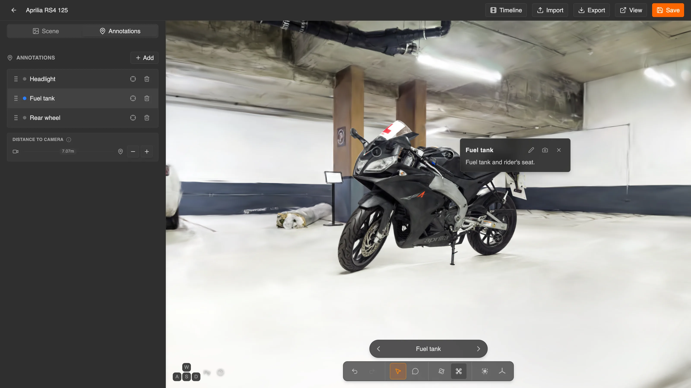

**Annotations** are 3D-positioned text hotspots you place on your published splat in [Studio](/user-manual/supersplat/studio/). On the viewer side, each annotation shows up as a numbered hotspot visitors can click; clicking it moves the camera to a curated pose and surfaces a title and body of text. Use them to call out features, narrate a story, or give a self-guided tour of the scene.

## Annotation properties

Each annotation has:

| Field | Description |
|-------|-------------|
| **Position** | World-space `[x, y, z]` where the hotspot marker sits in the scene. |
| **Title** | Short heading shown when the annotation is selected. |
| **Text** | Longer body of text, shown as plain text in the viewer. |
| **Camera** | The [camera pose](/user-manual/supersplat/studio/cameras) the viewer animates to when this annotation is selected. |
| **Extras** | Free-form metadata for custom integrations. Studio keeps it but has no control for editing it; set it in [imported settings](/user-manual/supersplat/studio/#saving-changes). |

## Adding an annotation {#adding-an-annotation}

1. Frame the viewport the way you want a visitor to see this part of the scene.
2. Choose **Add annotation**: the button in the viewport toolbar, **Add** on the **Annotations** tab, or <kbd>C</kbd>.
3. Click the point on the splat you want to annotate. Studio places the hotspot there and stores the current view as the annotation's camera.
4. Type a title (**Untitled** until you do) and a description in the card that opens beside the hotspot, then click **OK**.

A scene can have up to 50 annotations, with titles of up to 60 characters and text of up to 280. These are the [Experience Settings](/user-manual/supersplat/developers/experience-settings#authoring-limits) authoring limits.

## Editing annotations

Select an annotation by clicking its hotspot or its row on the **Annotations** tab. Its card in the viewport has three buttons:

- **Edit annotation** (pencil) — change the title and description.
- **Set camera to current view** — store the current view as the annotation's camera.
- **Unselect annotation** — close the card.

While an annotation is selected, **Distance to camera** on the **Annotations** tab moves its hotspot along the view direction: <kbd>-</kbd> nudges it toward the camera and <kbd>+</kbd> away, and holding <kbd>Shift</kbd> makes finer steps. Use it to lift a hotspot off the surface or tuck it closer.

Each row on the **Annotations** tab also has **Go to annotation**, which moves the viewport to the annotation's camera, and **Delete annotation**. Drag rows to reorder them: the order controls how visitors step through the annotations, and the number each hotspot shows.

<!-- TODO: media — /video/user-manual/supersplat/studio/annotation-flythrough.mp4 — visitor navigating between hotspots -->

## How visitors use them

On the [scene page](/user-manual/supersplat/viewing/scene-page), the viewer shows each annotation as a numbered hotspot. Selecting one eases the camera to the annotation's view and shows its title and text, and a navigator steps through the annotations in list order. [Viewer Controls](/user-manual/supersplat/viewing/controls#annotations) describes everything visitors can do with them.

:::note

The settings format accepts `annotation` as a scene's start mode, but the viewer doesn't act on it: a scene always starts from its [starting camera](/user-manual/supersplat/studio/cameras) or its camera animation.

:::

## See also

- [Cameras](/user-manual/supersplat/studio/cameras) — the camera poses annotations reference
- [Camera animation (Timeline)](/user-manual/supersplat/editor/timeline) — for cinematic flythroughs that don't need visitor interaction
- [Experience Settings](/user-manual/supersplat/developers/experience-settings) — the JSON contract that stores annotations
