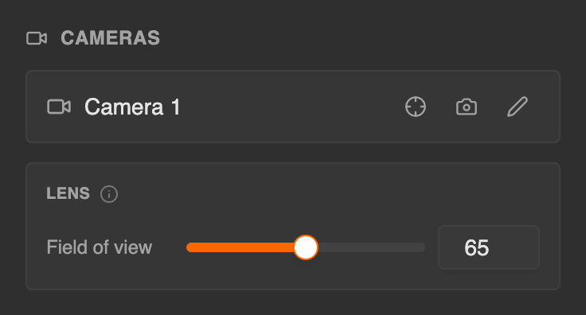

The **Cameras** section — in the **Scene** tab of [Studio](/user-manual/supersplat/studio/)'s left panel — defines the **starting camera** for your published splat: the view a visitor lands on when they open your [scene page](/user-manual/supersplat/viewing/scene-page) (unless the scene [plays its camera animation on open](/user-manual/supersplat/studio/animation#playing-on-open) instead). The camera has a **position**, a **target** (the point it looks at), and a **field of view**.

:::note

Studio currently supports a single camera. Support for multiple cameras is coming.

:::

## Setting the camera

The camera is listed as **Camera 1** with three icon buttons:

- **Go to camera** — flies the viewport to the camera's saved pose.
- **Set camera to current view** — stores the viewport's current position, target and field of view as the starting pose in one click.
- **Edit camera** (pencil) — opens [camera edit mode](#edit-camera-mode) to frame a new starting view. The pencil turns yellow while edit mode is active.

You set the camera's **position** and **target** by framing the viewport. There are no numeric position or target inputs in the Cameras section.

### Edit camera mode {#edit-camera-mode}

1. Click **Edit** (the pencil) in the Cameras panel. Studio enters camera edit mode: the viewport flies to the camera's saved pose, a thick yellow border frames the viewport, and a **Camera Edit Mode** badge appears at the top left, with **Apply** and **Cancel** buttons beside it.
2. Orbit, pan, and zoom the viewport to frame the shot (see [Camera Controls](/user-manual/supersplat/editor/camera-controls) for navigation).
3. Click **Apply** to save the viewport's **position**, **target** (look-at point), and **field of view** as Camera 1's stored start pose, then exit edit mode.
4. Click **Cancel** to exit without saving; the viewport returns to the last saved pose.

:::tip

While framing, **double-click a point on the splat** to set it as the focal point — the point the camera orbits around. The view smoothly re-centres on that point without moving the camera's position. Double-clicking empty space has no effect.

:::

Click **Edit** again (or press **Escape**) to exit edit mode without saving. Unlike **Cancel**, the viewport is not restored — only the stored pose stays unchanged.

<video autoPlay muted loop controls src='/video/supersplat-studio-edit-camera.mp4' style={{width: '100%', height: 'auto'}} />

## Lens (field of view)

Below the camera list, the **Lens** control sets the **Field of view** with a slider and a numeric input, in whole degrees from **10°** to **120°** (default **75°**). The value is the **full** viewing angle, not a half-angle. On a **wide** viewport the angle is measured **horizontally** (left to right); on a **tall** viewport it is measured **vertically** (top to bottom). You store one number — Studio and the published scene page apply it to whichever axis suits the screen shape.

This is a single, global setting: as its tooltip says, it applies to the start camera and all annotation cameras.

## Defaults

A fresh scene starts with a single camera at a **75°** field of view, with position and target chosen for the scene type:

- **Environment-style** scenes — position `[0, 2, 0]`, target `[2, 2, 0]`.
- **Object-style** scenes — position `[2, 2, -2]`, target `[0, 0, 0]`.

Frame the viewport and click **Set camera to current view**, or use [camera edit mode](#edit-camera-mode) and click **Apply**, to capture a new pose, then adjust the **Lens** field of view so the scene looks the way you want visitors to see it on first load.

## How cameras are used

- **Initial framing** — the first camera in the list is the default starting view when a visitor opens the scene page (`startMode: 'default'`). From there the viewer plays a slow, looping camera motion until the visitor takes over: an orbit around the target when the camera starts outside the splat (an object), or a gentle figure-eight when it starts inside (a scene). A [camera animation](/user-manual/supersplat/studio/animation) replaces that motion when **Play animation on open** is on.
- **Object or scene** — whether the camera starts outside or inside the splat's bounds also decides the viewer's starting [camera mode](/user-manual/supersplat/viewing/controls#camera-modes) (orbit for an object, walk or fly for a scene) and how the splat is presented in [VR and AR](/user-manual/supersplat/viewing/xr#scenes-and-objects).
- **Annotation poses** — each [annotation](/user-manual/supersplat/studio/annotations) embeds its own camera pose that the viewer animates to when the annotation is selected. The annotation's pose is independent of the entries in the Cameras list.

## See also

- [Camera Animation](/user-manual/supersplat/studio/animation) — keyframed camera motion on Studio's timeline
- [Annotations](/user-manual/supersplat/studio/annotations) — 3D-positioned hotspots that can adopt a camera pose
- [Experience Settings](/user-manual/supersplat/developers/experience-settings) — the JSON contract that stores the camera list
