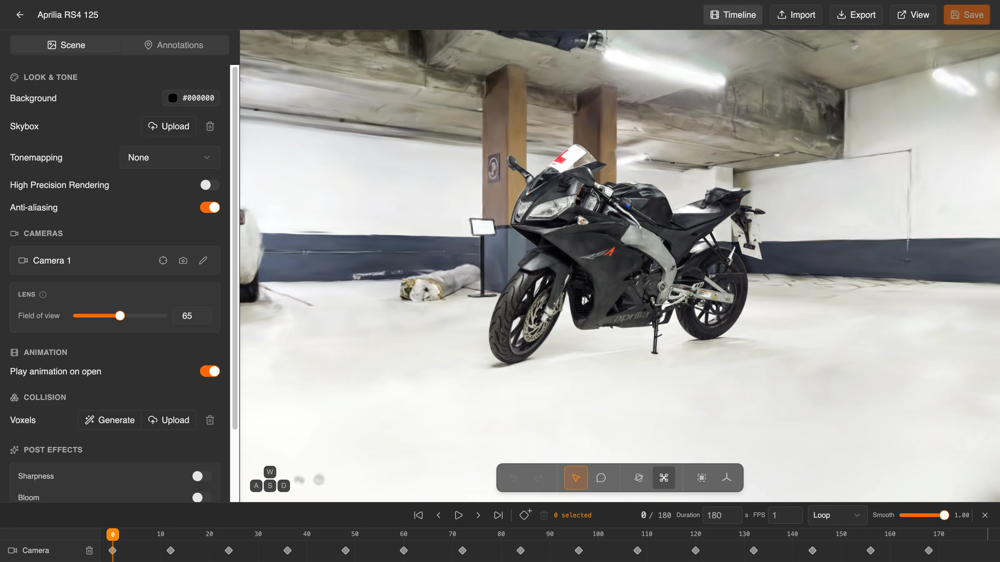

**SuperSplat Studio** is where you curate the viewing experience of a splat you've already [published](/user-manual/supersplat/publishing/editor) or [directly uploaded](/user-manual/supersplat/publishing/upload). It opens on top of the published scene and shapes what a visitor sees on its [scene page](/user-manual/supersplat/viewing/scene-page): the background or skybox, tonemapping, the starting camera, a camera animation, collision geometry for walkable scenes, post effects, and on-scene annotations.

Studio writes its output as a single JSON document, the [Experience Settings](/user-manual/supersplat/developers/experience-settings), which the open-source [SuperSplat Viewer](/user-manual/supersplat/developers/viewer/) reads at runtime.

## Launching Studio {#launching-studio}

Studio runs at **`https://superspl.at/scene/<hash>/studio`**. Only the splat's owner can open it; for anyone else the URL 404s.

There are three ways to get there:

- On the [Manage page](/user-manual/supersplat/publishing/manage), click **Open in Studio** in the splat's row.
- In a splat's **Edit Splat** dialog on the Manage page, click **Edit in Studio** in the preview card.
- On your own splat's [scene page](/user-manual/supersplat/viewing/scene-page), use the **Edit in Studio** entry point.

:::note Desktop recommended

Studio is built for a desktop browser with a keyboard and mouse. On a phone or tablet you'll see a "Studio works best on desktop" warning when you open it. You can continue, but expect a constrained UI.

:::

## The layout

- **Header**: **Back to manage**, the scene name, and on the right **Timeline**, **Import**, **Export**, **View** and **Save**. See [Saving changes](#saving-changes).
- **Left panel**, with two tabs:
  - **Scene**: the sections that make up the scene's look and behavior, from top to bottom:
    - [Look & Tone](/user-manual/supersplat/studio/look-and-tone): background color, skybox, tonemapping, High Precision Rendering and anti-aliasing.
    - [Cameras](/user-manual/supersplat/studio/cameras): the starting camera and the field of view.
    - [Animation](/user-manual/supersplat/studio/animation#playing-on-open): whether the camera animation plays when the scene opens.
    - [Collision](/user-manual/supersplat/studio/collision): voxel geometry that makes a scene walkable.
    - [Post Effects](/user-manual/supersplat/studio/post-effects): sharpness, bloom, color grading, vignette and chromatic fringing.
  - **Annotations**: the list of on-scene [annotations](/user-manual/supersplat/studio/annotations).
- **Viewport**: a live preview of how visitors will see the scene, with a toolbar along the bottom.
- **Timeline**: a panel along the bottom for keyframing the [camera animation](/user-manual/supersplat/studio/animation). It is hidden until you click **Timeline** or press <kbd>T</kbd>.

### The viewport toolbar

| Button | What it does |
|--------|--------------|
| **Undo** / **Redo** | Step through your edits. |
| **Move** | The default tool: navigate and select. |
| **Add annotation** | Place an [annotation](/user-manual/supersplat/studio/annotations#adding-an-annotation) by clicking the splat (<kbd>C</kbd>). |
| **Orbit mode** / **Fly mode** | Switch how the viewport camera moves. |
| **Frame selection** | Frame the selection in the viewport (<kbd>F</kbd>). |
| **Reset camera** | Return the viewport camera to its starting view (<kbd>Shift</kbd>+<kbd>F</kbd>). |
| **Open shortcut guide** | List Studio's keyboard shortcuts. |

### Keyboard shortcuts

| Shortcut | Action |
|----------|--------|
| <kbd>W</kbd> <kbd>A</kbd> <kbd>S</kbd> <kbd>D</kbd> | Move, in fly mode |
| <kbd>Q</kbd> / <kbd>E</kbd> | Move down / up, in fly mode |
| Hold <kbd>Shift</kbd> / <kbd>Ctrl</kbd> | Move faster / slower, in fly mode |
| Double-click | Set the orbit point |
| <kbd>F</kbd> | Frame the selection |
| <kbd>Shift</kbd>+<kbd>F</kbd> | Reset the camera |
| <kbd>C</kbd> | Add an annotation |
| <kbd>T</kbd> | Show or hide the timeline |
| <kbd>Space</kbd> | Play or pause the camera animation |
| <kbd>Enter</kbd> | Add a keyframe at the playhead |
| <kbd>Ctrl</kbd>+<kbd>Z</kbd> / <kbd>Ctrl</kbd>+<kbd>Shift</kbd>+<kbd>Z</kbd> | Undo / redo (<kbd>Cmd</kbd> on macOS) |
| <kbd>Esc</kbd> | Cancel or deselect |

## Saving changes {#saving-changes}

Edits are not saved automatically. **Save** is enabled while you have unsaved changes, and it writes your complete Experience Settings to superspl.at. Visitors who open the scene page from then on see the new version. If you try to leave Studio with unsaved changes, it asks you to confirm before they're lost.

Skybox and collision files are the exception: they upload as soon as you add them, without **Save**.

The other header buttons work with the settings as a file:

- **Export** downloads the current settings as `settings-<hash>.json`, for example to use with a [viewer you host yourself](/user-manual/supersplat/developers/embedding).
- **Import** replaces the current settings with a JSON file you choose, after asking for confirmation. Click **Save** to publish them.
- **View** opens the scene page.

Studio also reads settings saved in older versions of the format. See [Schema versioning](/user-manual/supersplat/developers/experience-settings#schema-versioning).

## AI agents {#ai-agents}

In a browser that supports the experimental [WebMCP API](https://webmachinelearning.github.io/webmcp/), Studio registers tools that let an AI agent work in your open Studio tab, much like the Editor's [AI Agents (WebMCP)](/user-manual/supersplat/editor/webmcp) tools. An agent can read the scene and the live camera, pick points on the splat, capture the viewport as an image, create and update cameras and annotations, edit the camera animation, and play or seek the timeline. Its edits share your undo history.

Agents can't save: you review what an agent did and click **Save** yourself.

## See also

- [Experience Settings](/user-manual/supersplat/developers/experience-settings) — the JSON contract Studio writes and the Viewer reads
- [Viewer Controls](/user-manual/supersplat/viewing/controls) — how visitors navigate the scene you curate
- [Scene page](/user-manual/supersplat/viewing/scene-page) — what visitors see after Studio changes are saved
