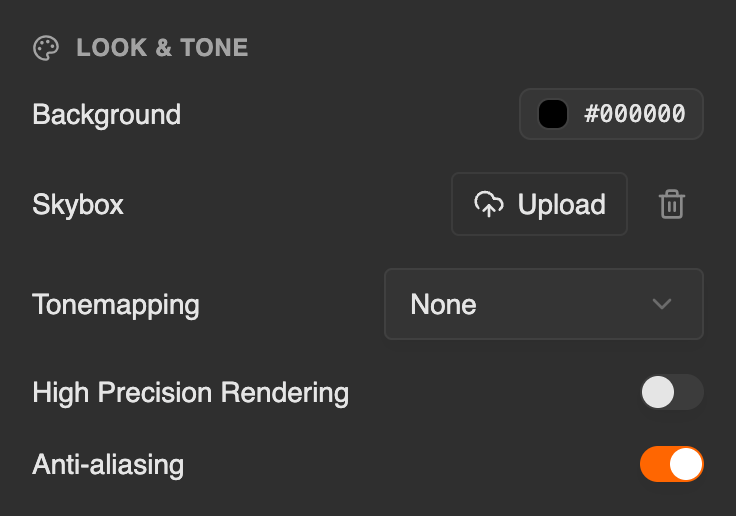

The **Look & Tone** section, at the top of the **Scene** tab in [Studio](/user-manual/supersplat/studio/), sets what surrounds your splat and how the whole image is rendered. Changes show in the viewport straight away.

| Control | What it does |
|---------|--------------|
| **Background** | The solid color behind the splat. Click the swatch to open a color picker. |
| **Skybox** | **Upload** an equirectangular image to surround the splat, or delete the current one. See [Skybox](#skybox). |
| **Tonemapping** | How the renderer maps high-dynamic-range output to the display. See [Tonemapping](#tonemapping). |
| **High Precision Rendering** | Renders with more precision, at the cost of more GPU work per frame. Use it when bright highlights, fine grading or post effects show banding. [Bloom](/user-manual/supersplat/studio/post-effects#bloom) needs it. Off by default. |
| **Anti-aliasing** | Draws the splat for anti-aliased training, such as Mip-Splatting. On by default. Turn it off if small or distant Gaussians look too faint. See [Anti-aliasing](#anti-aliasing). |

## Skybox {#skybox}

Click **Upload** next to **Skybox** to open the **Upload Skybox** dialog. It takes one `.webp` or `.hdr` file. HDR files are converted in your browser before they upload. For best results, use an **equirectangular** image: a 2:1 panoramic projection that maps cleanly onto the surrounding sphere.

Each scene can have one skybox, and uploading another replaces it. The upload happens immediately and doesn't need **Save**. The trash icon deletes the skybox.

The background color still matters with a skybox: it shows anywhere the skybox doesn't cover.

### When to use one or the other

- **Background color only** — for studio-style presentations where you want the focus on the splat itself.
- **Skybox** — for scenes captured outdoors or in believable environments, where matching the surrounding lighting and horizon matters.

## Tonemapping {#tonemapping}

| Option | Notes |
|--------|-------|
| **None** | Pass-through with no scaling. |
| **Linear** | No tonemapping curve: output is linear. |
| **Filmic** | Classic film-emulating curve. |
| **Hejl** | Hejl-Burgess-Dawson curve. |
| **ACES** | ACES filmic curve. |
| **ACES 2** | ACES variant with rolled-off highlights. |
| **Neutral** | Khronos Neutral tonemap. |

## Anti-aliasing {#anti-aliasing}

Splats trained with anti-aliasing, such as with Mip-Splatting, draw too bright without compensation. Studio's switch turns that compensation on (the default) or off for the whole scene, and saves the choice with the scene's settings.

:::note

The [SuperSplat Viewer](/user-manual/supersplat/developers/viewer/) doesn't apply this setting yet. On the scene page and in embeds, each splat file's own anti-aliasing tag decides. When you [host the viewer yourself](/user-manual/supersplat/developers/embedding#url-parameters), the `aa` URL parameter overrides it.

:::

## In the viewer

- **AR** — the skybox and background color are hidden during an [AR session](/user-manual/supersplat/viewing/xr), so the room shows through around the splat. VR sessions keep them.
- **Self-hosting** — the viewer doesn't load the skybox from the scene's settings. When you [host the viewer yourself](/user-manual/supersplat/developers/embedding#url-parameters), pass the image with the `skybox` URL parameter or the `skyboxUrl` option, and override High Precision Rendering with `hpr`.

## See also

- [Post Effects](/user-manual/supersplat/studio/post-effects) — sharpness, bloom, color grading, vignette and chromatic fringing
- [Experience Settings](/user-manual/supersplat/developers/experience-settings) — the JSON contract that stores these settings
