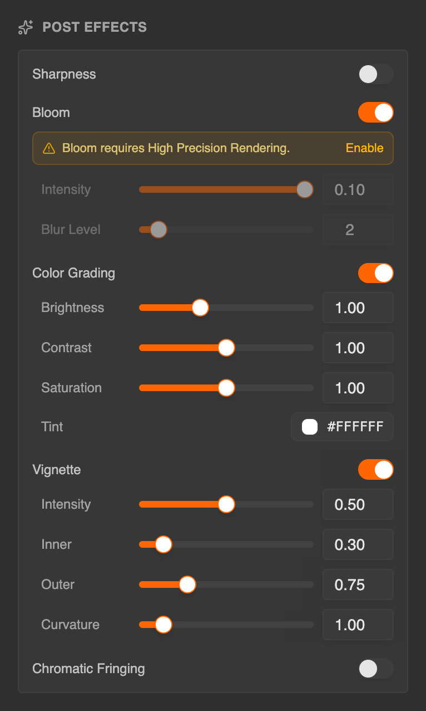

The **Post Effects** section, at the bottom of the **Scene** tab in [Studio](/user-manual/supersplat/studio/), controls the look of your scene after the splat is rendered. Effects are evaluated per frame in the viewer. Each effect has a switch that turns it on and shows its parameters.

Tonemapping and High Precision Rendering, which shape the whole image, are in the [Look & Tone](/user-manual/supersplat/studio/look-and-tone) section.

## Sharpness

| Field | Description |
|-------|-------------|
| **Amount** | Strength of the sharpening filter. |

Good for recovering perceived detail on dense splat captures.

## Bloom

| Field | Description |
|-------|-------------|
| **Intensity** | How strong the bloom glow appears. |
| **Blur Level** | Size of the bloom kernel. Larger values produce a softer, broader glow. |

Adds a glow to bright regions of the scene. Bloom needs [High Precision Rendering](/user-manual/supersplat/studio/look-and-tone): while it's off, the section says **Bloom requires High Precision Rendering**, and **Enable** turns it on.

## Color Grading

Color grading applies a global transform to the image.

| Field | Description |
|-------|-------------|
| **Brightness** | Overall brightness lift. |
| **Contrast** | Tone separation between dark and light. |
| **Saturation** | Color intensity (`0` is grayscale). |
| **Tint** | An RGB color blended into the image, useful for warm or cool grades. |

## Vignette

| Field | Description |
|-------|-------------|
| **Intensity** | Strength of the corner darkening. |
| **Inner** | Radius at which the vignette starts. |
| **Outer** | Radius at which the vignette reaches full strength. |
| **Curvature** | Shape of the vignette falloff. |

## Chromatic Fringing

| Field | Description |
|-------|-------------|
| **Intensity** | Strength of the chromatic aberration effect at frame edges. |

## In the viewer

- **VR and AR** — post effects and High Precision Rendering aren't applied during a [VR or AR session](/user-manual/supersplat/viewer/xr). The scene's tonemapping still is, and everything returns when the session ends.
- **Self-hosting** — when you [host the viewer yourself](/user-manual/supersplat/viewer/embedding#url-parameters), the `nofx` URL parameter turns post effects off.

## See also

- [Look & Tone](/user-manual/supersplat/studio/look-and-tone) — background, skybox, tonemapping and High Precision Rendering
- [Experience Settings](/user-manual/supersplat/studio/experience-settings) — the JSON contract that stores post-effect settings
