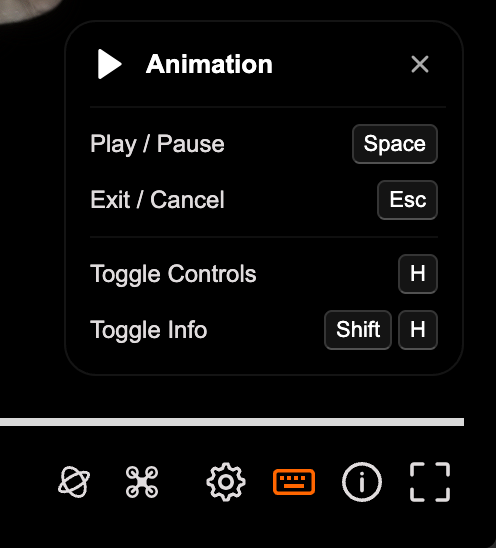
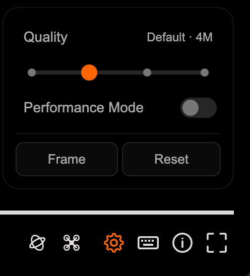

The [SuperSplat Viewer](/user-manual/supersplat/viewer/) is what visitors use on every [scene page](/user-manual/supersplat/scene-page), in every embed of one, and in viewers [exported from the Editor](/user-manual/supersplat/viewer/self-hosting). This page describes its built-in interface. For headsets, and AR on phones, see [Viewing in VR and AR](/user-manual/supersplat/viewer/xr).

## Loading

While a scene loads, the viewer shows its poster image, if it has one, and a loading bar with a percentage. A [streamed scene](/user-manual/supersplat/streaming) appears as soon as it has enough detail to render and keeps refining as more streams in. [Collision](/user-manual/supersplat/studio/collision) data keeps loading in the background, and walk mode becomes available when it arrives.

The camera then starts moving. If the scene [starts with a camera animation](/user-manual/supersplat/editor/timeline), that plays; otherwise the viewer plays a slow 20-second loop from the [starting camera](/user-manual/supersplat/studio/cameras): an orbit around an object, or a gentle figure-eight inside a scene. Interacting with the scene stops it and hands the camera to the visitor.

## The toolbar {#the-toolbar}

The toolbar runs along the bottom of the viewer. From left to right:

| Button | What it does |
|--------|--------------|
| **Play** / **Pause** | Plays or pauses the camera animation. Shown only when the scene has one. While it plays, a timeline above the toolbar shows the playhead; drag it to scrub, which pauses playback. |
| **Orbit Camera** | Switches to [orbit mode](#camera-modes). |
| **Fly Camera** | Switches to [fly mode](#camera-modes). |
| **Walk Mode** | Switches to [walk mode](#camera-modes), or back to the previous mode. Shown only on scenes that can be walked. |
| **Settings** | Opens the [settings panel](#the-settings-panel). |
| **Controls** | Opens the [controls panel](#the-controls-panel). |
| **Info** | Opens the [info panel](#the-info-panel). |
| **Enter AR** / **Enter VR** | Starts an AR or VR session. Shown only where the device and browser support one. See [Viewing in VR and AR](/user-manual/supersplat/viewer/xr). |
| **Fullscreen** | Enters or leaves fullscreen. |

Three seconds after the last interaction the toolbar dims, then hides; the next interaction brings it back. It stays up while a panel is open or the pointer is over it. In a narrow viewer the buttons shrink so that all of them, **Fullscreen** included, stay in view. On a phone or tablet, turning the device to landscape requests fullscreen and turning it back to portrait leaves it.

## Camera modes {#camera-modes}

| Mode | Key | What it does |
|------|-----|--------------|
| **Orbit** | <kbd>1</kbd> | Circles the camera around a focus point. The starting mode for objects. |
| **Fly** | <kbd>2</kbd> | Moves the camera freely through the scene. |
| **Walk** | <kbd>3</kbd> | Walks on the scene's floor at eye height (1.5 m), with gravity and jumping. Needs [collision](/user-manual/supersplat/studio/collision) and a scene at least 5 m across. The starting mode for scenes that can be walked. |
| **Animation** | — | Plays the camera animation. **Play** selects it. |

The viewer treats a splat as an object when its starting camera is outside the splat's bounds, and as a scene when the camera starts inside. A scene that can't be walked starts in fly mode.

On a desktop, pressing <kbd>W</kbd>, <kbd>A</kbd>, <kbd>S</kbd> or <kbd>D</kbd> outside fly and walk mode switches to walk mode (fly mode where walking isn't available) and turns on **Gaming Controls**.

### Gaming Controls {#gaming-controls}

Fly and walk mode have two control schemes. By default, you click or tap where you want to go and drag to look around. With **Gaming Controls** on:

- **On a desktop**, the viewer captures the mouse: moving it looks around, and <kbd>W</kbd> <kbd>A</kbd> <kbd>S</kbd> <kbd>D</kbd> move. <kbd>Esc</kbd> releases the mouse and turns Gaming Controls off. <kbd>G</kbd> toggles them.
- **On a touch device**, a joystick appears for moving, and you drag to look around. Turn them on with the **Gaming Controls** switch in the settings panel.

## The controls panel {#the-controls-panel}

**Controls** opens a panel above the toolbar that lists the controls for the current camera mode, for whichever you last used: mouse and keyboard, or touch. It updates as you switch modes or turn Gaming Controls on and off. The panel is open for a first-time visitor, and the viewer remembers when it's closed. <kbd>H</kbd> toggles it.

The panel lists these controls. Touch has none for the camera animation: any touch takes over.

### Orbit mode

| Action | Mouse and keyboard | Touch |
|--------|--------------------|-------|
| **Orbit** | Left-drag | One finger drag |
| **Pan** | Right-drag | Two finger drag |
| **Zoom** | Mouse wheel | Pinch |
| **Set Focus** | Click | Tap |
| **Fly to Point** | Double-click | Double-tap |
| **Frame Scene** | <kbd>F</kbd> | — |
| **Reset Camera** | <kbd>R</kbd> | — |

### Fly mode

| Action | Mouse and keyboard | Touch |
|--------|--------------------|-------|
| **Fly To** | Click | Tap |
| **Look Around** | Left-drag | Touch + drag |
| **Pan** | Right-drag | — |
| **Focus Point** | Double-click | Double-tap |
| **Move** | <kbd>W</kbd> <kbd>A</kbd> <kbd>S</kbd> <kbd>D</kbd> | Pinch / two finger drag |
| **Run / Slow** | <kbd>Shift</kbd> / <kbd>Ctrl</kbd> | — |
| **Reset Camera** | <kbd>R</kbd> | — |

With Gaming Controls on, **Look Around** is the captured mouse (or touch + drag), **Move** is <kbd>W</kbd> <kbd>A</kbd> <kbd>S</kbd> <kbd>D</kbd> (or the joystick), **Vertical** is <kbd>Q</kbd> / <kbd>E</kbd>, and <kbd>Esc</kbd> is **Release Mouse**.

### Walk mode

| Action | Mouse and keyboard | Touch |
|--------|--------------------|-------|
| **Walk To** | Click | Tap |
| **Look Around** | Left-drag | Touch + drag |
| **Fly to Point** | Double-click | Double-tap |
| **Move** | <kbd>W</kbd> <kbd>A</kbd> <kbd>S</kbd> <kbd>D</kbd> | — |
| **Run / Slow** | <kbd>Shift</kbd> / <kbd>Ctrl</kbd> | — |
| **Reset Camera** | <kbd>R</kbd> | — |
| **Exit Walk** | <kbd>Esc</kbd> | — |

With Gaming Controls on, **Look Around** is the captured mouse (or touch + drag), **Move** is <kbd>W</kbd> <kbd>A</kbd> <kbd>S</kbd> <kbd>D</kbd> (or the joystick), **Jump** is <kbd>Space</kbd> (or a tap), and <kbd>Esc</kbd> is **Release Mouse**.

### Animation

| Action | Mouse and keyboard |
|--------|--------------------|
| **Play / Pause** | <kbd>Space</kbd> |
| **Exit / Cancel** | <kbd>Esc</kbd> |

## The settings panel {#the-settings-panel}

**Settings** opens a panel above the toolbar:

| Setting | What it does |
|---------|--------------|
| **Show Annotations** | Shows or hides the [annotation](#annotations) hotspots and navigator. Shown only on scenes with annotations. |
| **Show Collision** | Draws the scene's collision geometry over the splat (<kbd>V</kbd>). Shown only when the scene's collision can be drawn: voxel collision needs WebGPU. |
| **Gaming Controls** | Turns on [Gaming Controls](#gaming-controls). Shown on touch devices; on a desktop, use <kbd>G</kbd>. |
| **Quality** | A slider with four positions, **Performance**, **Default**, **High** and **Max**, labeled with the splat budget each gives, such as **Default · 4M**. See [Quality](#quality). |
| **Performance Mode** | Switches to the viewer's alternative splat renderer. See [Performance Mode](#performance-mode). |
| **Frame** | Frames the whole scene, in orbit mode. |
| **Reset** | Resets the camera: in orbit mode to the starting view, in fly and walk mode to where you entered that mode. |

The viewer saves **Show Annotations**, **Gaming Controls**, **Quality** and **Performance Mode** in the browser, so they carry over to every scene the visitor opens on the same site.

### Quality {#quality}

The **Quality** slider sets the splat budget, the most splats the viewer draws at once in a streamed scene, from a ladder for the device: for example 2M, 4M, 8M and 16M on a desktop. [Streaming & Performance](/user-manual/supersplat/streaming#near-instant-loads-and-the-gaussian-budget) lists every ladder. Phones and tablets start at **Performance**, other devices at **Default**. Positions the device doesn't have the memory for are disabled.

At **Performance**, the viewer also renders at half resolution, unless Performance Mode is on. A scene published as a single file draws all its splats at every position.

### Performance Mode {#performance-mode}

**Performance Mode** draws the splats with a different renderer that doesn't sort them. Its image refines over a few frames once the camera stops moving. It's off by default and offered only on WebGPU, and not in the Meta Quest or Pico browsers.

## The info panel {#the-info-panel}

**Info** (<kbd>Shift</kbd>+<kbd>H</kbd>) shows the viewer's version, the renderer (**WebGPU** or **WebGL 2**) and GPU in use, and the PlayCanvas Engine version. On a desktop it also lists the global keyboard shortcuts.

## Keyboard shortcuts

| Key | Action |
|-----|--------|
| <kbd>1</kbd> | Orbit mode |
| <kbd>2</kbd> | Fly mode |
| <kbd>3</kbd> | Walk mode, or back to the previous mode |
| <kbd>W</kbd> <kbd>A</kbd> <kbd>S</kbd> <kbd>D</kbd> | Move; outside fly and walk mode, switches to walk (or fly) with Gaming Controls |
| <kbd>G</kbd> | Toggle Gaming Controls |
| <kbd>V</kbd> | Show Collision |
| <kbd>F</kbd> | Frame Scene (not in walk mode) |
| <kbd>R</kbd> | Reset Camera |
| <kbd>Space</kbd> | Play / Pause (Jump in walk mode) |
| <kbd>H</kbd> | Toggle the controls panel |
| <kbd>Shift</kbd>+<kbd>H</kbd> | Toggle the info panel |
| <kbd>Esc</kbd> | Release the mouse, leave walk mode, or close a panel |

Shortcuts follow the characters your keyboard layout types. On a layout that doesn't type Latin characters, such as Cyrillic or Greek, they fall back to the key positions of a US layout. <kbd>W</kbd> <kbd>A</kbd> <kbd>S</kbd> <kbd>D</kbd> always use the key positions.

## Annotations {#annotations}

Scenes with [annotations](/user-manual/supersplat/studio/annotations) show a numbered hotspot for each one.

- **Click or tap a hotspot** to select it. The camera eases to the annotation's view, and its title and text appear in a panel beside the hotspot as the camera arrives. Orbiting from there pivots near the annotated point, and the panel stays open.
- **Step through annotations** with the navigator's previous and next arrows, which show the annotation's number and title. The navigator appears when a scene has two or more annotations and wraps around at either end.
- **Click elsewhere in the viewer** to deselect. A drag doesn't count, so orbiting leaves the selection alone. The navigator keeps the last annotation, greyed out; click it to select it again.

Hotspots that part of the scene hides are faded, once the camera stops moving. **Show Annotations** in the settings panel hides the hotspots and the navigator.

## See also

- [Viewing in VR and AR](/user-manual/supersplat/viewer/xr) — headsets and AR on phones
- [Streaming & Performance](/user-manual/supersplat/streaming) — streamed scenes and the splat budget
- [Scene page](/user-manual/supersplat/scene-page) — where visitors meet the viewer on superspl.at
- [Viewer API](/user-manual/supersplat/viewer/api) — control the same features from your own code
