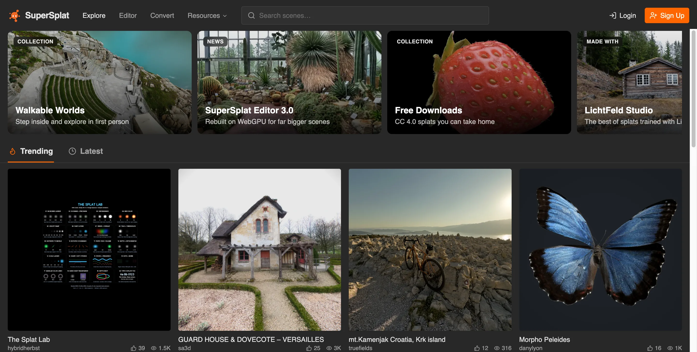

The [Explore page](https://superspl.at) is the public-facing home of SuperSplat: an infinite-scroll gallery of every **Public** splat published on the platform. It's where visitors discover scenes without needing an account.

Browsing Explore is **anonymous**: no PlayCanvas account is required. An account becomes useful when you want to [like](/user-manual/supersplat/viewing/scene-page/#likes), [comment](/user-manual/supersplat/viewing/scene-page/#comments), or [publish your own splats](/user-manual/supersplat/publishing/upload).

## Featured collections {#featured-collections}

A row of cards at the top of the home page leads to curated views. Drag it, or use its arrows, to see them all:

| Card | Opens |
|------|-------|
| **Walkable Worlds** | Splats with collision, which visitors can walk through. |
| **News** | A post on the PlayCanvas blog. |
| **Free Downloads** | Splats whose creators allow downloads under a Creative Commons license. |
| **Made With** | The [splats made with one tool](#splats-by-software): a different one each day, such as Postshot, LichtFeld Studio, Brush or Spirula Studio. |
| **Best of the Week** | The most viewed splats of the last seven days. |
| **All-Time Greats** | The most viewed splats ever published. |

## Feed tabs

Below the collections, the home page feed is split into tabs:

| Tab | What it shows |
|-----|---------------|
| **Trending** (default) | Splats gaining the most traction right now. |
| **Latest** (`?tab=latest`) | The most recently published splats. |
| **Following** (`?tab=following`) | Public splats from the creators you follow, newest first. Only shown while you're signed in. See [Following creators](/user-manual/supersplat/viewing/user-profile#following). |

## The grid

Splats are shown as cards with a thumbnail, title, and author. Click a card to open the splat's [scene page](/user-manual/supersplat/viewing/scene-page).

The grid loads progressively as you scroll: the first page returns 32 splats, and each later page returns 16. There's no "next page" button; just keep scrolling.

## Search and filters {#search-and-filters}

The search box at the top of every page opens the search page at [superspl.at/search](https://superspl.at/search), with your words matched against splat **titles** and **descriptions**. Its filter bar combines feature filters, a time period and a sort order. Every option is also a URL parameter, so any view is a shareable link.

### Sort (`?sort=...`)

| Value | Label | Order |
|-------|-------|-------|
| `trending` (default) | **Trending** | Splats gaining the most traction right now |
| `newest` | **Newest** | Most recently published first |
| `oldest` | **Oldest** | Oldest first |
| `views` | **Most viewed** | Most-viewed first |
| `likes` | **Most liked** | Most-liked first |
| `largest` | **Largest** | Largest file size first |
| `smallest` | **Smallest** | Smallest file size first |

**Trending** ranks splats by a recency-weighted engagement score: recent likes and views count for the most (engagement from the past week or so carries the most weight), with likes weighted above views. It's refreshed periodically, so it surfaces what's popular *now* rather than all-time favourites.

### Time period (`?time=...`)

Restricts the results to splats published within a period. It applies to every sort **except Trending**, which already accounts for recency and always spans all time, so the time period is disabled while Trending is selected. For the other sorts it defaults to the past month.

| Value | Label |
|-------|-------|
| `day` | **Past day** |
| `week` | **Past week** |
| `month` | **Past month** |
| `year` | **Past year** |
| `all` | **All time** |

### Feature filters (`?features=...`)

A comma-separated list of filters, shown as switches in the filter bar:

| Value | Label | Splats matching |
|-------|-------|-----------------|
| `walkable` | **Walkable** | Splats with [collision](/user-manual/supersplat/studio/collision), which visitors can walk through |
| `downloadable` | **Downloadable** | Splats whose creators have enabled [downloads](/user-manual/supersplat/publishing/manage/#downloadable--license) |

### Search (`?q=...`)

The words you search for, matched against splat titles and descriptions. When nothing matches, the page suggests adjusting a filter to browse everything.

### Combined example

`https://superspl.at/search?sort=likes&time=month&features=walkable&q=museum`

> Most-liked walkable splats published in the last month whose title or description mentions "museum."

## Splats by software {#splats-by-software}

Creators tag the tools they used to capture or train a splat, in the **Software Used** field of its [Edit Splat dialog](/user-manual/supersplat/publishing/manage#editing-splat-metadata). Each tool has a page of the public splats tagged with it, at `https://superspl.at/explore/software/<tool>`: for example, [superspl.at/explore/software/postshot](https://superspl.at/explore/software/postshot). The page is headed **Splats using** and the tool's name, and shows the same grid as the home page, Trending first.

To get there, click a tool's chip under **Software Used** on a [scene page](/user-manual/supersplat/viewing/scene-page), or the **Made With** card in the [featured collections](#featured-collections).

## Creator profiles

Click a card's author chip to land on that user's [profile page](/user-manual/supersplat/viewing/user-profile): a grid of every Public splat that user has shared, plus their avatar, bio, and social links. From there you can [follow them](/user-manual/supersplat/viewing/user-profile#following) to see their new splats in your Following tab.

## See also

- [Scene page](/user-manual/supersplat/viewing/scene-page) — what happens when you click a card
- [Profiles and Following](/user-manual/supersplat/viewing/user-profile) — browse one creator's published splats, and follow them
- [Notifications](/user-manual/supersplat/viewing/notifications) — comments, likes and new followers on your own splats
- [Manage](/user-manual/supersplat/publishing/manage) — set a splat to **Public** so it appears in Explore
