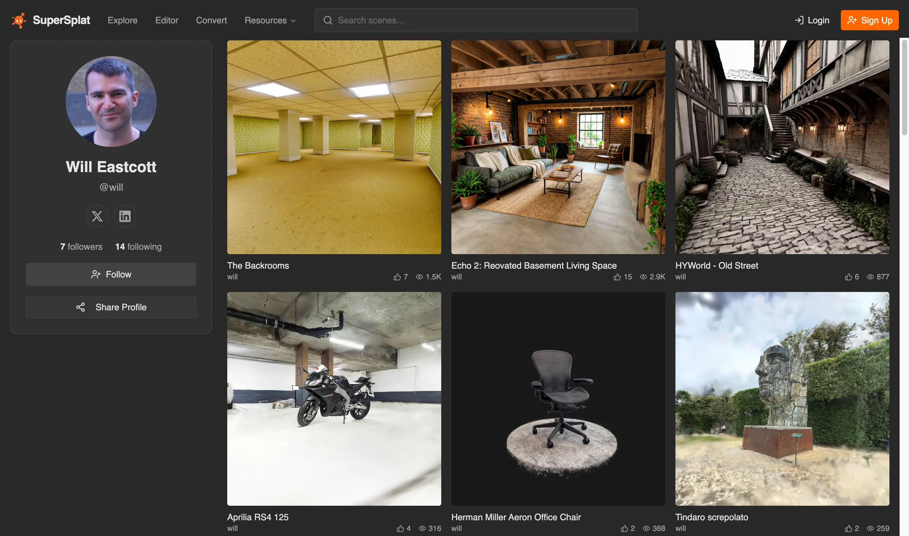

Each creator on SuperSplat gets a public profile at `https://superspl.at/user/<username>`. The profile shows their avatar, display name, bio, any social links they've added, their follower and following counts, and a grid of every **Public** splat they've published.

Profiles are linked from the **author chip** that appears on every [scene page](/user-manual/supersplat/viewing/scene-page) and on every card in the [Explore](/user-manual/supersplat/viewing/explore) grid — clicking the author's name navigates to their profile.

Browsing a profile is anonymous; no PlayCanvas account is required.

## What's on a profile

| Section | What it contains |
|---------|------------------|
| **Avatar and display name** | The creator's PlayCanvas account avatar and chosen display name. |
| **Bio** | A short profile description the creator has written about themselves. |
| **Social links** | Links to any external profiles the creator has added (X, LinkedIn, personal site, etc.). |
| **Followers and following** | How many people follow the creator and how many they follow. Click either number to see who. See [Finding more creators](#lists). |
| **Follow** | [Follow](#following) the creator to see their splats in your Following feed. |
| **Splat grid** | Every **Public** splat the creator has published, using the same card UI as [Explore](/user-manual/supersplat/viewing/explore). Click any card to open its [scene page](/user-manual/supersplat/viewing/scene-page). |

Unlisted splats are not shown on the public profile — only the creator can see those, via the [Manage page](/user-manual/supersplat/publishing/manage).

## Following creators {#following}

Follow a creator to see their public splats in your **Following** feed on the [superspl.at](https://superspl.at) home page.

1. Open the creator's profile, or any of their [scene pages](/user-manual/supersplat/viewing/scene-page).
2. Click **Follow**.

The button changes to **Following**. You'll need to be signed in with your PlayCanvas account.

### Your Following feed {#following-feed}

On the [home page](https://superspl.at), open the **Following** tab. It shows the public splats of everyone you follow, newest first, including the ones they published before you followed them.

### Finding more creators {#lists}

Click the follower or following count on any profile to see the list, and click anyone in it to visit their profile. The creators someone follows are often worth following too.

### Unfollowing a creator {#managing}

Click **Following** on the creator's profile or on one of their scene pages.

To review everyone you follow in one place, open your own profile and click your **following** count. Click **Following** next to anyone you want to unfollow.

## Your own profile

On your own profile you'll also find:

- **Everyone you follow.** Click your **following** count to see the list and [unfollow](#managing) anyone you like.
- **A Likes tab** with every splat you've liked. Only you can see it.

Comments, likes and new followers on your splats appear in the [Notifications](/user-manual/supersplat/viewing/notifications) panel, where you can also choose which ones you're emailed about.

## See also

- [Explore](/user-manual/supersplat/viewing/explore) — discover splats and creators across the whole platform
- [Scene page](/user-manual/supersplat/viewing/scene-page) — open one specific splat
- [Account Creation](/user-manual/account-management/user-accounts/account-creation) — set up your own profile
