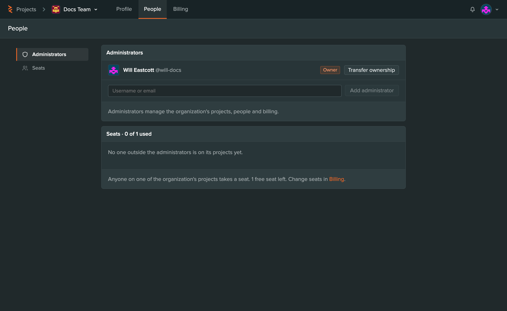
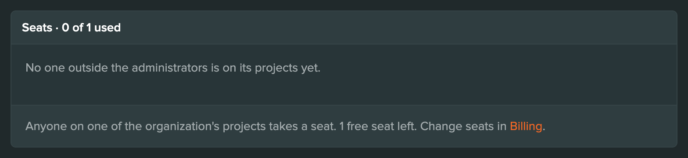
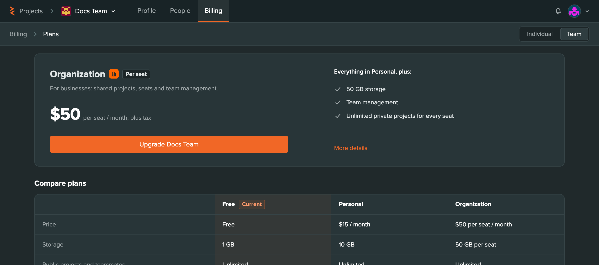
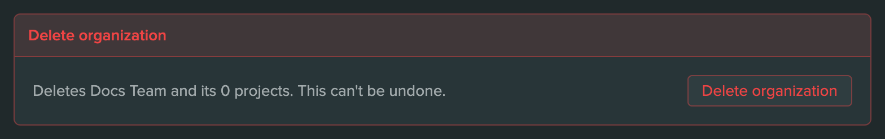

Organizationは、そのアカウント設定から管理します。アカウント設定では、オーナーと管理者がOrganizationのプロフィール、メンバー、請求を管理します。開くには、[アカウント設定](/user-manual/account-management/user-accounts/settings/)に移動し、ページ上部のアカウント切り替えでOrganizationを選択します。[プロジェクトダッシュボード](/user-manual/editor/projects/dashboard/#organizations)で、Organizationの「**⋮**」メニューにある**Organization details**からも開けます。

Organizationの設定には、**Profile**、**People**、**Billing**の3つのタブがあります。

## プロフィール {#profile}

**Profile**タブは、自分の[アカウント設定](/user-manual/account-management/user-accounts/settings/#profile)と同じように機能します。

- **Account** - Organizationのプロフィール画像、ユーザー名（プロフィールのアドレス`playcanvas.com/user/<ID>`のID）、名前、通知の送信先メールアドレスです。
- **Socials** - Organizationのプロフィールに表示される、Webサイトやソーシャルアカウントへのリンクです。
- **Email notifications** - **My projects**、**New comments**、**New stars**、**PlayCanvas news**、そしてOrganizationにユーザーが追加または削除されたときにメールが届く**Permission changes**です。
- **Delete organization** - [Organizationの削除](#delete)を参照してください。

## メンバー {#people}

### 管理者 {#administrators}

**Administrators**には、Organizationの**Owner**と管理者が一覧表示されます。管理者は、Organizationのプロジェクト、メンバー、請求を管理します。

- 管理者を追加するには、そのユーザーのユーザー名またはメールアドレスを入力し、**Add administrator**を選択します。
- 管理者を削除するには、その名前の横にある**Remove**を選択します。
- Organizationを別のユーザーに引き継ぐには、オーナーが**Transfer ownership**を選択し、ユーザー名で新しいオーナーを検索して**Transfer**を選択します。新しいオーナーがOrganizationとその請求を引き継ぎ、以前のオーナーは管理者として残ります。

管理者は、プロジェクトの作成や削除を含め、オーナーができることをすべて行えますが、所有権の譲渡とOrganization自体の削除だけはできません。これらはオーナーのみが行えます。

### シート {#seats}

**シート**は、Organizationの**プライベート**プロジェクトにユーザーを追加すると消費されます。公開プロジェクトはシートを必要としないため、公開プロジェクトの共同作業者は無料で無制限に追加できます。

**Seats**には、Organizationのシートの使用数が表示されます。また、管理者以外でOrganizationのプロジェクトに参加しているユーザーが、それぞれが参加しているプロジェクトとともに一覧表示されます。ユーザーの横にある**Remove**を選択すると、そのユーザーはOrganizationのすべてのプロジェクトから削除され、シートが空きます。

オーナーは、プロジェクトで実際に作業していない場合、シートを占有する必要はありません。少なくとも一人の管理者にシートを割り当て、常に誰かがプロジェクトを作成・管理できるようにすることをおすすめします。

## 請求 {#billing}

Organizationには独自の**Billing**タブがあり、プラン、ストレージ、支払い情報、請求書が表示されます。[プランと請求](/user-manual/account-management/plans-and-billing/#billing-tab)を参照してください。

新しいOrganizationはFreeプランで開始します。プライベートプロジェクトとシートを使えるようにするには、その**Billing**タブで**Change plan**を選択し、続いて**Upgrade**（後ろにOrganization名が付いたボタン）を選択して、チェックアウトでシート数を選びます。

### シートの追加と削除 {#adding-and-removing-seats}

Organizationプランでは、**Billing**タブの**Plan**セクションに使用中のシート数が表示されます。シートはいつでも追加・削除できます。**Change seats**を選択し、新しいシート数を選んで**Save seats**を選択します。シートの変更は次回の請求日に日割りで精算されます。請求に関するFAQの[計算例](/user-manual/account-management/billing/#how-is-billing-for-organization-accounts-calculated)をご覧ください。

## プロジェクト {#projects}

管理者は、Organizationが所有する任意のプロジェクトに自分自身を追加できます。[プロジェクトダッシュボード](/user-manual/editor/projects/dashboard/)で、サイドバーからOrganizationを選択し、続いてプロジェクトを選択します。まだプロジェクトに参加していない場合、プロジェクトの設定には**Team**だけが表示され、そこで自分を管理者として割り当てられます。[プロジェクト設定](/user-manual/editor/projects/dashboard/#project-settings)を参照してください。

そこから、通常どおり他のユーザーをプロジェクトに追加できます。[チーム管理](/user-manual/editor/projects/team-management/)を参照してください。

## Organizationの削除 {#delete}

Organizationを削除できるのはオーナーのみです。Organizationの**Profile**タブで**Delete organization**を選択し、確認のため`delete this account`と入力して、**Delete**を選択します。

:::danger

アカウント設定からOrganizationを削除すると、アカウントと**すべての**プロジェクトが完全に消去されます。この操作は取り消せません。

:::

Organizationのプロジェクトを残したい場合は、代わりに[プロジェクトダッシュボード](/user-manual/editor/projects/dashboard/#organizations)から削除してください。そうすると、プロジェクトはあなたのアカウントに移されます。
