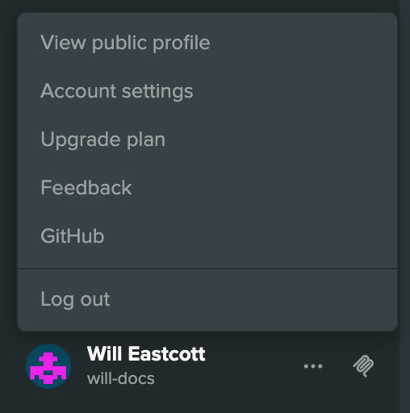
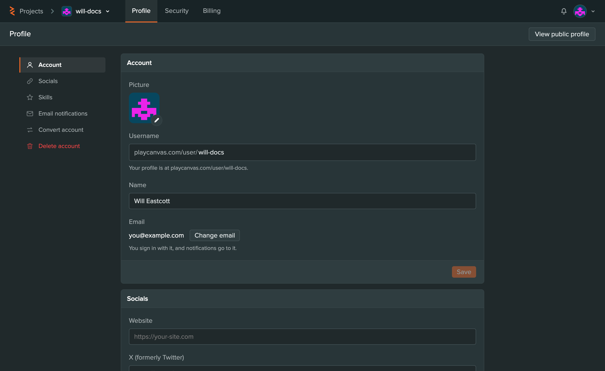
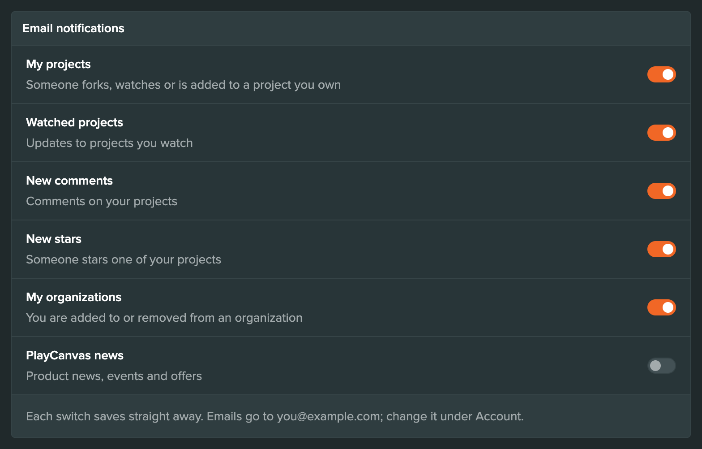
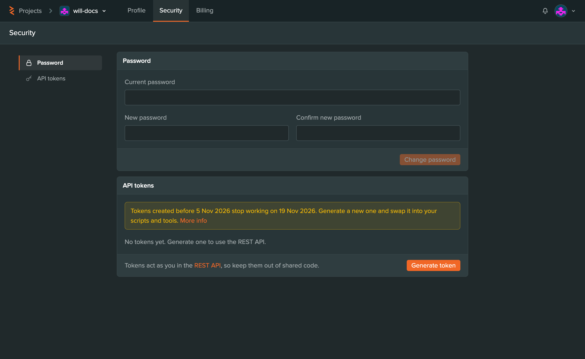

アカウント設定は[playcanvas.com/account](https://playcanvas.com/account)にあります。[プロジェクトダッシュボード](/user-manual/editor/projects/dashboard/)から開くには、サイドバー下部にある自分の名前を選択し、**Account settings**を選びます。

設定は3つのタブに分かれています。

- **[Profile](#profile)** - PlayCanvas上での表示、受け取るメール、アカウントの変換と削除
- **[Security](#security)** - パスワードとAPIトークン
- **[Billing](#billing)** - プラン、ストレージ、支払い情報、請求書

各タブの左側にあるリストから、そのタブの各セクションに移動できます。ページ上部には次のものがあります。

- **Projects**を選択すると、プロジェクトダッシュボードに戻ります。
- その横のアカウント切り替えには、編集中のアカウントが表示されます。ここで、個人アカウントと、自分がオーナーまたは管理者であるOrganizationを切り替えたり、新しいOrganizationを作成したりできます。[Organizationの管理](../organizations/managing.md)を参照してください。
- ベルには、誰かがあなたのプロジェクトにスターを付けたりフォークしたりしたときなどの通知が表示されます。
- プロフィール画像を選択すると、公開プロフィール、アカウント設定、請求とプラン、所属するOrganization、**Log out**を含むメニューが開きます。

## プロフィールタブ {#profile}

右上の**View public profile**を選択すると、他のユーザーから見た[プロフィール](profile.md)が開きます。

### アカウント {#account}

- **Picture** - 鉛筆アイコンを選択して、PNGまたはJPEG画像をアップロードします。
- **Username** - 一意のハンドルで、プロフィールのアドレス（`playcanvas.com/user/<username>`）を決めます。まだ使用されていない任意のユーザー名に変更できます。
- **Name** - 氏名です。プロフィールや共同作業者に表示されます。
- **Email** - ログインに使用するアドレスで、通知の送信先でもあります。変更するには、**Change email**を選択して新しいアドレスを入力します。確認リンクが新しいアドレスに送信され、現在のアドレスにも別のメールが送信されます。

**Save**を選択すると、変更が保存されます。

### ソーシャル {#socials}

**Website**、**X (formerly Twitter)**、**LinkedIn**、**YouTube**へのリンクを追加し、**Save**を選択します。これらのリンクはプロフィールで公開されます。

### スキル {#skills}

自分に当てはまるスキルを選択します。選択肢は**Coder**、**Artist**、**Designer**、**Musician**です。選択したスキルは公開プロフィールに表示されます。**Save**を選択すると、変更が保存されます。

### メール通知 {#email-notifications}

PlayCanvasから受け取るメールを選択します。各スイッチは、切り替えるとすぐに保存されます。

| スイッチ | メールが届くタイミング |
| --- | --- |
| **My projects** | 自分が所有するプロジェクトを誰かがフォークまたはウォッチしたとき、または誰かがそのプロジェクトに追加されたとき |
| **Watched projects** | ウォッチしているプロジェクトが更新されたとき |
| **New comments** | 誰かが自分のプロジェクトにコメントしたとき |
| **New stars** | 誰かが自分のプロジェクトにスターを付けたとき |
| **My organizations** | 自分がOrganizationに追加されたとき、またはOrganizationから削除されたとき |
| **PlayCanvas news** | PlayCanvasの製品ニュース、イベント、特典があるとき |

### アカウントの変換 {#convert-account-to-organization}

**Convert to organization**を選択すると、アカウントが別のユーザーをオーナーとする[Organization](../organizations/index.md)に変換されます。アカウントのプロジェクトもそのままOrganizationに移り、そのアカウントにはログインできなくなります。[ユーザーアカウントをOrganizationに変換する](../organizations/creating.md#convert-a-user-account-into-an-organization)を参照してください。

:::tip

Organizationを所有しているアカウントは変換できません。先にそれらのOrganizationを削除するか、所有権を別のユーザーに譲渡してください。

:::

### アカウントの削除 {#delete-account}

**Delete account**を選択すると、アカウントと、所有するすべてのプロジェクトが削除されます。確認のため、`delete this account`と入力して**Delete**を選択します。

:::danger

アカウントの削除は永久的で、元に戻せません。残しておきたいプロジェクトは、先に[エクスポート](/user-manual/editor/projects/backup-and-export/)してください。

:::

Organizationを所有している場合、**Delete account**は無効になっています。先にそれらのOrganizationを削除するか、[所有権を譲渡](../organizations/managing.md#administrators)してください。

## セキュリティタブ {#security}

### パスワード {#password}

パスワードを変更するには、**Current password**に現在のパスワードを、**New password**と**Confirm new password**に新しいパスワードを入力し、**Change password**を選択します。GoogleまたはGitHubでサインアップした場合、アカウントにはまだパスワードがありません。新しいパスワードを入力して**Set password**を選択すると、メールアドレスまたはユーザー名でもログインできるようになります。

:::tip

強力なパスワードを使用し、その管理にはパスワードマネージャーの利用を検討してください。

:::

### APIトークン {#api-tokens}

APIトークンを使用すると、スクリプトやツールから[REST API](/user-manual/api/)を利用できます。トークンはあなたとして動作するため、共有するコードには含めないでください。

トークンを作成するには、**Generate token**を選択し、`CI publish`などの**Name**を入力して、**Generate**を選択します。新しいトークンは後から表示できないため、すぐにコピーしてください。

トークンはこのセクションに一覧表示され、それぞれ**Rename**または**Revoke**を実行できます。**Revoke all**を選択してすべて取り消すこともできます。取り消したトークンはすぐに使用できなくなります。

:::note

2026年11月5日より前に作成されたAPIトークンは、2026年11月19日以降は使用できません。スクリプトやツールでまだ使用している場合は、新しいトークンを生成して置き換えてください。

:::

## 請求タブ {#billing}

**Billing**タブには、**Plan**、**Storage**の使用内訳、支払い情報、**Invoices**が表示されます。**Compare plans**を選択するとプランページが開き、アップグレードできます。[プランと請求](../plans-and-billing.md)を参照してください。
