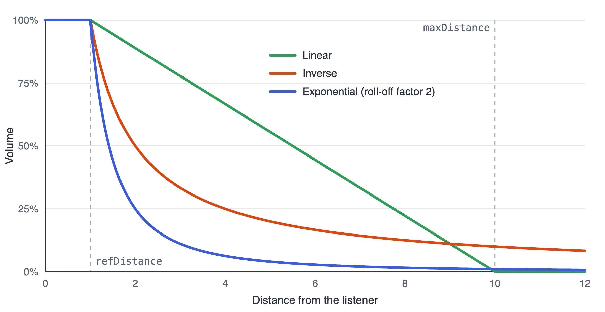

import Tabs from '@theme/Tabs';
import TabItem from '@theme/TabItem';

**ポジショナル**サウンドは、そのエンティティがある位置から聞こえます。エンティティが**オーディオリスナー**に対して動くと、サウンドはスピーカーの間を移動し、距離に応じて減衰します。これはすべてのSoundコンポーネントのデフォルトなので、Soundコンポーネントを持つエンティティは、それだけで、空間内で音を出す1つの点になります。このページでは、サウンドをどこで聞くか、どのように減衰するか、そしてポジショナルをいつオフにするかを説明します。

## ポジショナルサウンドと非ポジショナルサウンド {#positional-and-non-positional-sounds}

Soundコンポーネントの`positional`プロパティは、デフォルトで`true`です。この設定は、コンポーネントのすべてのスロットに適用されます。

- **ポジショナルサウンド**は、足音、エンジン音、声、滝など、ワールド内のどこかにあるものに適しています。
- **非ポジショナルサウンド**は、エンティティとリスナーがどこにあっても、左右のスピーカーから同じ音量で再生されます。音楽、インターフェースのサウンド、ナレーションでは`positional`をオフにします。

1つのコンポーネントは、どちらか一方にしかなれません。ワールド内で鳴る足音と頭の中で鳴る心臓の鼓動を持つプレイヤーのように、両方が必要なエンティティでは、非ポジショナルサウンドを、子エンティティに追加した2つ目のSoundコンポーネントに入れます。

## オーディオリスナー {#the-audio-listener}

ポジショナルサウンドは、**Audio Listenerコンポーネント**を持つエンティティの位置で聞こえます。そのエンティティの位置が耳の位置で、回転が耳の向きです。このコンポーネントをカメラに追加すると、サウンドは見えているものと一致します。

<Tabs groupId="workflow" defaultValue="engine">
<TabItem value="engine" label="Engine">

アプリケーションに`AudioListenerComponentSystem`を登録してから、カメラにコンポーネントを追加します。このコンポーネントに設定項目はありません。

```javascript
camera.addComponent('audiolistener');
```

</TabItem>
<TabItem value="editor" label="Editor">

カメラのエンティティを選択し、**Add Component**をクリックして**Audio Listener**を選択します。このコンポーネントに設定項目はありません。

</TabItem>
<TabItem value="react" label="React">

カメラの`<Entity>`の中に置いた独自の小さなコンポーネントから、エンジンのコンポーネントを追加します。

```jsx
import { useEffect } from 'react';
import { useParent } from '@playcanvas/react/hooks';

function AudioListener() {
  const entity = useParent();

  useEffect(() => {
    entity.addComponent('audiolistener');
    return () => entity.removeComponent('audiolistener');
  }, [entity]);

  return null;
}
```

```jsx
<Entity name="camera" position={[0, 2, 8]}>
  <Camera />
  <AudioListener />
</Entity>
```

</TabItem>
<TabItem value="web-components" label="Web Components">

カメラのエンティティの中に[`<pc-audio-listener>`](/user-manual/web-components/tags/pc-audio-listener/)を入れます。

```html
<pc-entity name="camera" position="0 2 8">
    <pc-camera></pc-camera>
    <pc-audio-listener></pc-audio-listener>
</pc-entity>
```

</TabItem>
</Tabs>

一度に使われるリスナーは1つだけです。

- **最後に有効になったリスナーが使われる。** 2つ目のリスナーを追加すると、1つ目に代わってそれが使われます。
- **使用中のリスナーを無効にしても、別のリスナーには切り替わらない。** リスナーが再び有効になるまで、サウンドはそのリスナーが最後にあった位置で聞こえ続けます。2つのリスナーを切り替えるには、一方を無効にしてから、もう一方を有効にします。必ずこの順序で行ってください。
- **リスナーが1つもない場合、サウンドはワールドの原点で聞こえる。** 向きはZ軸の負の方向です。

### カメラかキャラクターか {#the-camera-or-the-character}

一人称視点のゲームでは、カメラがキャラクターそのものなので、リスナーはカメラに置きます。三人称視点のゲームでは、選択の余地があります。リスナーをカメラに置くと、映像と一致します。画面の左側にあるサウンドは左から聞こえます。リスナーをキャラクターに置くと、ゲームの状況と一致します。キャラクターの背後から忍び寄る敵の足音は、カメラがどれだけ離れていても大きく聞こえます。よく使われる折衷案は、位置をキャラクターから、回転をカメラから取るエンティティにリスナーを置く方法です。

## 距離 {#distance}

Soundコンポーネントの4つのプロパティが、ポジショナルサウンドがリスナーからの距離に応じてどう減衰するかを決めます。これらは、コンポーネントのすべてのスロットに適用されます。

| プロパティ | デフォルト | 説明 |
| --- | --- | --- |
| `distanceModel` | `DISTANCE_LINEAR` | 減衰のカーブの形。`DISTANCE_LINEAR`、`DISTANCE_INVERSE`、`DISTANCE_EXPONENTIAL`のいずれか |
| `refDistance` | `1` | サウンドが最大音量で再生される範囲の距離。減衰はここから始まります |
| `maxDistance` | `10000` | リニアモデルで、減衰が終わる距離。ほかのモデルでは無視されます |
| `rollOffFactor` | `1` | 減衰の急さ。値が大きいほど、サウンドは短い距離で減衰します |



このグラフは、各モデルを`refDistance`が1の場合について示しています。リニアモデルは`maxDistance`が10の場合です。

3つのモデルは、サウンドをそれぞれ異なる形で減衰させます。

- **リニア**は、`refDistance`での最大音量から`maxDistance`での無音まで、均等に減衰します。最も理解しやすいモデルで、その先ではサウンドが無音になるという明確な境界を持つ唯一のモデルです。`rollOffFactor`が1未満の場合、減衰は無音に達する前に止まります。0.5のときは、サウンドは`maxDistance`で半分の音量まで下がり、そこから先は変わりません。
- **インバース**は、開けた空間での音と同じように減衰します。`rollOffFactor`が1の場合、リスナーからの距離が2倍になるたびに音量は半分になります。そのため、サウンドは近くでは大きく、急速に小さくなり、遠くでは無音になることなくかすかに残り続けます。
- **エクスポネンシャル**は、`rollOffFactor`が1の場合はインバースと同じですが、`rollOffFactor`が大きくなるほど急になります。`rollOffFactor`が2の場合、距離が2倍になるたびに音量は4分の1になります。

:::warning

デフォルト値は、ほとんどのシーンに適していません。10,000ユニットにわたるリニアの減衰は非常に緩やかで、100ユニット離れたサウンドでも音量の99%で再生されます。サウンドはスピーカーの間を移動しますが、小さくなったようには聞こえません。`maxDistance`をサウンドが無音になるべき距離に設定するか、インバースモデルを選んでください。

:::

<Tabs groupId="workflow" defaultValue="engine">
<TabItem value="engine" label="Engine">

```javascript
entity.addComponent('sound', {
    distanceModel: DISTANCE_LINEAR,
    refDistance: 1,
    maxDistance: 20
});

// または、サウンドの再生中でもいつでも変更できます
entity.sound.distanceModel = DISTANCE_INVERSE;
entity.sound.refDistance = 2;
```

</TabItem>
<TabItem value="editor" label="Editor">

**Positional**をオンにすると、Soundコンポーネントに**Ref Distance**、**Max Distance**、**Distance Model**、**Roll-off Factor**が表示されます。

</TabItem>
<TabItem value="react" label="React">

[はじめに](/user-manual/audio/getting-started/#playing-a-sound)のページの`<Sound>`コンポーネントは、デフォルト設定のSoundコンポーネントを追加します。設定を指定するには、propをエンジンのコンポーネントに渡すラッパーから、先にコンポーネントを追加しておきます。

```jsx
import { useEffect, useState } from 'react';
import { useParent } from '@playcanvas/react/hooks';

function SoundSource({ children, ...settings }) {
  const entity = useParent();
  const [ready, setReady] = useState(false);

  useEffect(() => {
    entity.addComponent('sound', settings);
    setReady(true);
    return () => {
      entity.removeComponent('sound');
      setReady(false);
    };
  }, [entity]);

  return ready ? children : null;
}
```

```jsx
<Entity name="radio" position={[4, 0, 0]}>
  <SoundSource positional distanceModel="linear" maxDistance={20}>
    <Sound name="music" src="https://developer.playcanvas.com/assets/music.mp3" loop autoPlay />
  </SoundSource>
</Entity>
```

</TabItem>
<TabItem value="web-components" label="Web Components">

```html
<pc-entity name="radio" position="4 0 0">
    <pc-sound distance-model="linear" ref-distance="1" max-distance="20">
        <pc-sound-slot name="music" asset="music" loop auto-play></pc-sound-slot>
    </pc-sound>
</pc-entity>
```

</TabItem>
</Tabs>

## パンニング {#panning}

リスナーから見たサウンドの方向によって、左右のスピーカーへの振り分けが決まります。正面にあるサウンドは左右で均等に再生され、真横にあるサウンドはその側のスピーカーだけで再生されます。

パンニングは左右方向だけです。リスナーの後ろにあるサウンドは前にあるサウンドと同じように聞こえ、高さによる違いもありません。エンジンはドップラー効果もシミュレートしません。サウンドがどれだけ速く動いても、ピッチは変わりません。

位置は毎フレーム更新されるので、何もしなくても、サウンドは動くエンティティと動くリスナーに追従します。

## 例 {#example}

このエンジンアプリは、リスナーである黄色いカプセルの周りを回る赤い球から音楽を再生します。内側のリングが`refDistance`、外側のリングが`maxDistance`です。**Play**をクリックし、ヘッドホンを着けてパンニングを聞いてみてください。

```js live-example
import {
    AppBase,
    AppOptions,
    Asset,
    AudioHandler,
    AudioListenerComponentSystem,
    CameraComponentSystem,
    Color,
    createGraphicsDevice,
    DEVICETYPE_WEBGPU,
    Entity,
    FILLMODE_FILL_WINDOW,
    LightComponentSystem,
    RenderComponentSystem,
    RESOLUTION_AUTO,
    SoundComponentSystem,
    SoundManager,
    StandardMaterial,
    Vec3
} from 'playcanvas';

// 使用するコンポーネントシステムとリソースハンドラーを指定してアプリケーションを作成します
const canvas = document.getElementById('application');
const device = await createGraphicsDevice(canvas, {
    deviceTypes: [DEVICETYPE_WEBGPU]
});
device.maxPixelRatio = Math.min(window.devicePixelRatio, 2);

const options = new AppOptions();
options.graphicsDevice = device;
options.soundManager = new SoundManager();
options.componentSystems = [
    RenderComponentSystem,
    CameraComponentSystem,
    LightComponentSystem,
    SoundComponentSystem,
    AudioListenerComponentSystem
];
options.resourceHandlers = [AudioHandler];

const app = new AppBase(canvas);
app.init(options);
app.setCanvasFillMode(FILLMODE_FILL_WINDOW);
app.setCanvasResolution(RESOLUTION_AUTO);
window.addEventListener('resize', () => app.resizeCanvas());
app.start();

app.scene.ambientLight = new Color(0.35, 0.35, 0.4);

const asset = new Asset('music', 'audio', {
    url: 'https://developer.playcanvas.com/assets/music.mp3'
});
await new Promise((resolve) => {
    asset.ready(resolve);
    app.assets.add(asset);
    app.assets.load(asset);
});

const createMaterial = (color) => {
    const material = new StandardMaterial();
    material.diffuse = color;
    material.update();
    return material;
};

// カメラはシーンを見下ろしているので、サウンドを聞く位置ではありません
const camera = new Entity('camera');
camera.addComponent('camera', {
    clearColor: new Color(0.11, 0.12, 0.17)
});
camera.setPosition(0, 20, 11);
camera.lookAt(0, 0, 1.5);
app.root.addChild(camera);

const light = new Entity('light');
light.addComponent('light');
light.setEulerAngles(48, 38, 0);
app.root.addChild(light);

const floor = new Entity('floor');
floor.addComponent('render', { type: 'plane', material: createMaterial(new Color(0.24, 0.26, 0.31)) });
floor.setLocalScale(40, 1, 40);
app.root.addChild(floor);

// リスナーです。サウンドは、カメラに背を向けたこの位置で聞こえます
const listener = new Entity('listener');
listener.addComponent('render', { type: 'capsule', material: createMaterial(new Color(0.95, 0.75, 0.2)) });
listener.addComponent('audiolistener');
listener.setPosition(0, 1, 0);
app.root.addChild(listener);

// 音源です。ポジショナルなSoundコンポーネントを持ちます
const radio = new Entity('radio');
radio.addComponent('render', { type: 'sphere', material: createMaterial(new Color(0.9, 0.3, 0.35)) });
radio.addComponent('sound', {
    positional: true,
    distanceModel: 'linear',
    refDistance: 1,
    maxDistance: 10,
    rollOffFactor: 1
});
radio.sound.addSlot('music', { asset: asset.id, loop: true });
app.root.addChild(radio);

// 各距離モデルが、指定した距離で与える音量です
const volumeAt = (distance) => {
    const { distanceModel, refDistance, maxDistance, rollOffFactor } = radio.sound;
    const d = Math.max(distance, refDistance);
    if (distanceModel === 'linear') {
        const rollOff = Math.min(rollOffFactor, 1);
        return 1 - rollOff * (Math.min(d, maxDistance) - refDistance) / (maxDistance - refDistance);
    }
    if (distanceModel === 'inverse') {
        return refDistance / (refDistance + rollOffFactor * (d - refDistance));
    }
    return Math.pow(d / refDistance, -rollOffFactor);
};

// 操作用のコントロールです
const panel = document.createElement('div');
panel.style.cssText = 'position: absolute; left: 12px; top: 12px; right: 12px; display: flex; flex-wrap: wrap; gap: 8px 14px; align-items: center; color: #ccc; font: 14px sans-serif;';
document.body.appendChild(panel);

const playButton = document.createElement('button');
playButton.textContent = 'Play';
playButton.onclick = () => {
    const slot = radio.sound.slot('music');
    if (slot.isPlaying) {
        slot.stop();
    } else {
        slot.play();
    }
    playButton.textContent = slot.isPlaying ? 'Stop' : 'Play';
};
panel.appendChild(playButton);

const model = document.createElement('select');
for (const name of ['linear', 'inverse', 'exponential']) {
    model.add(new Option(name));
}
model.onchange = () => {
    radio.sound.distanceModel = model.value;
};
panel.appendChild(model);

const addSlider = (text, property, min, max) => {
    const label = document.createElement('label');
    const input = document.createElement('input');
    Object.assign(input, { type: 'range', min, max, step: 0.5, value: radio.sound[property] });
    input.style.width = '90px';
    input.oninput = () => {
        radio.sound[property] = Number(input.value);
    };
    label.append(`${text} `, input);
    panel.appendChild(label);
};
addSlider('Ref', 'refDistance', 0.5, 5);
addSlider('Max', 'maxDistance', 6, 12);
addSlider('Roll-off', 'rollOffFactor', 0, 3);

const status = document.createElement('div');
status.style.cssText = 'position: absolute; left: 12px; bottom: 10px; color: #ccc; font: 14px sans-serif;';
document.body.appendChild(status);

// リスナーの周りの床にリングを描画します
const drawRing = (radius, color) => {
    const center = listener.getPosition();
    const steps = 64;
    for (let i = 0; i < steps; i++) {
        const a = (i / steps) * Math.PI * 2;
        const b = ((i + 1) / steps) * Math.PI * 2;
        app.drawLine(
            new Vec3(center.x + Math.cos(a) * radius, 0.02, center.z + Math.sin(a) * radius),
            new Vec3(center.x + Math.cos(b) * radius, 0.02, center.z + Math.sin(b) * radius),
            color
        );
    }
};

let angle = 0;
app.on('update', (dt) => {
    // ラジオをリスナーの周りで動かし、片側ではすぐ近くを通過させます
    angle += dt * 0.5;
    radio.setPosition(Math.cos(angle) * 7 + 3, 0.5, Math.sin(angle) * 5);

    drawRing(radio.sound.refDistance, Color.WHITE);
    drawRing(radio.sound.maxDistance, Color.GRAY);

    const distance = radio.getPosition().distance(listener.getPosition());
    status.textContent = `Distance: ${distance.toFixed(1)}   Volume: ${Math.round(volumeAt(distance) * 100)}%`;
});
```

次のことを試してみてください。

- モデルを**inverse**に切り替えます。外側のリングはもう意味を持ちません。サウンドはどこでも聞こえ、ラジオが近づくと急速に大きくなります。
- **Roll-off**を0までドラッグすると、減衰がなくなります。**exponential**モデルで3までドラッグすると、サウンドが急激に小さくなります。
- `listener.addComponent('audiolistener');`の行を削除します。何も変わらないように見えますが、これはサウンドがワールドの原点で聞こえるようになり、カプセルがちょうどそこに立っているためです。次に、`listener.setPosition(8, 1, 0)`でカプセルを動かします。リングはカプセルと一緒に動きますが、サウンドは原点で聞こえたままです。

## 関連情報 {#see-also}

- [はじめに](/user-manual/audio/getting-started/) - Soundコンポーネントの追加とサウンドの再生
- [Audio Listenerコンポーネント](/user-manual/editor/scenes/components/audiolistener/)と[Soundコンポーネント](/user-manual/editor/scenes/components/sound/) - エディターでのリファレンス
- [`<pc-audio-listener>`](/user-manual/web-components/tags/pc-audio-listener/)と[`<pc-sound>`](/user-manual/web-components/tags/pc-sound/) - Web Componentsのリファレンス
- [Positional Sound](https://playcanvas.github.io/web-components/examples/#positional-sound.html)と[Clock Tower](https://playcanvas.github.io/web-components/examples/#clock-tower.html) - ポジショナルオーディオを扱うWeb Componentsのサンプル
- [AudioListenerComponent](https://api.playcanvas.com/engine/classes/AudioListenerComponent.html)と[SoundComponent](https://api.playcanvas.com/engine/classes/SoundComponent.html) - エンジンのAPIリファレンス
