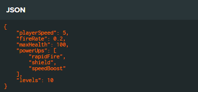

自分で書いたりアップロードしたりしたテキストを保持するアセットには、**CSS**、**HTML**、**JSON**、**Shader**、**Text** の5種類があります。Editorではどれも同じように扱います。

- **作成**: [Assetsパネル](../asset-panel.md)の **+** メニューから作成するか、下にある拡張子のファイルをアップロードします。
- **編集**: Assetsパネルでアセットを右クリックして **Edit** を選択すると、[コードエディター](../../scripting/code-editor.md)で開きます。
- **確認**: アセットを選択すると、Inspectorに内容の読み取り専用プレビューが表示されます。これらのアセットに設定するプロパティはありません。

スクリプトからこれらのアセットを使うには、[Asset属性](/user-manual/scripting/script-attributes/esm/#asset-attribute)を参照してください。

## CSS {#css}

CSSアセットはスタイルシートを保持します。`.css`ファイルをアップロードすると作成できます。HTMLで作ったユーザーインターフェースなど、アプリがページに追加するHTMLのスタイル設定に使います。[HTMLとCSS](/user-manual/user-interface/html-and-css/)を参照してください。

## HTML {#html}

HTMLアセットは、ページ全体または一部のHTMLを保持します。`.html`ファイルをアップロードすると作成できます。

## JSON {#json}

JSONアセットは、[JavaScript Object Notation](https://ja.wikipedia.org/wiki/JavaScript_Object_Notation)形式の構造化データを保持します。人が読み書きしやすく、コードで解析しやすい形式です。`.json`ファイルをアップロードすると作成できます。JSONアセットは次のような用途に便利です。

- 設定やゲームの設定値
- レベルのレイアウトなどのデザインデータ
- プロシージャル生成のためのデータ

大きなデータをスクリプト属性ではなくJSONアセットに入れておくと、シーンも小さく保てます。[シーンのサイズ上限](../../scenes/index.md#size-limit)を参照してください。

## Shader {#shader}

Shaderアセットは、独自の描画効果のためのGLSLコードを保持します。`.glsl`、`.vert`、`.frag`ファイルをアップロードすると作成できます。[シェーダー](/user-manual/graphics/shaders/)を参照してください。

## Text {#text}

Textアセットは、会話のテキストやアプリが読み込むその他のデータなど、プレーンテキストを保持します。`.txt`か`.xml`ファイルをアップロードすると作成できます。Spineのテクスチャアトラス（`.atlas`ファイル）もTextアセットとしてアップロードされます。[Spine](/user-manual/engine/libraries/spine/)を参照してください。
