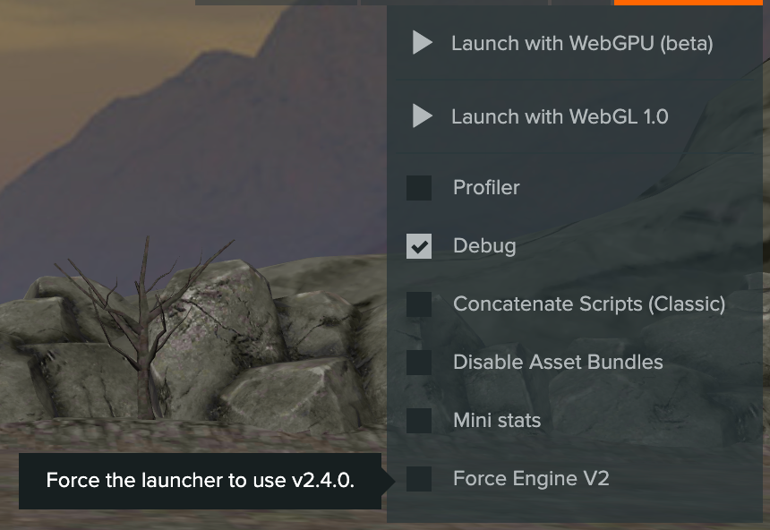
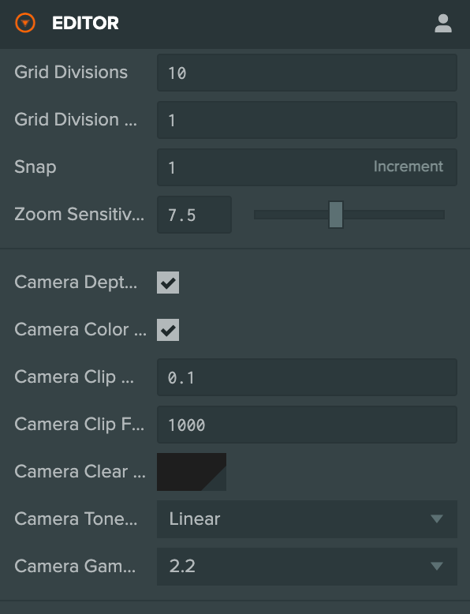
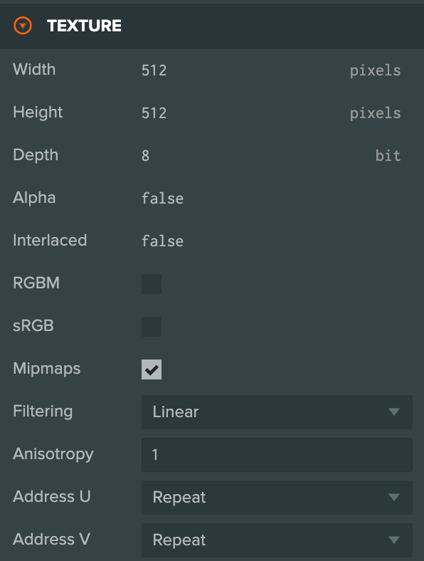
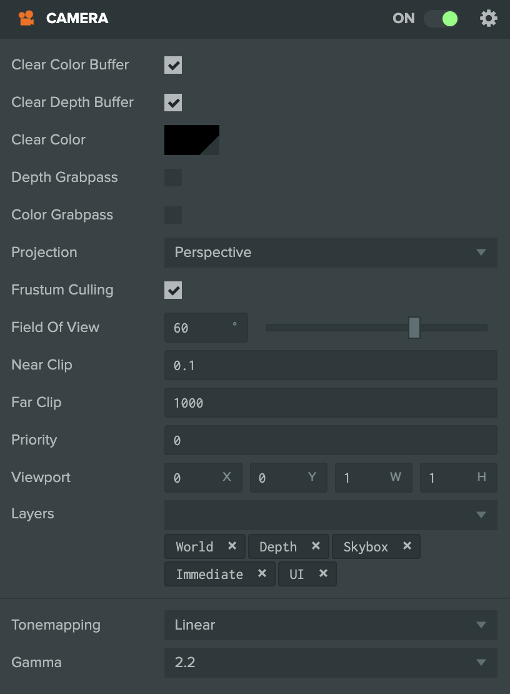

## はじめに {#introduction}

Editorは、エンジンの主要な2つのリリースストリームをサポートしています。

- エンジン v1.x.x の最新リリース (**Engine V1**)
  - これはWebGL1とWebGL2をサポートし、重要なバグ修正を受け取ります。新しい機能は追加されません。
- エンジン v2.x.x の最新リリース (**Engine V2**)
  - これはWebGL2とWebGPUをサポートしますが、レンダリング用のWebGL1はサポートしません。新しい機能と修正の両方を受け取ります。

これらはいつでも自由に切り替えることができます。

### Engine V1とV2間でのプロジェクトの切り替え {#switching-projects-between-engine-v1-and-v2}

このプロセスには、Engine V1とV2間のEngine APIの違いに伴うスクリプトの移行と更新が含まれます。エンジンの変更に関するすべての詳細は[こちら](/user-manual/engine/migrations)で確認できます。

これを開始するには、設定パネルに移動し、「`SWITCH TO ENGINE V2`」ボタンをクリックして、プロジェクトをEngine V2を使用するように変換します（変換前に確認が必要です）。元に戻したい場合は、Project V2の同じ場所に「`SWITCH TO ENGINE V1`」ボタンがあります。

:::important

エンジンを切り替える前に、チェックポイントを作成することをお勧めします。

:::

:::warning

切り替えが確認されると、現在のプロジェクトの**すべてのユーザー**がリロードされます。

:::

#### スクリプティング {#scripting}

エンジンのAPIの変更を考慮して、LauncherでEngine V1またはV2を使用してプロジェクトをテストしたい場合があります。Launcherオプションの「Force Engine V2」または「Force Engine V1」チェックボックスを有効にすることで、これを行うことができます。

さらに、実行時にエンジンのバージョンを条件付きで確認することで、移行期間中にスクリプトをエンジンの両方のバージョンと互換性を持たせることができます。

:::ai
Engineのバージョン間で動作が異なる場合は、[**Editor MCP Server**](/user-manual/editor/mcp-server/)で同じシナリオを再現します。AIアシスタントはログやキャプチャを関連するスクリプトやAPIと結び付け、修正箇所を絞り込めます。
:::

#### ガンマとトーンマップ {#gamma-and-tonemap}

これらの設定は以前、設定パネルのレンダリングセクションにありました。しかし、Engine V2では、これらはカメラごとに設定されるように移動されました。各カメラコンポーネントには、これらの追加フィールドが含まれるようになります。

ビューポートの設定は、設定パネルのEDITORセクション内に移動されました。

:::note

カメラごとに設定を変更し、Project V1に戻すと、カメラごとの設定は失われます。

:::

#### sRGBテクスチャ {#srgb-textures}

Engine V2では、テクスチャは使用ケースに応じてsRGBに設定するかどうかを決める必要があります。ディフューズマップやエミッシブマップなどの色データを保存するテクスチャは、正確な色表現のためにsRGBを使用する必要があります。これは上記に示すテクスチャアセットパネルの下にあります。これらは自動的に設定されますが、競合がある場合はconsoleに表示されます。

consoleメッセージをクリックして、競合する参照を開きます。sRGBと非sRGBの両方に同じテクスチャを使用したい場合は、両方のケースをカバーするためにテクスチャを複製することをお勧めします。

## 切り替え後のトラブルシューティング {#troubleshooting-the-switch}

### シーンが明るく、または暗く見える {#the-scene-looks-brighter-or-darker}

ガンマとトーンマッピングを設定する場所はエンジンのバージョンごとに違うので、シーンの見た目に影響するすべての場所を確認してください。

- **シーン**（Engine V1のプロジェクト）: **Settings** > **Rendering** の **Gamma** と **Tone Mapping**。
- **各カメラ**（Engine V2のプロジェクト）: すべてのCameraコンポーネントの **Gamma** と **Tone Mapping**。[ガンマとトーンマップ](#gamma-and-tonemap)を参照してください。
- **Viewport**: **Settings** > **Editor** にあるViewport独自のガンマとトーンマッピング。

次に、各テクスチャのsRGB設定が正しいことを確認してください（[sRGBテクスチャ](#srgb-textures)を参照）。対応が必要なテクスチャがあると、Editor下部のステータスバーに **N audits found** と表示されます。

- それを選択してから **Fix Issues** を選ぶと、自動修正が適用されます。
- 競合は1つずつ解決します。影響を受けるテクスチャやテクスチャアトラスと使用場所がConsoleに表示され、メッセージを選択するとその場所に移動します。

<video autoPlay muted loop controls playsInline src='/video/asset-auditor.mp4' style={{width: '100%', height: 'auto'}} />

### カメラの見た目がEditorと起動ページで違う {#a-camera-looks-different-in-the-editor-and-on-the-launch-page}

スクリプトでカメラを作成している場合は、Cameraコンポーネントの`gammaCorrection`プロパティと`toneMapping`プロパティで、コードからガンマとトーンマッピングを明示的に設定してください。
