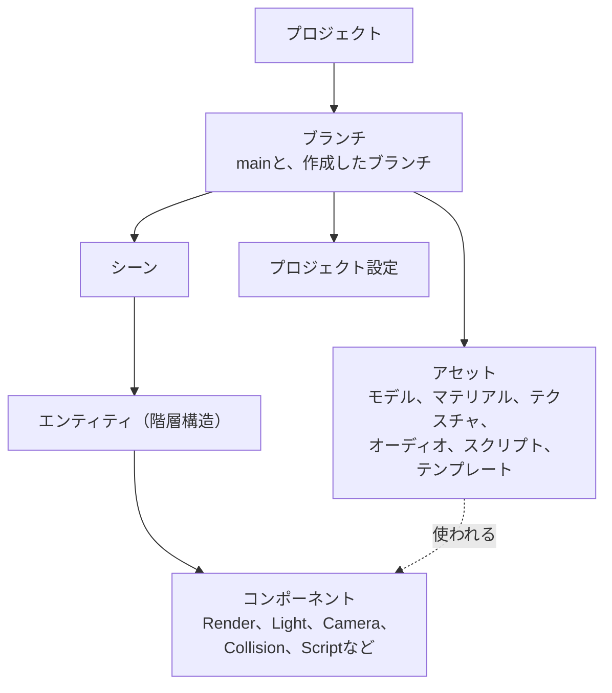

PlayCanvas Editorのプロジェクトには、1つのアプリを構成するものがすべて入っています。シーン、シーンが使うアセット、スクリプト、そして設定です。このページでは、これらがどう組み合わさっているかを説明します。これを押さえておくと、このマニュアルの他のページが理解しやすくなります。まだの場合は、先に[初めてのアプリ](your-first-app.md)を作ってみてください。ここで説明するすべての要素に、15分ほどで一通り触れられます。

## シーン、エンティティ、コンポーネント {#scenes-entities-and-components}

**シーン**は、レベルやメニューなど、アプリが表示する1つの世界です。1つのプロジェクトに複数のシーンを持つことができます。アプリは1つのシーンから始まり、[実行中に別のシーンを読み込む](../scenes/loading-scenes.md)こともできます。シーンの作成や切り替えは[シーンの管理](../scenes/managing-scenes.md)から行います。

シーンは**エンティティ**の階層でできていて、[Hierarchyパネル](../interface/hierarchy.md)に表示されます。エンティティ単体では、位置、回転、スケールしか持ちません。エンティティに機能を与えるのが**コンポーネント**です。Renderコンポーネントは形状やモデルを描画し、Lightはシーンを照らし、CollisionとRigid Bodyのコンポーネントはエンティティを物理シミュレーションに参加させ、Scriptコンポーネントはあなたのコードを実行します。エンティティを選択すると、そのコンポーネントを[Inspector](../interface/inspector.md)で編集できます。このしくみについては[エンティティ・コンポーネント・システム](/user-manual/ecs/)で詳しく説明しています。

シーンには、スカイボックス、環境光、物理演算の重力など、シーン固有の設定もあります。

## アセット {#assets}

**アセット**は、シーンが使うファイルやデータです。モデル、マテリアル、テクスチャ、オーディオ、フォント、スクリプトなどがあります。アセットは1つのシーンではなくプロジェクトに属しているので、どのシーンからも使うことができ、[Assetsパネル](../assets/asset-panel.md)で管理します。エンティティがアセットを使うのは、Renderコンポーネントのマテリアルのように、そのコンポーネントがアセットを参照しているときです。

ファイルをアップロードすると、Editorの[インポートパイプライン](../assets/import-pipeline/index.md)が元のファイルを**ソースアセット**として保持し、アプリが読み込む**ターゲットアセット**を作成します。たとえば3Dモデルをアップロードすると、モデルの階層を持つテンプレート、メッシュごとのRenderアセット、そしてマテリアルとテクスチャが作成されます。モデルを更新するときは同じファイルをもう一度アップロードすると、そこから作られたアセットがすべて更新されます。

[テンプレート](../templates/index.md)もアセットの一種です。テンプレートはプレハブのように保存したエンティティの階層で、何度でも配置でき、あとから全部を一度に変更できます。

## スクリプト {#scripts}

スクリプトはJavaScriptのアセットです。エンティティに動きを与えるには、Scriptコンポーネントを追加してスクリプトをアタッチします。スクリプト属性を使うと値がInspectorに表示されるので、コードを編集せずにスクリプトを調整できます。スクリプトは組み込みの[コードエディター](../scripting/code-editor.md)で書くことも、[PlayCanvas拡張機能](../scripting/vscode-extension.md)を入れたVisual Studio Codeで書くこともできます。

スクリプトはPlayCanvas Engineを直接扱うので、[スクリプティング](/user-manual/scripting/)の内容はすべてスクリプトに当てはまります。

## 何が保存され、誰に見えるか {#what-saves-and-who-sees-it}

シーンには保存ボタンがありません。エンティティ、コンポーネント、アセット、設定への変更は、変更したその場で保存され、同じブランチで作業している他の人にもすぐに表示されます。[リアルタイムコラボレーション](../realtime-collaboration.md)を参照してください。

- **スクリプトは例外です。** コードエディターでの変更は、<kbd>Ctrl</kbd>+<kbd>S</kbd>（macOS では <kbd>Cmd</kbd>+<kbd>S</kbd>）でファイルを保存したときに保存されます。起動したときに実行されるのは、保存済みのコードだけです。
- **元に戻せるのは自分の変更です。** <kbd>Ctrl</kbd>+<kbd>Z</kbd>（macOS では <kbd>Cmd</kbd>+<kbd>Z</kbd>）で戻れるのは自分の変更だけで、他の人の変更は戻りません。
- **ほとんどの設定は共有されます。** プロジェクト設定はブランチ上の全員に適用されますが、Editorのカメラやギズモの好みのように、自分だけに適用されるものもいくつかあります。どれがどちらかは[プロジェクト設定](../interface/settings/index.md)で説明しています。

プロジェクトはユーザーか組織が所有し、誰が閲覧・編集できるかはプロジェクトの[チーム](../projects/team-management.md)で決まります。

## 起動ページでテストする {#testing-with-the-launch-page}

Viewport右上の**Launch**を選択すると、現在のシーンが新しいブラウザタブで実行されます。[起動ページ](../interface/launch-page/index.md)はEditorとつながったままなので、エンティティ、コンポーネント、マテリアル、設定への変更は、変更したその場で実行中のアプリに反映されます。新しいアセットやスクリプトの変更を反映するには、ページを再読み込みします。ただし、[ホットリロード](../scripting/hot-reloading.md)に対応したスクリプトは再読み込みなしで反映されます。

同じページをPlayCanvasアカウントにログインしたスマートフォンやタブレットで開けば、実機でテストできます。

## ブランチとチェックポイント {#branches-and-checkpoints}

どのプロジェクトも**main**ブランチから始まり、上の図にあるものはすべてブランチの中にあります。[チェックポイント](../version-control/checkpoints.md)は、あとで戻れるプロジェクトのスナップショットです。[ブランチ](../version-control/branches.md)は独立した作業の流れで、mainブランチに影響を与えずに何かを試し、準備ができたら[マージ](../version-control/merging.md)して戻せます。[バージョン管理](../version-control/index.md)を参照してください。

## ビルド {#builds}

アプリを公開できる状態になったら、**ビルド**を[公開](../publishing/index.md)します。ビルドは選んだシーンのスナップショットで、単独で動くようにパッケージされます。[playcanvas.comでホスト](../publishing/web/playcanvas-hosting.md)して誰にでも送れるリンクで公開することも、[ダウンロード](../projects/downloading.md)して自分でホストすることもできます。公開後に加えた変更は、新しいビルドを公開するまでビルドには反映されません。

## EditorとEngine {#the-editor-and-the-engine}

Editorは[PlayCanvas Engine](/user-manual/engine/)の上に作られています。Viewportはシーンをこのエンジンで描画し、起動したアプリや公開したアプリもこのエンジンで動きます。そのため、[グラフィックス](/user-manual/graphics/)、[物理演算](/user-manual/physics/)、[アニメーション](/user-manual/animation/)など、このマニュアルの共通トピックはEditorのプロジェクトにも当てはまります。多くのページには、Editorでの手順を示す**Editor**タブがあります。起動と公開に使うEngineのバージョンは[Engine設定](../interface/settings/engine.md)で選べます。

## 次のステップ {#next-steps}

- [エディターインターフェース](../interface/index.md) — よく使うパネルの見取り図です。
- [次に学ぶこと](next-steps.md) — 初めてのアプリの後に進むチュートリアルとトピックの、おすすめの順番です。
