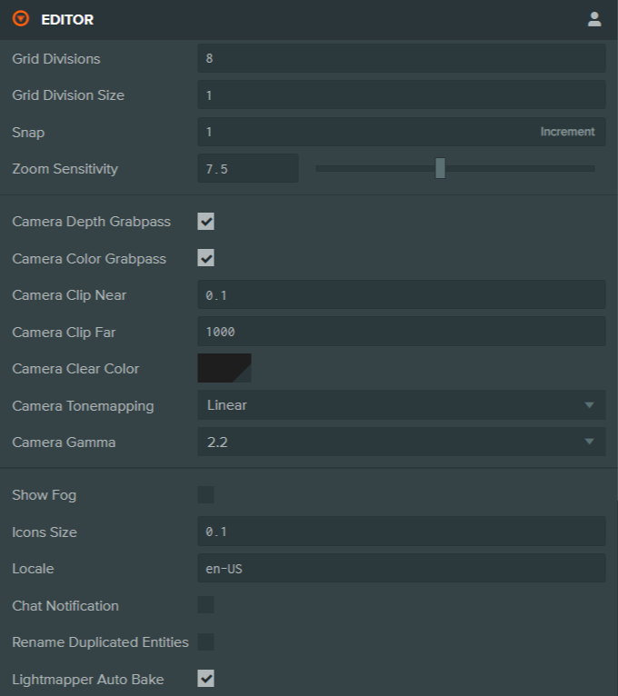

既定では、エディターは多くのユーザーに適した設定になっています。必要に応じて、エディターの既定の動作を変更できます。

:::note

これらの設定はあなた個人にのみ適用され、セッションをまたいで維持（スティッキー）されます。ほとんどの設定はこのプロジェクトのすべてのシーンとブランチに適用されますが、**Zoom Sensitivity**、**Gizmo Size**、**Gizmo Preset**、**Show View Cube**、**View Cube Size**、**Icons Size** はあなたのすべてのプロジェクトに適用されます。

:::

`EDITOR` セクションに移動し、パネルを展開します。

利用可能な設定は次のとおりです。

## 設定 {#settings}

| 設定 | 説明 |
| --- | --- |
| **Grid Divisions** | グリッドの水平方向あたりのセル数。0 に設定するとグリッドを無効化します。**Gizmo Preset** が Default の場合、グリッドは距離に応じてフェードアウトするため、0 以外の値は効果がありません。 |
| **Grid Division Size** | 各セルのサイズ。 |
| **Snap** | [ギズモ](../viewport.md#gizmos)のスナップ間隔。<kbd>Shift</kbd>を押すかツールバーの Snap トグルでギズモ使用中にスナップを有効化します。 |
| **Zoom Sensitivity** | エディターのビューポートでのズーム感度。 |
| **Gizmo Size** | ビューポートに表示される[ギズモ](../viewport.md#gizmos)のサイズ。 |
| **Gizmo Preset** | [ギズモ](../viewport.md#gizmos)とグリッドの見た目:<ul><li><strong>Default</strong>: 変換ギズモはドラッグした量を表示し、平面に輪郭線を描き、真横から見える軸や平面をフェードアウトします。ヘルパーギズモには、カメラ、ライト、コリジョン形状、選択範囲のバウンディングボックスを編集するハンドルがあり、ライトのアイコンはそのライトの色で表示されます。グリッドは距離に応じてフェードアウトします。</li><li><strong>Classic</strong>: 従来の PlayCanvas Editor の見た目です。ギズモの平面は不透明で、グリッドは線で描かれ、バウンディングボックスは単純なボックスで表示されます。ヘルパーギズモはハンドルのない細い白線で描かれます。</li></ul> |
| **Show View Cube** | ビューポートの [View Cube](../viewport.md#view-cube) を表示または非表示にします。 |
| **View Cube Size** | View Cube のサイズ。**Show View Cube** が有効な場合にのみ表示されます。 |
| **Camera Depth Grabpass** | エディタービューポート用のデプスマップテクスチャを生成します。特定のマテリアル効果のプレビューに必要です。 |
| **Camera Color Grabpass** | エディタービューポート用のカラーマップテクスチャを生成します。特定のマテリアル効果のプレビューに必要です。 |
| **Camera Clip Near** | エディターカメラの Near クリップ値。ゲームには影響しません。 |
| **Camera Clip Far** | エディターカメラの Far クリップ値。ゲームには影響しません。 |
| **Camera Clear Color** | エディターカメラのクリアカラー。ゲームには影響しません。 |
| **Camera Tonemapping** | エディターカメラのトーンマッピング。ゲームには影響しません。 |
| **Camera Gamma** | エディターカメラのガンマ補正。ゲームには影響しません。 |
| **Show Fog** | ビューポートでのフォグ描画を有効化。 |
| **Icons Size** | エディタービューポートに表示されるアイコンのサイズ。 |
| **Locale** | エディターおよび Launch 実行時のプレビュー用ロケール。あなたのみに表示され、他のメンバーには共有されません。 |
| **Chat Notification** | エディター内蔵の[リアルタイムチャット](../../realtime-collaboration.md#real-time-chat)の通知を受け取ります。 |
| **Rename Duplicated Entities** | 有効化すると、重複作成したエンティティに連番を付けて一意にします（例: 'Box' → 'Box2'）。 |
| **Lightmapper Auto Bake** | [ランタイムライトマッパー](/user-manual/graphics/lighting/runtime-lightmaps)がシーン更新のたびに自動リベイクするかを制御します。 |
| **Code Editor** | スクリプトを編集するときに開くコードエディター:<ul><li><strong>Web</strong>: ブラウザベースの[コードエディター](../../scripting/code-editor.md)で開きます</li><li><strong>VS Code</strong>、<strong>Cursor</strong>、<strong>Antigravity IDE</strong>: [PlayCanvas VS Code 拡張機能](../../scripting/vscode-extension.md)を使って、そのデスクトップエディターで開きます</li></ul> |
