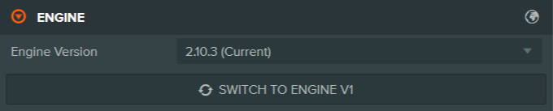

起動、公開、ビルドのダウンロード時に使用する PlayCanvas エンジンのバージョンを設定します。

:::note

この設定はあなたにのみ、現在のセッションの間だけ適用されます。保存されることはなく、他のユーザーとも共有されません。

:::

`ENGINE` セクションに移動し、パネルを展開します。

利用可能な設定は次のとおりです。

## 設定 {#settings}

| 設定 | 説明 |
| --- | --- |
| **Engine Version** | Launch のクリック時や公開/ビルドのダウンロード時に使用するエンジンを指定します。この設定は現在のセッション中のみ有効で、チームメンバー間で共有されません。オプション：<ul><li><strong>Previous</strong>: 直前のマイナーバージョンの最新パッチ</li><li><strong>Current</strong>: 最新の安定版ビルド</li><li><strong>Release Candidate</strong>: エディターで安定版として昇格される前の次期マイナービルド</li></ul> |

### 備考 {#notes}

- エンジンのバージョンによりレンダリング機能や挙動が変わる場合があります。切り替え後はプロジェクトの動作を確認してください。
