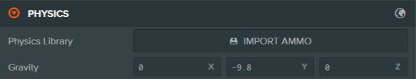

グローバルな物理シミュレーションの設定を制御します。

:::note

**Gravity** はシーン設定です。開いているシーンに保存されるため、シーンごとに異なる重力を設定できます。**Physics Library** はプロジェクトにファイルを追加するため、すべてのシーンに適用されます。どちらの設定も、現在アクティブな[ブランチ](../../version-control/branches.md)の全ユーザーに影響します。

:::

`PHYSICS` セクションに移動し、パネルを展開します。

利用可能な設定は次のとおりです。

## 設定 {#settings}

| 設定 | 説明 |
| --- | --- |
| **Physics Library** | PlayCanvas ストアから Ammo の asm.js および WebAssembly モジュールをこのプロジェクトに追加します。 |
| **Gravity** | シーン内のすべてのリジッドボディに毎フレーム適用される加速度。既定では -9.8 m/s^2（地球の重力に近い値）。宇宙空間のゲームなどでは 0, 0, 0（無重力）に設定できます。 |

### 備考 {#notes}

- Ammo.js をインポートしない場合、物理機能は動作しません。
- 重力を調整すると様々な世界をシミュレーションでき、シーンごとに異なる値を使用できます。
