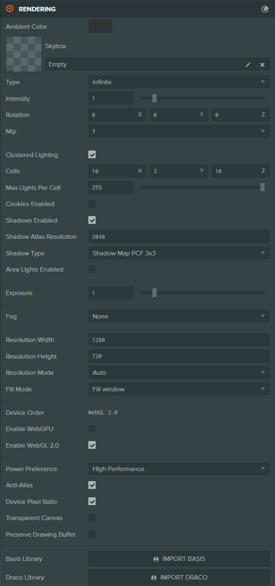

ライティング、解像度、各種レンダリング機能を制御します。

:::note

`RENDERING` パネルには、2 種類の設定があります。

- スカイボックス、クラスタードライティング、フォグなどの[シーン設定](#scene-settings)は、開いているシーンに保存されるため、シーンごとに異なる値を使用できます。
- 解像度やグラフィックスデバイスなどの[プロジェクト設定](#project-settings)は、プロジェクト内のすべてのシーンに適用されます。

どちらの設定も、現在アクティブな[ブランチ](../../version-control/branches.md)の全ユーザーに影響します。

:::

`RENDERING` セクションに移動し、パネルを展開します。

<video autoPlay muted loop controls src='/video/editor-rendering-max-lights.mp4' style={{width: '100%', height: 'auto'}} />

利用可能な設定は次のとおりです。

## シーン設定 {#scene-settings}

パネルの前半には、現在のシーンの設定が表示されます。アプリケーションが[シーンを切り替える](/user-manual/editor/scenes/loading-scenes/)と、エンジンは読み込んだシーンの設定を適用します。

### 環境 (Environment) {#environment}

| 設定 | 説明 |
| --- | --- |
| **Ambient Color** | シーンのアンビエントライトの色（sRGB 色空間）。 |
| **Skybox** | 3D シーンの背後に描画されるキューブマップアセット。事前フィルター済みの場合、物理ベースマテリアルの既定の環境マップとしても使用されます。 |
| **Type** | スカイボックスの投影方式:<ul><li><strong>Infinite</strong>: 無限遠での描画</li><li><strong>Box</strong>: ボックスメッシュへのマッピング</li><li><strong>Dome</strong>: 半球状ドームへのマッピング</li></ul> |
| **Mesh Position / Rotation / Scale** | スカイメッシュの位置、回転、スケール。 |
| **Sky Center** | 地面からの相対的な正規化オフセット。 |
| **Intensity** | 露出に合わせるためのスカイボックスの強度。 |
| **Rotation** | スカイボックスの回転。 |
| **Mip** | 事前フィルター済みスカイボックスの Mip レベル。値が大きいほど低解像度でよりブラーの強い Mip を選択します。 |
| **Sky Depth Write** | スカイを深度バッファに書き込むかどうか。無効にすると、3D ジオメトリをスカイの上に描画できます。 |

### クラスタードライティング {#clustered-lighting}

| 設定 | 説明 |
| --- | --- |
| **Clustered Lighting** | クラスタードライティングを有効化。この設定を変更した後は、エディターを再読み込みする必要があります。[起動ページ](../launch-page/index.md)を開いている場合は、起動ページも再読み込みしてください。 |
| **Cells (X, Y, Z)** | 光源を含む空間を分割する各軸方向のセル数。 |
| **Max Lights Per Cell** | 各セルが保持できる最大ライト数。 |
| **Max Lights** | 1フレーム内に表示できるクラスタードライトの最大数。シーンが許す範囲でできるだけ小さく保ってください。255を超える値では、より大きなライトインデックステクスチャが使用されます。 |
| **Cookie Atlas Resolution** | 非平行光のクッキーテクスチャをまとめるアトラステクスチャの解像度。 |
| **Cookies Enabled** | クラスタードライトでクッキーをサポート。 |
| **Shadows Enabled** | クラスタードライトでシャドウをサポート。 |
| **Shadow Atlas Resolution** | 非平行光のシャドウテクスチャをまとめるアトラステクスチャの解像度。 |
| **Shadow Type** | すべてのシャドウで使用するフィルタリング方式。 |
| **Area Lights Enabled** | クラスタードライトでエリアライトをサポート。 |

### ガウシアンスプラッティング (Gaussian Splatting) {#gaussian-splatting}

[ガウシアンスプラット](/user-manual/gaussian-splatting)のレンダリングに関するシーン全体の設定です。エンティティごとのLOD範囲とLOD距離は[GSplatコンポーネント](/user-manual/editor/scenes/components/gsplat)で設定します。

| 設定 | 説明 |
| --- | --- |
| **Radial Sorting** | ビュー深度ではなく、カメラからの放射距離でスプラットをソートします。 |
| **LOD Update Distance** | ガウシアンスプラットのLOD更新を引き起こすカメラの移動距離。 |
| **LOD Update Angle** | LOD更新を引き起こすカメラの回転角度（度）。0に設定すると角度による更新が無効になります。 |
| **LOD Behind Penalty** | LOD選択時に、カメラの背後にあるスプラットノードに適用される距離の乗数。 |
| **LOD Underfill Limit** | 最適なデータの読み込み中に使用できる、より低詳細なLODレベルの数。 |
| **Splat Budget** | シーン全体でレンダリングするスプラット数。**Splat Budget Mode** の設定に従って使用されます。0に設定すると予算なしになります。 |
| **Splat Budget Mode** | スプラット予算の使い方:<ul><li><strong>Target</strong>: 予算を使い切るまで詳細度を上げます</li><li><strong>Limit</strong>: 各 GSplat の LOD 距離で詳細度を決め、予算に収める必要がある場合にのみ詳細度を下げます</li></ul> |
| **Alpha Clip** | ガウシアンスプラットのシャドウ、ピッキング、プリパスのレンダリングに使用するアルファしきい値。 |
| **Forward Alpha Clip** | この値を下回るスプラットがフォワードパスから除外されるアルファしきい値。 |
| **Min Pixel Size** | この値を下回るスプラットが破棄される、スクリーン空間での最小サイズ。 |
| **Min Contribution** | この値を下回るスプラットがカリングされる、視覚的な寄与の最小値。0に設定すると無効になります。 |
| **Foveation Strength** | 画面の端に向かうほど強まる寄与カリングの強度。0に設定すると無効になります。GPUソートのラスターレンダラーにのみ適用され、それ以外のレンダラーでは効果がありません。 |
| **Foveation Center** | フォービエーションが適用されない、保護される画面中央の半径。 |
| **Anti-Alias** | アンチエイリアスを有効にして学習されたスプラットに、アンチエイリアスの補正を適用します。 |
| **Use Fog** | シーンのフォグをガウシアンスプラットに適用します。 |
| **Use Tonemapping** | カメラのトーンマッピングとシーンの露出をガウシアンスプラットに適用します。シーン内の他のオブジェクトには影響しません。 |
| **Color Update Angle** | 球面調和関数によるカラー更新を引き起こす視線角度の変化量。 |
| **Cooldown Ticks** | 未使用のストリーミングスプラットリソースがアンロードされるまでに待機するティック数。 |
| **Data Format** | ガウシアンスプラットのレンダリングに使用するワークバッファの形式。オプション：Compact、Large。 |
| **Enable IDs** | ガウシアンスプラットのワークバッファに一意のコンポーネントIDを格納します。 |

### トーンマッピング、露出とフォグ {#tonemapping-exposure-and-fog}

| 設定 | 説明 |
| --- | --- |
| **Tonemapping** | Engine v1 のプロジェクトのみ。トーンマッピングは HDR の色を表示可能な範囲に圧縮します。オプション：Linear、Filmic、Hejl、ACES、ACES2、Neutral。Engine v2 のプロジェクトでは、トーンマッピングは各[カメラ](/user-manual/editor/scenes/components/camera)で設定します。 |
| **Exposure** | シーン全体の明るさを調整します。 |
| **Gamma** | Engine v1 のプロジェクトのみ。ガンマ補正：1.0（補正なし）または 2.2（sRGB）。Engine v2 のプロジェクトでは、ガンマ補正は各[カメラ](/user-manual/editor/scenes/components/camera)で設定します。 |
| **Fog** | シーン内のアンビエントフォグの近似を制御します。種類:<ul><li><strong>None</strong>: 無効</li><li><strong>Linear</strong>: Distance Start と Distance End の距離間で線形にフェード</li><li><strong>Exponential</strong>: 視点から指数関数に従ってフェード</li><li><strong>Exponential Squared</strong>: 視点から指数関数二乗に従ってフェード</li></ul> |
| **Distance Start / End** | Linear フォグがフェードインを開始する距離（Start）と最大に達する距離（End）。シーン単位で指定します。 |
| **Density** | Exponential / Exponential Squared タイプでのフェードイン率を制御します。大きいほど素早く濃くなります。正の値にしてください。 |
| **Color** | フォグの色。フォグが濃くなるほど、この色がサーフェスの色に強くブレンドされます。 |

## プロジェクト設定 {#project-settings}

パネルの残りの部分はプロジェクト設定で、すべてのシーンに適用されます。

### 解像度 (Resolution) {#resolution}

| 設定 | 説明 |
| --- | --- |
| **Resolution Width / Height** | アプリケーションの幅／高さ（ピクセル）。 |
| **Resolution Mode** | キャンバスのサイズ変更時に解像度を変更するかどうか。 |
| **Fill Mode** | キャンバスがブラウザウィンドウをどのように満たすか。 |

### デバイスと API (Device & API) {#device-and-api}

| 設定 | 説明 |
| --- | --- |
| **Device Order** | グラフィックスデバイスの作成を試行する順序。 |
| **Enable WebGPU** | 利用可能な場合、WebGPU の使用を試みます。 |
| **Enable GLSL Shader Transpilation** | 有効にすると、WebGPU で GLSL 専用のシェーダーがサポートされます。公開およびダウンロードするビルドに、シェーダーコンパイラーのファイルが追加されます。**Enable WebGPU** が有効な場合にのみ表示されます。 |
| **Enable WebGL 2.0** | 利用可能な場合、WebGL 2.0 の使用を試みます。 |

### レンダリングオプション {#rendering-options}

| 設定 | 説明 |
| --- | --- |
| **Power Preference** | WebGL に希望の電力モードを示します:<ul><li><strong>Default</strong>: ブラウザに委ねる</li><li><strong>High Performance</strong>: 描画性能を優先</li><li><strong>Low Power</strong>: 省電力を優先</li></ul> |
| **Anti-aliasing** | 無効化するとバックバッファのアンチエイリアスを無効にします。 |
| **Device Pixel Ratio** | デバイスピクセル比でキャンバスのバックバッファ解像度を乗算（例: Retina では 2x）。シャープさが増す一方で GPU/メモリ使用量も増えます。 |
| **Transparent Canvas** | キャンバスの背景を透過にして、Web ページの背景を透過表示できます。ページデザインや UI とアプリを重ねる用途に有用です。 |
| **Preserve Drawing Buffer** | 明示的にクリアするまで描画バッファを保持します。スクリーンショット取得などに有用です。 |

### 外部ライブラリ {#external-libraries}

| 設定 | 説明 |
| --- | --- |
| **Basis Library** | Basis 圧縮をサポートするために必要なライブラリを追加します。 |
| **Draco Library** | Draco 圧縮をサポートするために必要なライブラリを追加します。 |
