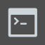

ビューポートは現在レンダリングされているシーンを表示します。エディタの現在のカメラを操作して、自由にシーン内を移動できます。

## カメラ (Cameras) {#cameras}

エディタは最初に **Perspective** (透視投影) カメラを使用するように設定されています。このカメラは、シーン内に浮かんでいるかのように見えます。カメラドロップダウンメニューを使用して、他のさまざまなカメラを使用してシーンを表示できます。

上部、下部、前面、背面、左側、右側の**正投影**カメラでは、遠近法のないシーンを表示できます。位置を微調整するのに便利です。

また、カメラメニューを使用して、シーン内の任意のカメラエンティティを選択することもできます。これにより、ゲーム内カメラを必要な位置に正確に配置できます。

キーボードでカメラを切り替えるには、テンキーを使用します。[ビューポートのカメラ](keyboard-shortcuts.md#viewport-cameras)を参照してください。

## ビューキューブ (View Cube) {#view-cube}

ビューポートの右下にある View Cube は、カメラの向きを示します。各軸の先には円があります。X、Y、Z のラベルが付いた色付きの円は正の軸を、色付きの輪郭を持つグレーの円は負の軸を表します。

円をクリックすると、その方向からシーンを表示します。カメラはその軸上に回り込み、周回の中心となる点の方を向きます。中心からの距離と透視投影はそのまま保たれるため、新しい視点から続けて周回できます。たとえば、Y をクリックするとシーンを真上から見下ろし、Z をクリックすると正面から表示します。

正投影カメラを使用している間、View Cube は表示されません。View Cube を非表示にしたりサイズを変更したりするには、[エディター設定](settings/editor.md)の **Show View Cube** と **View Cube Size** を使用します。

## ギズモ (Gizmo) {#gizmos}

スクリーンショットで見ることができる3色の軸は、[ギズモ](/user-manual/glossary#gizmo)と呼ばれます。これは、選択したエンティティの変換行列を操作するために使用されます。変換ギズモには3つの種類があります。矢印が軸の端にある「移動」、色付きの円がある「回転」、軸の端にキューブがある「拡大縮小」です。4つ目のギズモである「エレメントのサイズ変更」は、[UIエレメント](/user-manual/user-interface/elements/#element-resizing)の幅と高さを変更します。これらのギズモは、[ツールバー](toolbar.md)または 1、2、3、4 キーで切り替えます。

ギズモのサイズとスタイルを変更するには、[エディター設定](settings/editor.md)の **Gizmo Size** と **Gizmo Preset** を使用します。

## エンティティアイコン {#entity-icons}

一部のコンポーネントは可視ジオメトリを持たないため、エディタは非選択時にエンティティの位置を示すアイコンをビューポートに描画します。アイコンをクリックすると、そのエンティティが[ヒエラルキー](/user-manual/editor/interface/hierarchy)パネルと[インスペクター](/user-manual/editor/interface/inspector)パネルで選択されます。

| コンポーネント | アイコン |
| --------- | ---- |
| [Camera](/user-manual/editor/scenes/components/camera) |  |
| [Light](/user-manual/editor/scenes/components/light) — directional |  |
| [Light](/user-manual/editor/scenes/components/light) — omni |  |
| [Light](/user-manual/editor/scenes/components/light) — spot |  |
| [Script](/user-manual/editor/scenes/components/script) |  |
| [Animation](/user-manual/editor/scenes/components/animation) |  |

エンティティが複数のコンポーネントを持つ場合、表示されるアイコンは次の優先順位に従います: camera、light、script、animation。また、ライトのアイコンはライトの色に合わせて着色されます。

## レンダーモード {#render-mode}

ビューポートの右上のこのドロップダウンメニューを使用して、ビューポートのレンダーモードを変更できます。

ワイヤーフレームレンダリングを切り替えることができます。

また、さまざまなデバッグレンダーモードでシーンを視覚化することもできます。これにより、レンダリングされるシーンはアルベド、ノーマル、AO、エミッションなどに限定されます。

