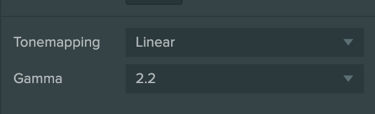
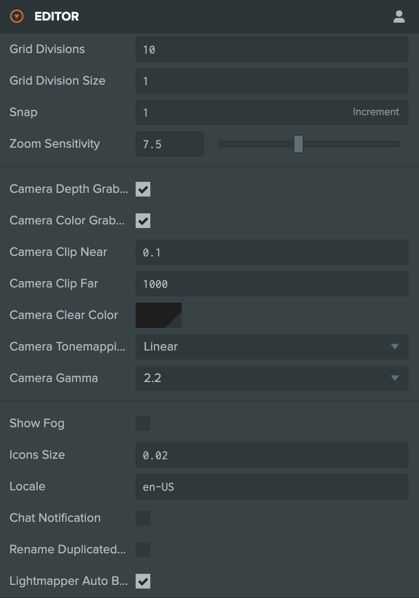

EditorはすべてのプロジェクトをEngine V2で実行します。Engine V1用に作られたプロジェクトは、書き込み権限を持つユーザーが初めてEditorで開いたときに、自動的にEngine V2へアップグレードされます。Editorは開いているシーンを変換し、変更を保存してからリロードします。プロジェクトをEngine V1に戻す方法はありません。

Engine V2では、シーンの一部の設定方法と、エンジンの一部のAPIが変わりました。このページでは、アップグレードで自動的に行われることと、その後に自分で確認することを説明します。

## アップグレードで変わること {#what-the-upgrade-changes}

### ガンマとトーンマッピング {#gamma-and-tone-mapping}

Engine V1では、ガンマとトーンマッピングはRendering設定でシーン全体に対して設定していました。Engine V2ではカメラごとに設定するため、すべてのCameraコンポーネントに **Tonemapping** と **Gamma** のフィールドがあります。

アップグレードでは、開いているシーンのガンマとトーンマッピングがそのシーンの各カメラにコピーされ、値が変わったカメラがConsoleに表示されます。プロジェクトのほかのシーンのカメラは変更されないので、それぞれのシーンを開いてカメラを確認してください。

Viewportには独自のガンマとトーンマッピングがあり、Editorでのシーンの見え方だけに影響します。[Editor設定](/user-manual/editor/interface/settings/editor/)の **Camera Tonemapping** と **Camera Gamma** で設定します。

### sRGBテクスチャ {#srgb-textures}

Engine V2では、各テクスチャがsRGBかどうかを指定する必要があります。ディフューズマップやエミッシブマップなど色を保存するテクスチャは、正確な色のためにsRGBにします。法線マップなどそれ以外のデータを保存するテクスチャはsRGBにしません。この設定はテクスチャアセットのパネルにあります。

Editorは、各テクスチャの設定を、そのテクスチャが使われている場所と照らし合わせて確認します。対応が必要なテクスチャがあると、Editor下部のステータスバーに **N audits found** と表示され、影響を受けるテクスチャやテクスチャアトラスと使用場所がConsoleに表示されます。

- **N audits found** を選択してから **Fix issues** を選ぶと、すべての使用場所で同じ設定が必要なテクスチャが修正されます。
- 使用場所によって必要な設定が異なる競合は、1つずつ解決します。Consoleのメッセージを選択すると、その使用場所に移動します。同じ画像を両方の用途で使うには、テクスチャを複製して、用途ごとに別のコピーを使ってください。

<video autoPlay muted loop controls playsInline src='/video/asset-auditor.mp4' style={{width: '100%', height: 'auto'}} />

sRGBについて詳しくは、リニアワークフローの[テクスチャ](/user-manual/graphics/linear-workflow/textures/)を参照してください。

### スクリプト {#scripts}

アップグレードではスクリプトは変更されません。Engine V2では一部のEngine V1のAPIが変更または削除されたため、[エンジンマイグレーション](/user-manual/engine/migrations/)ガイドと照らし合わせてスクリプトを確認してください。その後、**Debug** [起動オプション](/user-manual/editor/interface/launch-page/)にチェックを入れてプロジェクトを起動し、ブラウザのJavaScriptコンソールにエラーや非推奨の警告が出ていないか確認します。

:::ai
**[Editor MCP Server](/user-manual/editor/mcp-server/)** を使うと、AIアシスタントがEngine V1のAPIを使っているスクリプトを見つけて更新し、プロジェクトを起動して結果を確認できます。そのページには、アシスタントがEngine V1のプロジェクトを移行する[デモ](/user-manual/editor/mcp-server/#verify-the-running-result)があります。
:::

## アップグレード後のトラブルシューティング {#troubleshooting-the-upgrade}

### シーンが明るく、または暗く見える {#the-scene-looks-brighter-or-darker}

シーンの見た目に影響するすべての場所を確認してください。

- **各カメラ**: すべてのシーンの、すべてのCameraコンポーネントの **Gamma** と **Tonemapping**。[ガンマとトーンマッピング](#gamma-and-tone-mapping)を参照してください。
- **Viewport**: Editor設定の **Camera Gamma** と **Camera Tonemapping**。Viewportの見え方だけが変わります。
- **各テクスチャ**: sRGB設定。[sRGBテクスチャ](#srgb-textures)を参照してください。

### カメラの見た目がEditorと起動ページで違う {#a-camera-looks-different-in-the-editor-and-on-the-launch-page}

スクリプトでカメラを作成している場合は、Cameraコンポーネントの`gammaCorrection`プロパティと`toneMapping`プロパティで、コードからガンマとトーンマッピングを明示的に設定してください。
