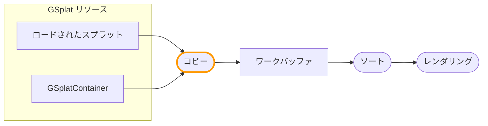

import Tabs from '@theme/Tabs';
import TabItem from '@theme/TabItem';

ワークバッファフォーマットは、ワークバッファで利用可能なデータストリームと、スプラットデータがリソースからどのようにコピーされるかを定義します。コピー操作をカスタマイズして、スプラットを変換し、コンポーネントごとの追加データを書き込むことができます。

:::note

この機能は[スプラットレンダリングアーキテクチャ](/user-manual/gaussian-splatting/rendering-architecture)に基づいています。

:::

## パイプラインの概要

スプラットデータは**コピー**操作を通じてリソースからワークバッファに流れます：



コピー操作は各gsplatコンポーネントに対して実行され、`setWorkBufferModifier()`を使用してコンポーネントごとにカスタマイズできます。

## コピー操作のカスタマイズ

各gsplatコンポーネントで`setWorkBufferModifier()`を使用して、そのスプラットがワークバッファにどのようにコピーされるかをカスタマイズします。

### モディファイア関数

モディファイアコードは3つの関数を実装する必要があります：

| 関数 | 目的 |
|----------|---------|
| `modifySplatCenter(inout vec3 center)` | スプラットの位置を変更 |
| `modifySplatRotationScale(vec3 originalCenter, vec3 modifiedCenter, inout vec4 rotation, inout vec3 scale)` | 回転とスケールを変更 |
| `modifySplatColor(vec3 center, inout vec4 color)` | 色を変更し、追加ストリームに書き込む |

`modifySplatCenter`は常に最初に実行されます。追加ストリームをサンプリングして値をグローバル変数に格納したり、3つの関数間で共有されるコードを実行したりするために使用できます。

### 基本的な例

```javascript
entity.gsplat.setWorkBufferModifier({
    glsl: `
        void modifySplatCenter(inout vec3 center) {
            // すべてのスプラットを上にオフセット
            center.y += 1.0;
        }
        void modifySplatRotationScale(vec3 originalCenter, vec3 modifiedCenter,
                                       inout vec4 rotation, inout vec3 scale) {}
        void modifySplatColor(vec3 center, inout vec4 color) {
            // スプラットを赤くティント
            color.rgb *= vec3(1.0, 0.5, 0.5);
        }
    `,
    wgsl: `
        fn modifySplatCenter(center: ptr<function, vec3f>) {
            (*center).y += 1.0;
        }
        fn modifySplatRotationScale(originalCenter: vec3f, modifiedCenter: vec3f,
                                     rotation: ptr<function, vec4f>, scale: ptr<function, vec3f>) {}
        fn modifySplatColor(center: vec3f, color: ptr<function, vec4f>) {
            *color = vec4f((*color).rgb * vec3f(1.0, 0.5, 0.5), (*color).a);
        }
    `
});
```

## 追加ストリームの追加 {#adding-extra-streams}

デフォルトでは、ワークバッファには標準的なスプラットデータ（位置、色、回転、スケール）が含まれています。カスタムのスプラットごとのデータを格納するために追加ストリームを追加できます：

```javascript
// コンポーネントIDを格納するストリームを追加（R32U = unsigned int）
app.scene.gsplat.format.addExtraStreams([
    { name: 'splatId', format: pc.PIXELFORMAT_R32U }
]);
```

一般的なストリームフォーマット：

- `PIXELFORMAT_R32U` - 単一の符号なし整数（例：コンポーネントID）
- `PIXELFORMAT_RGBA8` - 4バイト（例：パックされたデータ）
- `PIXELFORMAT_RGBA16F` - 4つのhalf float（例：カスタム属性）
- `PIXELFORMAT_RGBA32F` - 4つのfloat（例：高精度データ）

:::note

ストリームは一度追加すると削除できません。`GSPLAT_STREAM_INSTANCE`ストレージオプションはワークバッファフォーマットでは無視されます。

:::

## 追加ストリームへの書き込み

追加ストリームごとに、書き込み関数が生成されます：`write{StreamName}()`。例えば、`splatId`という名前のストリームは`writeSplatId()`を生成します。

:::note

各`setWorkBufferModifier`は、ワークバッファフォーマットで定義された**すべての**追加ストリームに書き込む必要があります。すべてのコンポーネントは同じワークバッファフォーマットを共有するため、モディファイアは一貫している必要があります。

:::

```javascript
entity.gsplat.setWorkBufferModifier({
    glsl: `
        uniform uint uComponentId;

        void modifySplatCenter(inout vec3 center) {}
        void modifySplatRotationScale(vec3 originalCenter, vec3 modifiedCenter,
                                       inout vec4 rotation, inout vec3 scale) {}
        void modifySplatColor(vec3 center, inout vec4 color) {
            // splatIdストリームにコンポーネントIDを書き込む
            writeSplatId(uvec4(uComponentId, 0u, 0u, 0u));
        }
    `,
    wgsl: `
        uniform uComponentId: u32;

        fn modifySplatCenter(center: ptr<function, vec3f>) {}
        fn modifySplatRotationScale(originalCenter: vec3f, modifiedCenter: vec3f,
                                     rotation: ptr<function, vec4f>, scale: ptr<function, vec3f>) {}
        fn modifySplatColor(center: vec3f, color: ptr<function, vec4f>) {
            writeSplatId(vec4u(uniform.uComponentId, 0u, 0u, 0u));
        }
    `
});
```

## ユニフォームの受け渡し

コンポーネントで`setParameter()`、`getParameter()`、`deleteParameter()`を使用してユニフォーム値を管理します：

```javascript
// ユニフォームを設定
entity.gsplat.setParameter('uComponentId', componentIndex);

// ユニフォーム値を取得
const id = entity.gsplat.getParameter('uComponentId');

// ユニフォームを削除
entity.gsplat.deleteParameter('uComponentId');
```

サポートされているユニフォームタイプ：

- 数値（int、float、uint）
- 配列（vec2、vec3、vec4、mat4など）
- `Texture`オブジェクト
- `StorageBuffer`オブジェクト

## ソースデータの読み取り

コピーモディファイアでは、[スプラットデータフォーマット](/user-manual/gaussian-splatting/rendering-architecture/splat-data-format)から生成されたロード関数を使用して元のスプラットデータを読み取ることができます。デフォルトフォーマットの場合：

- `loadDataColor()` - `vec4`の色を返す
- `loadDataCenter()` - `vec4`の位置(xyz) + 追加データ(w)を返す
- `loadDataScale()` - `vec4`のスケールを返す
- `loadDataRotation()` - `vec4`の回転クォータニオンを返す

### 異なるインデックスからの読み取り

各ロード関数には、特定のスプラットインデックスから読み取るための`WithIndex`バリアントがあります：

```glsl
// GLSL - 隣接するスプラットデータを読み取る
vec4 neighborCenter = loadDataCenterWithIndex(neighborIndex);
```

同じ異なるインデックスから複数の属性を読み取るには、`setSplat()`を使用して現在のインデックスを変更します：

```glsl
// GLSL - 別のスプラットから複数の属性を読み取る
setSplat(otherIndex);
vec3 otherPos = getCenter();
vec4 otherColor = getColor();
```

詳細については[スプラットデータフォーマット - シェーダーアクセス](/user-manual/gaussian-splatting/rendering-architecture/splat-data-format#shader-access)を参照してください。

## SOGブラインドデータの読み取り {#reading-sog-blind-data}

[SOG](/user-manual/gaussian-splatting/formats/sog)バージョン3のファイルは[ブラインドデータ](/user-manual/gaussian-splatting/formats/sog#37-blind-data-optional)を持つことができます。これは、意味をアプリケーションが定義するGaussianごとのフィールドです。このようなアセットを描画するコンポーネントのコピーモディファイアは、各フィールドを次の方法で読み取れます。

- `getBlind_<name>()` - 現在のスプラットのフィールド値を返します。整数型の `u8` から `u32` では `uint`（WGSLでは `u32`）、`f16`、`f32`、`unorm8`、`unorm16` では `float`（`f32`）です。
- `SOG_BLIND_<name>` - アセットがそのフィールドを持つ場合に設定されるdefineです。1つのモディファイアで、フィールドを持つアセットと持たないアセットの両方に対応できます。

`<name>` は、フィールド名の英字、数字、`_` 以外の文字をすべて `_` に置き換え、連続する `_` を1つにまとめ、先頭と末尾の `_` を取り除いたものです。`part-id` という名前のフィールドは `getBlind_part_id()` で読み取ります。

次のモディファイアは、`logo` フィールドが1のスプラットに色を付けます。

<Tabs groupId="shader-language" queryString="lang">
<TabItem value="glsl" label="GLSL">

```glsl
void modifySplatCenter(inout vec3 center) {}
void modifySplatRotationScale(vec3 originalCenter, vec3 modifiedCenter, inout vec4 rotation, inout vec3 scale) {}
void modifySplatColor(vec3 center, inout vec4 color) {
    #ifdef SOG_BLIND_logo
        if (getBlind_logo() == 1u) {
            color.rgb = vec3(1.0, 0.65, 0.15);
        }
    #endif
}
```

</TabItem>
<TabItem value="wgsl" label="WGSL">

```wgsl
fn modifySplatCenter(center: ptr<function, vec3f>) {}
fn modifySplatRotationScale(originalCenter: vec3f, modifiedCenter: vec3f, rotation: ptr<function, vec4f>, scale: ptr<function, vec3f>) {}
fn modifySplatColor(center: vec3f, color: ptr<function, vec4f>) {
    #ifdef SOG_BLIND_logo
        if (getBlind_logo() == 1u) {
            *color = vec4f(1.0, 0.65, 0.15, (*color).a);
        }
    #endif
}
```

</TabItem>
</Tabs>

```javascript
entity.gsplat.setWorkBufferModifier({ glsl: glslModifier, wgsl: wgslModifier });
```

ブラインドデータはアセットから読み取られ、ワークバッファには含まれません。描画時にフィールドを使用するには、コピーの際に[追加ストリーム](#adding-extra-streams)へ書き込んでください。

Blind Dataサンプルは、SOGバージョン3のファイルから2つのフィールドを読み取ります。ロゴに光沢を加える `logo` フラグと、スプラットの残りの部分に色相の波を走らせる `edge` 距離です。**View** オプションでは、フィールドそのものを表示します。

<EngineExample id="gaussian-splatting-fx/blind-data" title="Blind Dataサンプル" />

## ライブサンプル

以下を示すLOD Instancesサンプルを参照してください：

<EngineExample id="gaussian-splatting/streamed-instances" title="LOD Instancesサンプル" />

- ワークバッファへの`splatId`ストリームの追加
- `setWorkBufferModifier()`を使用したコピー中のコンポーネントIDの書き込み
- `setParameter()`によるユニフォームの受け渡し

## 関連項目

- [ワークバッファレンダリング](/user-manual/gaussian-splatting/rendering-architecture/work-buffer-rendering) - レンダリング操作のカスタマイズ
- [スプラットデータフォーマット](/user-manual/gaussian-splatting/rendering-architecture/splat-data-format)
- [スプラットレンダリングアーキテクチャ](/user-manual/gaussian-splatting/rendering-architecture)
