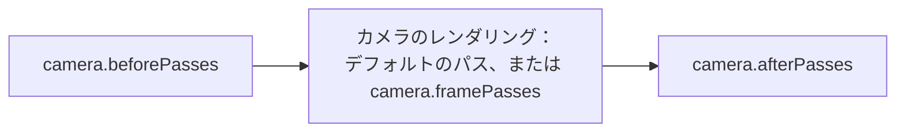

各カメラは、[フレームグラフ](index.md)のうち自身が担当する部分を、[フレームパス](frame-passes.md)のグループとしてレンダリングします。デフォルトでは、これらはカメラのレイヤーをレンダリングするためにエンジンが作成するパスです。その前後に独自のパスを追加したり、それらを独自のパスに置き換えたりできます。

## カメラのパス {#the-passes-of-a-camera}

各カメラは、パスを次の 3 つのグループに分けてこの順にレンダリングし、次のカメラが開始する前に 3 つすべてが完了します。



- [`beforePasses`](#before-passes) は、カメラがシーンをレンダリングする前にレンダリングされます。
- カメラのレンダリングは、デフォルトのレンダリングか、[`framePasses`](#replacing-the-cameras-rendering) 内のパスのいずれかです。
- [`afterPasses`](#after-passes) は、カメラがレンダリングするすべてのものの後にレンダリングされます。

## 前のパス {#before-passes}

[`CameraComponent#beforePasses`](https://api.playcanvas.com/engine/classes/CameraComponent.html#beforepasses) 内のパスは、カメラのディレクショナルライトのシャドウマップの後、カメラがシーンをレンダリングする前にレンダリングされます。同じフレーム内で、シーンのマテリアルが読み取るテクスチャにレンダリングしたり、シーンが結果を使用するコンピュートシェーダーを実行したりするために使用します。

前のパスには、[`RenderPassForward`](render-pass-forward.md#limitations) のような、カメラのレイヤーをレンダリングするパスを含めることはできません。フレームが複数の XR ビューをレンダリングする場合、前のパスはビューごとにレンダリングされます。ただし、コンピュートパスは例外で、その [`xrViewIndex`](compute-pass.md#xr-views) が選択するビューで実行されます。

## 後のパス {#after-passes}

[`CameraComponent#afterPasses`](https://api.playcanvas.com/engine/classes/CameraComponent.html#afterpasses) 内のパスは、カメラがそのフレームでレンダリングするすべてのもの（カメラのフレームパスを含む）の後にレンダリングされます。カメラがレンダリングした結果を同じフレーム内で処理するために使用します。たとえば、カメラのカラーマップを読み取る[コンピュートパス](compute-pass.md)で処理します。フレームが複数の XR ビューをレンダリングする場合、後のパスはすべてのビューの後に 1 回だけレンダリングされます。

## カメラのレンダリングを置き換える {#replacing-the-cameras-rendering}

[`CameraComponent#framePasses`](https://api.playcanvas.com/engine/classes/CameraComponent.html#framepasses) 内のパスは、カメラのデフォルトのレンダリングの代わりに、配列の順にレンダリングされます。これらを使って、カメラのレンダリング方法を決定します。つまり、カメラのどのレイヤーをどのレンダーターゲットにレンダリングするか、そしてどのパスで結果を処理するかを決めます。通常、そのうちの 1 つは [`RenderPassForward`](render-pass-forward.md) で、カメラを使ってシーンのレイヤーをレンダリングします。

次の例では、フォワードパスがシーンをテクスチャにレンダリングし、[シェーダークアッドパス](render-pass-shader-quad.md)がそれに色味を付けて画面に描画します。

```javascript
// シーンのレンダリング先となる、バックバッファと同じサイズのテクスチャ
const texture = new Texture(app.graphicsDevice, {
    name: 'SceneTexture',
    width: 4,
    height: 4,
    format: PIXELFORMAT_RGBA8,
    mipmaps: false,
    minFilter: FILTER_LINEAR,
    magFilter: FILTER_LINEAR,
    addressU: ADDRESS_CLAMP_TO_EDGE,
    addressV: ADDRESS_CLAMP_TO_EDGE
});
const renderTarget = new RenderTarget({ colorBuffer: texture, depth: true });

// ワールドレイヤーと UI レイヤーをテクスチャにレンダリングし、テクスチャは毎フレームバックバッファのサイズにリサイズされます
const scenePass = new RenderPassForward(app.graphicsDevice, app.scene, cameraEntity.camera);
scenePass.name = 'ScenePass';
scenePass.init(renderTarget, { resizeSource: null });
scenePass.addLayer(worldLayer, false);
scenePass.addLayer(uiLayer, true);

// テクスチャに色味を付けて画面に描画します
const tintPass = new TintPass(app.graphicsDevice, texture);
tintPass.init(null);

cameraEntity.camera.framePasses = [scenePass, tintPass];
```

カメラのデフォルトのレンダリングに戻すには、`framePasses` を `null` に設定します。

カメラの前のパスと後のパスは、引き続きフレームパスの前後でレンダリングされます。前のパスは、カメラのレイヤーをレンダリングするフレームパスのうち最初のものの前にレンダリングされ、そのようなフレームパスが 1 つもない場合はレンダリングされません。後のパスは、すべてのフレームパスの後にレンダリングされます。

カメラは、レイヤーを複数のフォワードパスでレンダリングすることもできます。たとえば、不透明レイヤー、次にそれらのレンダリング結果を読み取る独自のパス、そして半透明レイヤーという順です。

## パスの追加と削除 {#adding-and-removing-passes}

パスを配列に追加し、レンダリングを停止するには配列から削除します。カメラはパスを破棄しないため、パスを削除したら破棄し、その後でパスのレンダリング先を破棄してください。

```javascript
const pass = new MyPass(app.graphicsDevice);
pass.name = 'MyPass';
cameraEntity.camera.afterPasses.push(pass);

// 不要になったら、パスを削除して破棄します
const passes = cameraEntity.camera.afterPasses;
passes.splice(passes.indexOf(pass), 1);
pass.destroy();
```

## 例 {#examples}

カメラがフレームパスでレンダリングします。フォワードパスがワールドレイヤーと UI レイヤーをテクスチャにレンダリングし、シェーダークアッドパスがそれに色味を付けて画面に描画します。

<EngineExample id="render-targets/render-pass-camera" title="Render Pass Camera" />

カメラの後のパスに含まれるコンピュートパスが、カメラがレンダリングした色のヒストグラムを作成します。

<EngineExample id="compute/histogram" title="Histogram" />
