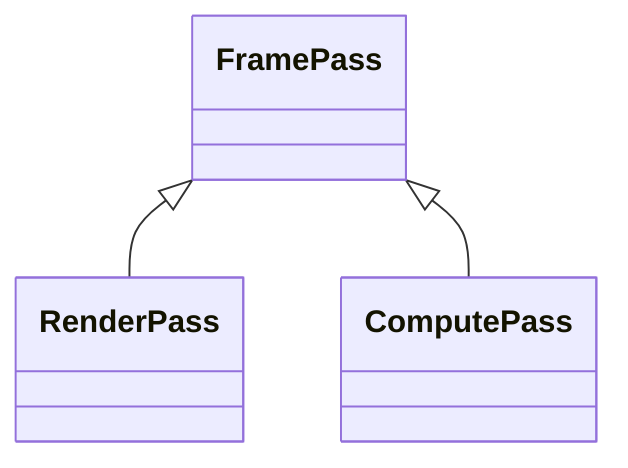
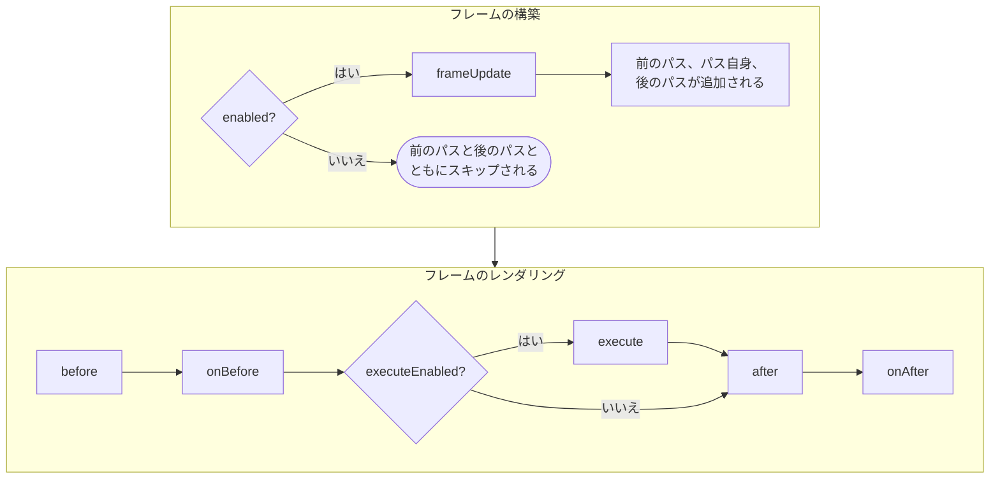
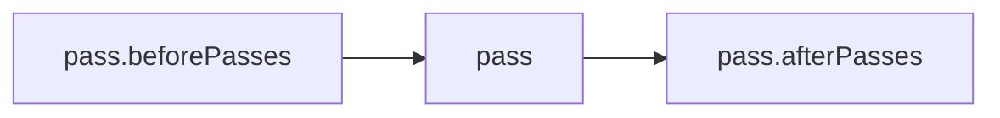

PlayCanvas では、[フレームグラフ](index.md)の各論理パスは**フレームパス**です。フレームパスはエンジンのオブジェクトで、フレームのレンダリング時にパスの処理を記録します。エンジンは自身のフレームをこの方法でレンダリングします。シャドウマップ、各カメラのシーン、ポストプロセスはすべてフレームパスです。また、独自のフレームパスを追加して、テクスチャにレンダリングしたり、カメラのレンダリング結果を処理したり、その結果に対してコンピュートシェーダーを実行したりできます。

エンジンは毎フレーム、フレームパスを順番にフレームグラフへ集め、それらを順に実行しながら、必要な物理パスを開始・終了します。物理パスを自分で開始・終了することはありません。

## パスのクラス {#the-pass-classes}

すべてのフレームパスは、`FramePass` またはその派生クラスのインスタンスです。2 種類の物理パスには、それぞれ派生クラスが 1 つずつ対応します。レンダリング用の `RenderPass` と、コンピュートシェーダー用の `ComputePass` です。



| クラス | 用途 |
| ----- | ---------- |
| [`FramePass`](https://api.playcanvas.com/engine/classes/FramePass.html) | 基底クラス。物理パスを必要としない処理、または他のフレームパスのグループ。 |
| [`RenderPass`](render-pass.md) | レンダーターゲット、またはバックバッファへのレンダリング。 |
| [`ComputePass`](compute-pass.md) | フレーム内の特定の位置でのコンピュートシェーダーのディスパッチ。 |

`RenderPass` は論理レンダーパスで、そのドローコールを自身のレンダーターゲット用の物理レンダーパスに記録します。通常、エンジンは `RenderPass` ごとに物理レンダーパスを開始し、その後に終了します。連続する `RenderPass` オブジェクトが同じレンダーターゲットにレンダリングする場合は、代わりに単一の物理レンダーパスを共有します。[フレームグラフ](index.md#the-frame-graph)を参照してください。同様に、エンジンは `ComputePass` のディスパッチを物理コンピュートパスに記録します。

エンジンは、レンダーターゲットのすべてのピクセルに対するシェーダーの実行やシーンのレンダリングなど、一般的な種類の描画のために `RenderPass` からクラスを派生させています。[レンダーパス](render-pass.md#classes-derived-from-renderpass)を参照してください。

## フレームパスのライフサイクル {#the-lifecycle-of-a-frame-pass}

フレームパスは、自身が含まれる各フレームで 2 つのフェーズを経ます。フレームの構築中、何もレンダリングされる前に、エンジンはパスを更新し、フレームがどのパスをレンダリングするかを決定します。その後、フレームはパスを順番にレンダリングします。



サブクラスは、これらのメソッドをオーバーライドして処理を行います。

- [`frameUpdate`](https://api.playcanvas.com/engine/classes/FramePass.html#frameupdate) は、何もレンダリングされる前に、そのフレームに向けてパスを更新します。たとえば、レンダーターゲットのリサイズ、読み取るテクスチャの設定、前のパスや後のパスの追加や削除を行います。
- [`before`](https://api.playcanvas.com/engine/classes/FramePass.html#before) と [`after`](https://api.playcanvas.com/engine/classes/FramePass.html#after) は、パスの処理の前後に実行されます。
- [`execute`](https://api.playcanvas.com/engine/classes/FramePass.html#execute) は処理を記録します。`RenderPass` の場合、自身のレンダーターゲット用の物理レンダーパスの中で実行されます。

[`onBefore`](https://api.playcanvas.com/engine/classes/FramePass.html#onbefore) と [`onAfter`](https://api.playcanvas.com/engine/classes/FramePass.html#onafter) コールバックを使うと、サブクラスを作成せずにパスにフックできます。パスの実行直前にパラメーターを設定したり、パスが書き込むバッファをクリアしたり、実行直後にパスが書き込んだ内容を読み戻したりできます。

```javascript
pass.onBefore = () => {
    buffer.clear();
};

pass.onAfter = () => {
    buffer.read().then((data) => {
        // 結果は数フレーム後に届きます
    });
};
```

### enabled と executeEnabled {#enabled-and-executeenabled}

パスを無効にするプロパティは 2 つあり、ライフサイクルの異なる時点で作用します。

- [`enabled`](https://api.playcanvas.com/engine/classes/FramePass.html#enabled) を false に設定すると、フレームの構築時に、パスはその前のパスと後のパスとともにスキップされ、`frameUpdate` は呼び出されません。フレームが構築される前に変更してください。パスの `frameUpdate` で、そのパス自身を無効にすることはできません。
- [`executeEnabled`](https://api.playcanvas.com/engine/classes/FramePass.html#executeenabled) を false に設定すると、`execute` のみがスキップされます。パスは引き続き更新され、前のパスと後のパスもレンダリングされ、`before`、`after`、`onBefore`、`onAfter` も呼び出されます。遅くとも `frameUpdate` の中で設定してください。

## 前のパスと後のパス {#before-and-after-passes}

すべてのパスは [`beforePasses`](https://api.playcanvas.com/engine/classes/FramePass.html#beforepasses) と [`afterPasses`](https://api.playcanvas.com/engine/classes/FramePass.html#afterpasses) を持ちます。これらは、パスがレンダリングされるフレームごとに、パスの直前と直後にレンダリングされます。



これによりパスをネストでき、素の `FramePass` で、まとめて有効化・無効化されるパスのグループを保持できます。

```javascript
// 2 つのブラーパスのグループ：グループを無効にすると両方がスキップされます
const blur = new FramePass(app.graphicsDevice);
blur.name = 'Blur';
blur.beforePasses.push(horizontalBlurPass, verticalBlurPass);

blur.enabled = false;
```

## カメラへのパスの追加 {#adding-passes-to-a-camera}

カメラは[前のパス](camera-passes.md#before-passes)、次にカメラ自身のレンダリング（独自の[フレームパス](camera-passes.md#replacing-the-cameras-rendering)に置き換えることができます）、そして[後のパス](camera-passes.md#after-passes)の順にレンダリングします。[カメラパス](camera-passes.md)を参照してください。

## パスを単独でレンダリングする {#rendering-a-pass-on-its-own}

[`render`](https://api.playcanvas.com/engine/classes/FramePass.html#render) を呼び出すと、パスをフレームの外でレンダリングすることもできます。たとえば、テクスチャに一度だけレンダリングする場合です。`before`、`onBefore`、`execute`、`after`、`onAfter` は実行されますが、フレームによる準備は行われません。`frameUpdate` は呼び出されず、前のパスと後のパスもレンダリングされません。

```javascript
pass.render();
```

## パスの所有 {#owning-passes}

パスが自動的に破棄されることはありません。カメラは自身のリスト内のパスを破棄せず、パスも自身の前のパスと後のパスを破棄しません。パスを作成したコードが、追加先のリストからパスを削除した後に [`destroy`](https://api.playcanvas.com/engine/classes/FramePass.html#destroy) を呼び出して破棄します。破棄したパスは、それ以降使用しないでください。また、パスは、レンダーターゲットやシェーダーなど、渡されたものも破棄しません。

[`name`](https://api.playcanvas.com/engine/classes/FramePass.html#name) で設定するパスの名前は、GPU プロファイリングやグラフィックスデバッガーでパスを識別するために使われます。デフォルトの名前はクラス名で、ミニファイされたビルドでは短縮されるため、明示的に設定してください。
